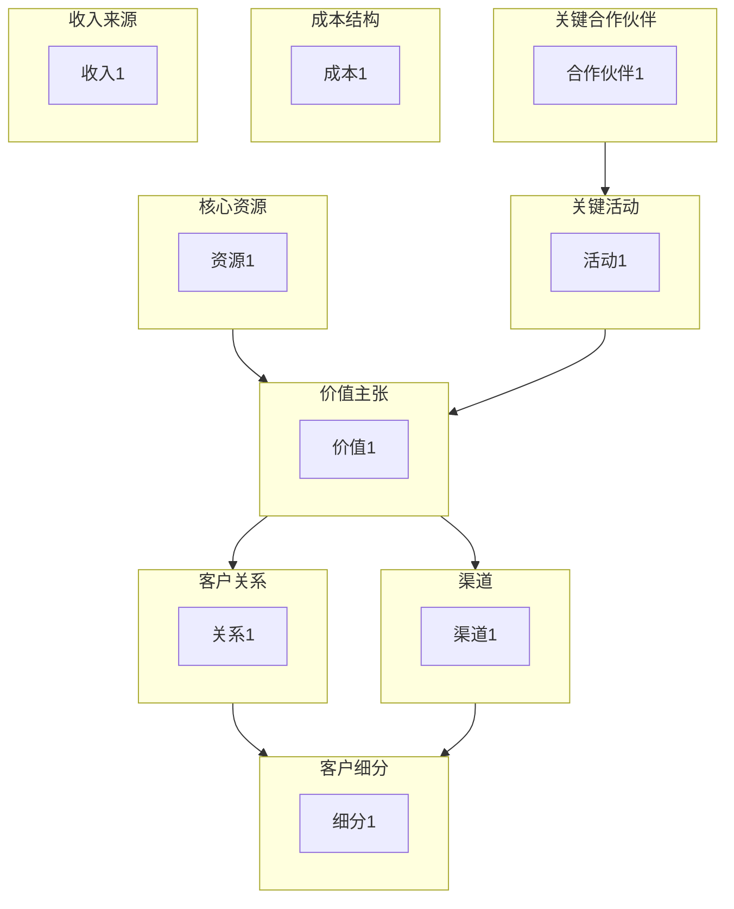

# 商业模式画布命令

使用 Osterwalder 的商业模式画布或 Maurya 的精益画布创建结构化的商业模式，以可视化和设计组织如何创造、交付和捕获价值。

## 参数

- `<业务描述>`：要建模的业务、初创企业或倡议的描述
- `--mode`：画布类型（默认：`bmc`）
  - `bmc`：完整商业模式画布（约8K tokens）
  - `lean`：面向初创企业的精益画布（约6K tokens）
  - `quick`：快速单次填充画布（约3K tokens）
- `--output`：输出格式（默认：`both`）
  - `yaml`：结构化 YAML，用于下游处理
  - `mermaid`：Mermaid 图表可视化
  - `both`：两种格式

- `--dir`：输出目录（默认：`docs/analysis/`）

## 执行

### 步骤1：解析参数

从参数中提取业务描述、模式和输出格式。

如果未提供描述，询问用户：
"您想为哪个业务、产品或倡议创建画布？"

默认模式为 `bmc`。默认输出为 `both`。

### 步骤2：加载商业模式画布 Skill

调用 `business-model-canvas` skill 以访问：

- 9块画布结构
- 块定义和示例
- 价值主张类型
- 收入模式模式
- 精益画布适配

### 步骤3：根据模式执行

#### BMC 模式（完整商业模式画布）

按交互方式遍历所有9个块（从右到左的顺序）：

**需求侧（从这里开始）：**

1. **客户细分**：最重要的客户是谁？
   - 细分类型：大众市场、利基市场、细分市场、多元化市场、多边平台

2. **价值主张**：我们为每个细分群体提供什么价值？
   - 价值类型：新颖性、性能、定制化、价格、便利性

3. **渠道**：我们如何触达并向客户交付？
   - 阶段：认知、评估、购买、交付、售后

4. **客户关系**：我们如何与每个细分群体互动？
   - 类型：个人化、专属服务、自助服务、自动化、社区

5. **收入来源**：每个细分群体如何付费？
   - 模式：资产销售、使用费、订阅、许可、广告

**供给侧：**

6. **核心资源**：我们需要什么来交付价值？
   - 类型：实体、知识、人力、财务

7. **关键活动**：我们必须做好什么？
   - 类型：生产、问题解决、平台/网络

8. **关键合作伙伴**：谁帮助我们？
   - 类型：战略联盟、竞合关系、合资企业、供应商

9. **成本结构**：主要成本是什么？
   - 重点：成本驱动 vs 价值驱动

填充所有块后，验证一致性：

- 价值主张是否满足细分群体需求？
- 渠道是否有效触达细分群体？
- 收入是否超过成本？

#### Lean 模式（初创企业画布）

针对早期创业公司的适配块：

1. **问题**（替代关键合作伙伴）：要解决的3个首要问题
2. **解决方案**（替代关键活动）：3个核心功能
3. **关键指标**（替代核心资源）：重要的数字
4. **独特优势**（替代客户关系）：无法被复制的优势

共享块：客户细分、价值主张、渠道、收入来源、成本结构

聚焦于问题-解决方案匹配和早期采用者。

#### Quick 模式（快速填充）

单次画布完成：

1. 从价值主张和客户细分开始
2. 从上下文推断其他块
3. 跳过详细分解
4. 生成最小可行画布
5. 标记假设以供后续验证

### 步骤4：生成输出产物

#### YAML 输出

```yaml
business_model_canvas:
  version: "1.0"
  organization: "[企业名称]"
  date: "[ISO日期]"
  type: "business_model_canvas"  # 或 "lean_canvas"
  analyst: "canvas-facilitator"

  customer_segments:
    - name: "[细分名称]"
      description: "[他们是谁？]"
      size: "[市场规模估算]"
      priority: primary  # 或 secondary

  value_propositions:
    - segment: "[细分名称]"
      proposition: "[交付的价值]"
      type: convenience  # newness, performance, customization, price等
      differentiation: "[为什么选择我们？]"

  channels:
    - phase: awareness
      channel: "[渠道名称]"
      type: own  # 或 partner
      effectiveness: high

  customer_relationships:
    - segment: "[细分名称]"
      type: self_service
      purpose: retention  # acquisition, retention, upselling

  revenue_streams:
    - segment: "[细分名称]"
      type: subscription
      pricing: fixed  # 或 dynamic
      percentage: 80

  key_resources:
    - name: "[资源]"
      category: intellectual  # physical, intellectual, human, financial
      source: own
      importance: critical

  key_activities:
    - activity: "[活动]"
      category: production  # production, problem_solving, platform
      importance: critical

  key_partnerships:
    - partner: "[合作伙伴名称]"
      type: strategic_alliance
      motivation: acquisition  # optimization, risk_reduction, acquisition
      provides: "[他们提供什么]"

  cost_structure:
    focus: value_driven  # cost_driven 或 value_driven
    costs:
      - category: "[成本类别]"
        type: fixed  # fixed 或 variable
        percentage: 40

  validation:
    value_customer_fit: true
    channel_segment_fit: true
    revenue_cost_balance: true
```

#### Mermaid 输出



#### 摘要报告

```markdown
## 商业模式画布：[组织名称]

**日期：** [ISO日期]
**类型：** 商业模式画布 / 精益画布

### 执行摘要

[2-3句话总结商业模式]

### 客户聚焦

- **主要细分群体：** [描述]
- **交付的价值：** [核心价值主张]
- **渠道：** [主要渠道]

### 价值创造

- **关键活动：** [核心活动]
- **核心资源：** [关键资源]
- **关键合作伙伴：** [战略合作伙伴]

### 财务模型

- **收入模式：** [如何赚钱]
- **成本结构：** [主要成本驱动因素]
- **单位经济学：** [关键指标]

### 风险和假设

| 块 | 假设 | 风险等级 |
|-------|------------|------------|
| [块] | [假设] | 高/中/低 |

### 建议

1. [验证假设X]
2. [探索渠道Y]
3. [考虑合作伙伴Z]
```

### 步骤5：保存结果

根据格式标志保存输出：

**YAML 文件：**

- `docs/analysis/business-model-canvas.yaml`

**Mermaid 图表：**

- `docs/analysis/business-model-canvas.md`

使用 `--dir` 指定自定义输出目录。

### 步骤6：建议后续行动

完成画布后：

```markdown
## 建议的下一步

1. **战略背景**：使用 `/ba:swot-analysis` 了解环境因素
2. **价值流**：使用 `/ba:value-stream` 优化价值交付
3. **干系人映射**：使用 `/ba:stakeholder-analyze` 识别关键关系
4. **验证计划**：与客户测试风险最高的假设
```
