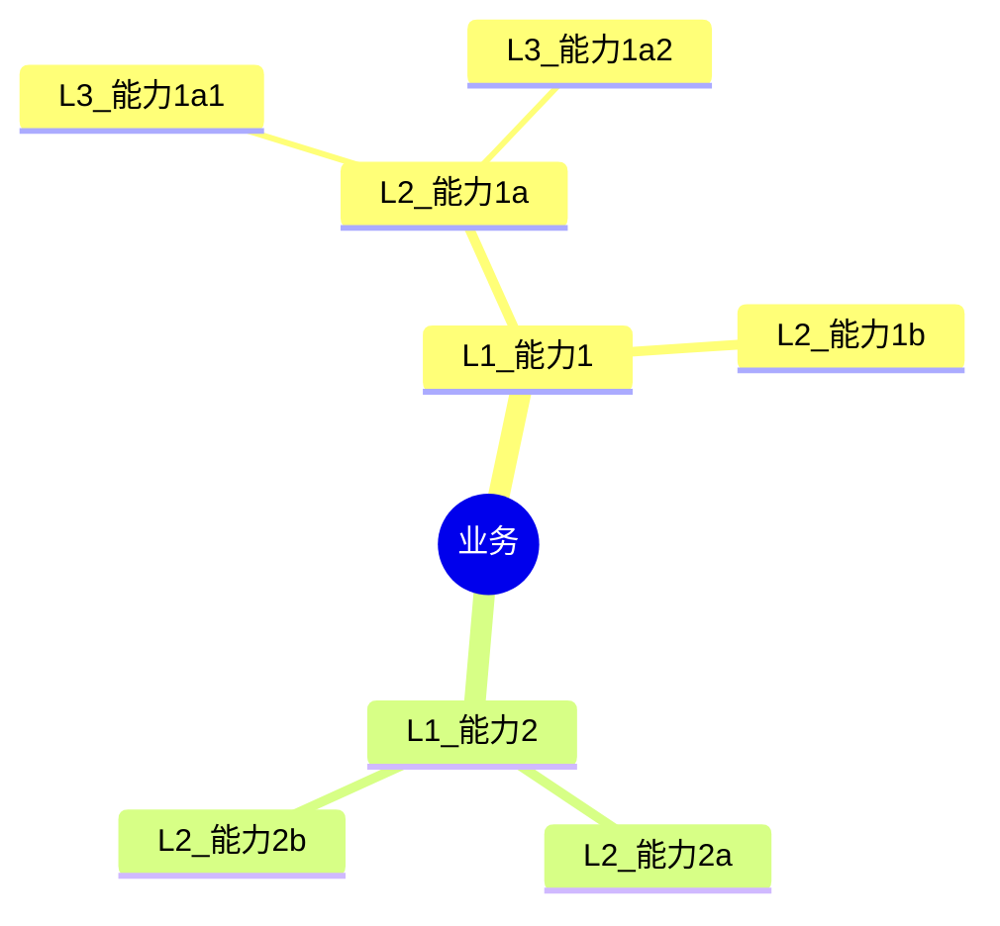

# 能力图谱命令

创建分层业务能力模型，以理解组织做什么，独立于如何实现或由谁执行工作。

## 参数

- `<业务描述>`：要分析的业务、组织或领域的描述
- `--mode`：分析模式（默认：`guided`）
  - `full`：多角色发现与战略对齐（约12K tokens）
  - `quick`：单次分析通过（约4K tokens）
  - `guided`：交互式能力发现（可变）
- `--output`：输出格式（默认：`both`）
  - `yaml`：结构化 YAML，用于下游处理
  - `mermaid`：Mermaid 图表可视化
  - `both`：两种格式

- `--dir`：输出目录（默认：`docs/analysis/`）

## 执行

### 步骤1：解析参数

从参数中提取业务描述、模式和输出格式。

如果未提供描述，询问用户：
"您想为哪个业务、组织或领域创建能力图谱？"

默认模式为 `guided`。默认输出为 `both`。

### 步骤2：加载能力映射 Skill

调用 `capability-mapping` skill 以访问：

- 能力层级框架
- 行业特定模板
- 成熟度评估标准
- 交叉映射指导

### 步骤3：根据模式执行

#### Full 模式（多角色发现）

启动 `capability-analyst` Agent 进行全面分析：

```text
分析此业务并创建完整的能力模型：

[业务描述]

要求：
1. 使用干系人访谈和文档审查分析业务背景
2. 创建 L1-L3 能力层级
3. 分类每个能力（战略型、核心型、支持型、通用型）
4. 评估当前成熟度（1-5级）
5. 识别能力差距和机会
6. 生成 YAML 和 Mermaid 输出
```

Agent 将：

- 利用 EA 发现模式
- 构建带交叉映射的层级模型
- 评估成熟度并识别差距
- 生成综合文档

#### Quick 模式（单次通过）

执行快速能力识别：

1. 从业务描述中识别明显的 L1 能力
2. 将 L1 分解为 L2 能力
3. 如适用，应用行业模板覆盖
4. 跳过详细的成熟度评估
5. 生成最小层级

#### Guided 模式（交互式）

使用结构化问题交互式地进行能力发现。

##### 步骤 G1：范围和深度选择

使用 AskUserQuestion 预先确定范围：

```yaml
# 问题1：范围选择（MCP：CLI 最佳实践 - MVP vs 完整）
question: "能力模型应该有多全面？"
header: "范围"
options:
  - label: "MVP（推荐）"
    description: "仅 L1-L2 能力，快速执行（约15分钟）"
  - label: "标准"
    description: "带分类的 L1-L3 能力（约30分钟）"
  - label: "全面"
    description: "带成熟度评估的完整层级（约60分钟）"

# 问题2：输出格式（MCP：CLI 最佳实践 - 格式选择）
question: "您需要什么输出格式？"
header: "格式"
multiSelect: true
options:
  - label: "Mermaid 图表"
    description: "能力层级的可视化思维导图"
  - label: "YAML 结构"
    description: "用于下游工具的结构化数据"
  - label: "摘要报告"
    description: "带分析的 Markdown 叙述"
```

##### 步骤 G2：L1 发现

询问"这个组织需要哪些主要能力？"

根据 G1 的范围：

- MVP：停在 L1-L2
- 标准：继续到 L3
- 全面：带成熟度的完整深度

##### 步骤 G3：L2 分解

对于每个 L1，询问"哪些组件能力构成这个？"

**步骤 G4：分类**（仅标准/全面）

对于每个能力，确认分类：

- 战略型（差异化）
- 核心型（基本运营）
- 支持型（使能核心）
- 通用型（商品化）

**步骤 G5：成熟度评估**（仅全面）

评估当前状态与目标状态（1-5级）。

##### 步骤 G6：差距识别和优先级排序

识别缺失或薄弱的能力并按战略重要性排名。

### 步骤4：生成输出产物

#### YAML 输出

```yaml
capability_model:
  version: "1.0"
  domain: "[业务名称]"
  generated: "[ISO日期]"
  mode: "[full|quick|guided]"

  capabilities:
    - name: "[L1 能力]"
      level: 1
      type: core  # strategic, core, supporting, generic
      maturity: 3
      target_maturity: 4
      children:
        - name: "[L2 能力]"
          level: 2
          type: core
          maturity: 2
          target_maturity: 4
          children:
            - name: "[L3 能力]"
              level: 3
              type: supporting
              maturity: 3
              target_maturity: 3
```

#### Mermaid 输出



#### 摘要报告

```markdown
## 能力模型：[业务名称]

**日期：** [ISO日期]
**模式：** [full|quick|guided]
**能力总数：** N（L1: X, L2: Y, L3: Z）

### 能力分布

| 类型 | 数量 | 示例 |
|------|-------|----------|
| 战略型 | X | [列表] |
| 核心型 | Y | [列表] |
| 支持型 | Z | [列表] |
| 通用型 | W | [列表] |

### 成熟度概览

| 评级 | 数量 | % |
|--------|-------|---|
| 1 - 临时 | X | Y% |
| 2 - 发展中 | X | Y% |
| 3 - 已定义 | X | Y% |
| 4 - 已管理 | X | Y% |
| 5 - 优化 | X | Y% |

### 战略差距

1. **[能力]**：当前成熟度 X，目标 Y - [差距分析]
2. **[能力]**：[战略目标]所需的缺失能力

### 建议

1. 优先投资 [有差距的战略能力]
2. 考虑外包 [低成熟度的通用能力]
3. 整合 [重叠的相似能力]
```

### 步骤5：保存结果

根据格式标志保存输出：

**YAML 文件：**

- `docs/analysis/capability-model.yaml`

**Mermaid 图表：**

- `docs/analysis/capability-model.md`

使用 `--dir` 指定自定义输出目录。

### 步骤6：建议后续行动

生成能力图谱后：

```markdown
## 建议的下一步

1. **干系人对齐**：使用 `/ba:stakeholder-analyze` 识别能力所有者
2. **价值流映射**：使用 `/ba:value-stream` 了解能力如何交付价值
3. **差距分析**：使用 `decision-analysis` skill 评估能力投资优先级
4. **投资规划**：使用能力差距为预算决策提供信息
```
