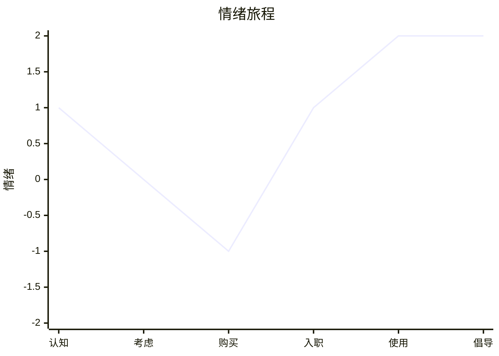
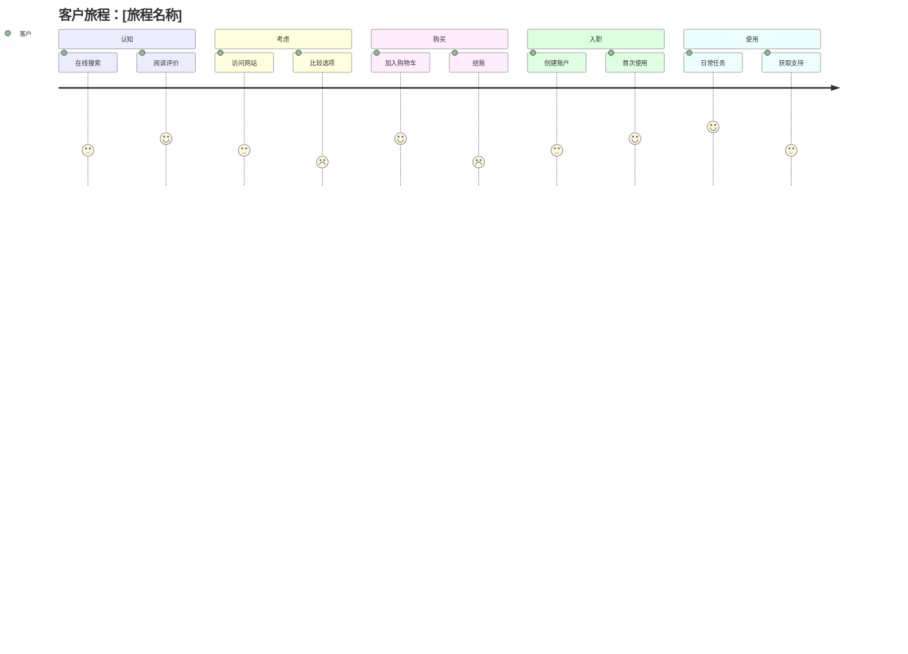

# 旅程地图命令

创建用户或客户旅程地图，以理解体验、情绪并识别改进机会。

## 参数

- `<旅程描述>`：要映射的旅程描述（例如，"客户购买订阅"）
- `--mode`：映射模式（默认：`guided`）
  - `full`：带详细触点分析的全面旅程（约10K tokens）
  - `quick`：快速旅程映射（约4K tokens）
  - `guided`：交互式旅程发现（可变）
- `--persona`：可选的画像名称（如未提供则创建新画像）

- `--dir`：输出目录（默认：`docs/analysis/`）

## 执行

### 步骤1：解析参数

从参数中提取旅程描述、模式和画像。

如果未提供描述，询问用户：
"您想映射哪个旅程？请描述：

- 谁在进行这个旅程？（用户/客户）
- 他们试图完成什么？
- 旅程从哪里开始，到哪里结束？"

默认模式为 `guided`。

### 步骤2：加载旅程映射 Skill

调用 `journey-mapping` skill 以访问：

- 旅程结构模板
- 画像开发框架
- 情绪映射指导
- 关键时刻定义

### 步骤3：定义或选择画像

如果提供了画像，使用它。否则：

**Quick/Full 模式**：从上下文中创建默认画像

**Guided 模式**：与用户合作定义画像：

```markdown
让我们为此旅程定义画像：

1. **姓名**：[给他们一个代表性姓名]
2. **角色/人口统计**：[他们是谁？]
3. **目标**：[他们想要实现什么？]
4. **挫折**：[通常什么让他们沮丧？]
5. **语录**：[他们可能会说什么？]
```

### 步骤4：根据模式执行

#### Full 模式（全面分析）

启动 `journey-facilitator` Agent 进行彻底映射：

```text
为以下内容创建全面的旅程地图：

[旅程描述]

画像：[如提供则包含画像详情]

要求：
1. 如未提供则定义完整画像
2. 识别4-6个旅程阶段
3. 为每个阶段映射触点、行动、想法、情绪
4. 绘制情绪曲线，强度范围（+2到-2）
5. 识别所有痛点并评级严重程度
6. 发现改进机会
7. 分析关键时刻（ZMOT、FMOT、SMOT、UMOT）
8. 按影响和 effort 对机会进行优先级排序
```

Agent 将：

- 创建详细的逐阶段分析
- 生成情绪曲线可视化
- 生成优先级的机会待办列表
- 识别关键的关键时刻

#### Quick 模式（快速映射）

执行快速旅程映射：

1. 从上下文推断画像
2. 识别4-5个明显的旅程阶段
3. 映射每个阶段的关键触点
4. 记录明显的痛点
5. 估算情绪高低
6. 识别前3个机会

#### Guided 模式（交互式）

使用结构化问题交互式地进行旅程映射。

##### 步骤 G1：研究方法和共情深度

使用 AskUserQuestion 预先确定方法：

```yaml
# 问题1：研究方法（MCP：设计思维共情阶段）
question: "我们应该如何理解用户？"
header: "方法"
options:
  - label: "访谈（推荐）"
    description: "直接干系人对话和引用"
  - label: "观察"
    description: "在自然环境中观察用户"
  - label: "数据分析"
    description: "审查现有使用数据和反馈"
  - label: "旅程映射"
    description: "端到端映射当前用户体验"

# 问题2：共情深度（MCP：设计思维 - Five Whys、共情映射）
question: "您需要多深的共情映射？"
header: "深度"
options:
  - label: "快速扫描（推荐）"
    description: "仅关键痛点和需求（约15分钟）"
  - label: "共情地图"
    description: "完整的说/想/做/感四象限（约30分钟）"
  - label: "Five Whys"
    description: "问题的根因分析（约45分钟）"
```

##### 步骤 G2：画像

定义或确认此旅程的画像。

##### 步骤 G3：旅程范围

确认触发器、目标和结束状态。

##### 步骤 G4：阶段识别

将旅程分解为主要阶段（通常4-6个）。

##### 步骤 G5：阶段深入

对于每个阶段，根据 G1 的深度进行探索：

- 快速扫描：关键触点和明显痛点
- 共情地图：每个阶段的完整说/想/做/感
- Five Whys：主要痛点的根因分析

每个阶段的标准问题：

- "他们在哪里与我们互动？"（触点）
- "他们在做什么？"（行动）
- "他们在想什么？"（想法）
- "他们感觉如何？"（情绪 - 评分 +2 到 -2）
- "什么让他们在这里感到沮丧？"（痛点）

##### 步骤 G6：关键时刻

识别关键互动（ZMOT、FMOT、SMOT、UMOT）。

##### 步骤 G7：机会

基于痛点严重程度头脑风暴改进方案。

### 步骤5：生成输出产物

#### 旅程地图

```markdown
## 旅程地图：[旅程名称]

**日期：** [ISO日期]
**模式：** [full|quick|guided]

### 画像：[姓名]

**角色：** [描述]
**目标：** [他们想要实现什么]
**挫折：** [常见痛点]
**语录：** "[特征性陈述]"

---

### 旅程概览

**目标：** [用户想要实现什么]
**触发器：** [什么开始旅程]
**结束状态：** [什么标志成功]
**时间框架：** [典型持续时间]

---

### 阶段1：[阶段名称]

**触点：** [列出渠道/互动]

**行动：**
- [用户做什么]

**想法：**
- [用户在想什么]

**情绪：** [表情符号] [描述]
- **强度：** [+2/+1/0/-1/-2]

**痛点：**
- [痛点及严重程度：高/中/低]

**机会：**
- [改进想法]

---

[对每个阶段重复]
```

#### 情绪曲线



#### 痛点清单

```markdown
### 痛点清单

| ID | 痛点 | 阶段 | 严重程度 | 证据 | 根因 |
|----|------------|-------|----------|----------|------------|
| PP1 | 混淆的定价页面 | 考虑 | 高 | 用户测试 | 选项太多 |
| PP2 | 缓慢的结账流程 | 购买 | 高 | 分析数据 | 第三方集成 |
| PP3 | 不清晰的入职流程 | 入职 | 中 | 支持工单 | 缺少指导 |
```

#### 机会待办列表

```markdown
### 机会待办列表

| ID | 机会 | 阶段 | 影响 | Effort | 优先级 |
|----|-------------|-------|--------|--------|----------|
| O1 | 简化定价层级 | 考虑 | 高 | 中 | 1 |
| O2 | 添加进度指示器 | 入职 | 高 | 低 | 2 |
| O3 | 优化结账 API | 购买 | 高 | 高 | 3 |
```

#### 关键时刻

```markdown
### 关键时刻

| 时刻 | 阶段 | 当前状态 | 期望状态 | 差距 |
|--------|-------|---------------|---------------|-----|
| **ZMOT**（预研究） | 认知 | 混合评价 | 正面声誉 | 中 |
| **FMOT**（首次接触） | 考虑 | 杂乱的主页 | 清晰的价值主张 | 高 |
| **SMOT**（使用产品） | 使用 | 学习曲线 | 直观体验 | 中 |
| **UMOT**（分享） | 倡导 | 无提示 | 轻松推荐 | 低 |
```

#### Mermaid 旅程图表



### 步骤6：保存结果

保存输出到：

- `docs/analysis/journey-map-[画像名称].md`

使用 `--dir` 指定自定义输出目录。

### 步骤7：建议后续行动

```markdown
## 建议的下一步

1. **干系人对齐**：使用 `/ba:stakeholder-analyze` 识别旅程所有者
2. **流程分析**：使用 `/ba:value-stream` 分析痛点背后的运营
3. **能力审查**：使用 `/ba:capability-map` 将触点链接到能力
4. **服务设计**：创建分层前台/后台的服务蓝图
5. **原型和测试**：为高优先级机会原型化解决方案
```
