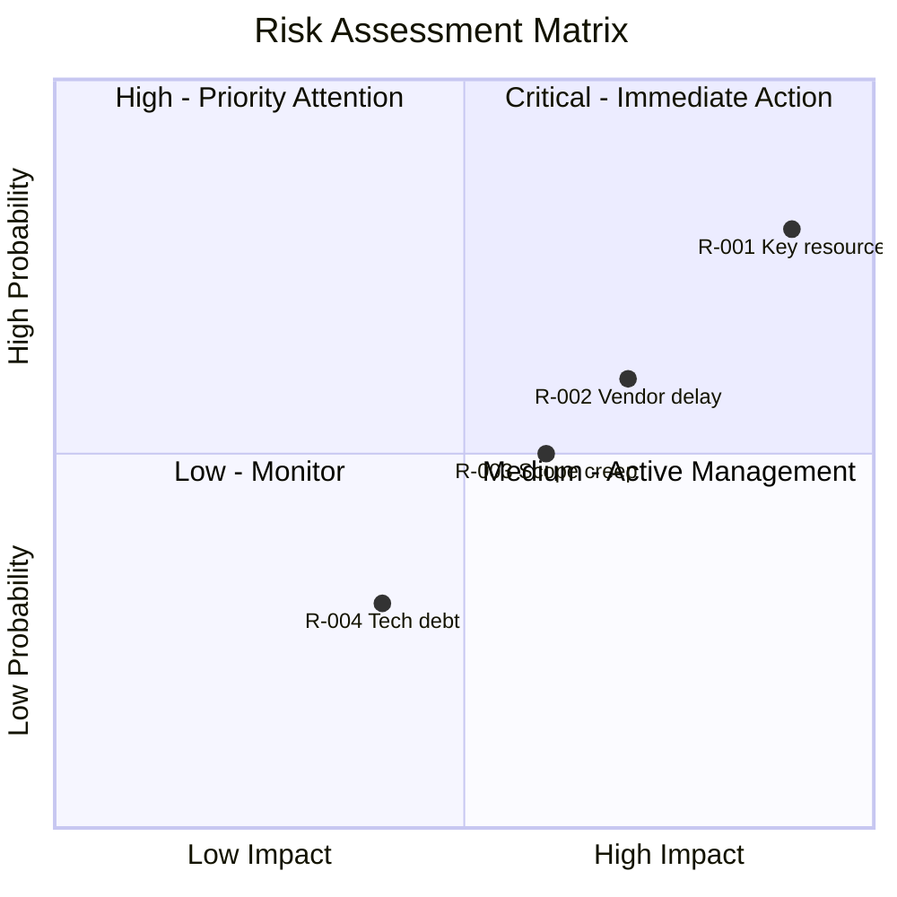

# Risk Register 命令

使用风险登记表、概率/影响矩阵与应对策略，系统性地识别、评估并规划风险应对。同时支持威胁（threat）和机会（opportunity）。

## 参数

- `<context-or-file>`：项目/initiative 的背景信息，或已有的 risk register 文件
- `--mode`：运行模式（默认：`create`）
  - `create`：新建 risk register（约 6K tokens）
  - `update`：向已有 register 追加风险（约 4K tokens）
  - `review`：复核与重新评估已有风险（约 5K tokens）
- `--output`：输出格式（默认：`both`）
  - `yaml`：用于下游处理的结构化 YAML
  - `markdown`：排版好的 markdown 表格
  - `both`：两种都输出

- `--dir`：输出目录（默认：`docs/analysis/`）

## 执行流程

### 步骤 1：解析参数

从参数中提取 context/文件、mode 与输出格式。

如果未提供 context，则询问用户：
"你想针对哪个项目、initiative 或领域做风险评估？"

默认 mode 为 `create`。默认输出为 `both`。

### 步骤 2：加载 Risk Analysis skill

调用 `risk-analysis` skill 以获得：

- 风险识别技法
- 概率与影响的量表
- 风险打分方法论
- 应对策略（Avoid、Transfer、Mitigate、Accept）
- Risk register 模板
- 监控与复核流程

### 步骤 3：按 mode 执行

#### Create 模式（新建 register）

##### 子步骤 A：定义上下文

```markdown
## Risk Register Context

**Project/Initiative:** [Name]
**Owner:** [Risk register owner]
**Review Cycle:** [Weekly/Bi-weekly/Monthly]
**Risk Appetite:** [Conservative/Moderate/Aggressive]
**Date Created:** [ISO Date]
```

##### 子步骤 B：识别风险

用多种技法识别风险：

1. **Checklist Review**：标准风险分类
   - 技术、进度、成本、资源、外部、质量、安全

2. **Assumption Analysis**：列出并挑战假设
   - 我们假设哪些事情会顺利？
   - 如果这些假设失败会怎样？

3. **Expert Input**：领域特定风险
   - 在这个领域可能会出什么问题？
   - 类似项目以前在哪翻过车？

4. **SWOT Threats**：来自战略分析
   - 可能损害目标的外部因素

对每个风险，记录：

- 清晰的描述（cause + effect 格式）
- 分类
- 初步评估
- 潜在的影响面

##### 子步骤 C：评估风险

套用概率/影响评分：

**概率量表（1-5）：**

| 等级 | 分值 | 发生可能性 |
|-------|-------|------------|
| Very Low | 1 | < 10% |
| Low | 2 | 10-30% |
| Medium | 3 | 30-50% |
| High | 4 | 50-70% |
| Very High | 5 | > 70% |

**影响量表（1-5）：**

| 等级 | 分值 | 进度 | 成本 | 质量 |
|-------|-------|----------|------|---------|
| Very Low | 1 | < 1 周 | < 5% | 轻微 |
| Low | 2 | 1-2 周 | 5-10% | 可察觉 |
| Medium | 3 | 2-4 周 | 10-20% | 明显 |
| High | 4 | 1-3 个月 | 20-40% | 严重 |
| Very High | 5 | > 3 个月 | > 40% | 灾难级 |

**风险分值：** 概率 × 影响（1-25）

**优先级区段：**

| 分值 | 优先级 | 行动 |
|-------|----------|--------|
| 1-4 | 低 | 接受或仅监测 |
| 5-9 | 中 | 主动管理 |
| 10-14 | 高 | 重点关注 |
| 15-25 | 危急 | 立即行动 |

##### 子步骤 D：规划应对

对每个重要风险定义应对策略：

**针对 Threat（威胁）：**

- **Avoid**：完全消除威胁
- **Transfer**：转移给第三方（保险、合同）
- **Mitigate**：降低概率或影响
- **Accept**：承认风险并制定应急预案

**针对 Opportunity（机会）：**

- **Exploit**：确保机会发生
- **Share**：合作以增强能力
- **Enhance**：提升概率或影响
- **Accept**：机会出现时顺势而为

对每项应对，定义：

- 预防措施（降低概率）
- 应急措施（风险发生时采取）
- 责任人与目标日期
- 缓解后的残余风险

#### Update 模式（追加到已有 register）

1. 读取已有的 risk register 文件
2. 识别要新增的风险
3. 用相同量表评估新风险
4. 为新风险规划应对
5. 更新汇总统计
6. 保留已有的风险历史

#### Review 模式（重新评估）

1. 读取已有的 risk register
2. 对每个 open 的风险：
   - 概率是否变化？
   - 影响是否变化？
   - 缓解措施是否已执行完？
   - 状态是否需要变更（Open → Mitigated → Closed）？
3. 识别复核过程中新发现的风险
4. 更新复核日期与备注
5. 根据当前评估调整优先级

### 步骤 4：生成风险矩阵可视化



### 步骤 5：生成输出产物

#### YAML 输出

```yaml
risk_register:
  version: "1.0"
  name: "[Project/Initiative]"
  date: "[ISO Date]"
  owner: "[Name]"
  review_cycle: "bi-weekly"

  risk_appetite:
    overall: "moderate"
    schedule: "low"
    cost: "moderate"
    quality: "low"

  scales:
    probability:
      1: "Rare (<10%)"
      2: "Unlikely (10-30%)"
      3: "Possible (30-50%)"
      4: "Likely (50-70%)"
      5: "Almost Certain (>70%)"
    impact:
      1: "Very Low"
      2: "Low"
      3: "Medium"
      4: "High"
      5: "Very High"

  risks:
    - id: "R-001"
      description: "Key developer may leave during critical phase"
      category: "Resource"
      type: "threat"
      probability: 4
      impact: 5
      score: 20
      priority: "critical"
      owner: "[Name]"
      response_strategy: "mitigate"
      response_actions:
        prevention:
          - action: "Cross-train team member"
            owner: "[Name]"
            due_date: "[Date]"
            status: "in_progress"
        contingency:
          - trigger: "Developer gives notice"
            action: "Engage contractor immediately"
      residual_risk:
        probability: 3
        impact: 3
        score: 9
      status: "open"
      created_date: "[Date]"
      last_reviewed: "[Date]"
      notes: "[Additional context]"

  summary:
    total: 10
    by_priority:
      critical: 1
      high: 2
      medium: 4
      low: 3
    by_status:
      open: 8
      mitigated: 1
      closed: 1
      occurred: 0
    by_category:
      technical: 3
      resource: 2
      schedule: 2
      external: 2
      cost: 1

  review_log:
    - date: "[Date]"
      reviewer: "[Name]"
      changes: "[Summary of changes]"
```

#### Markdown 输出

```markdown
## Risk Register: [Project/Initiative]

**Owner:** [Name]
**Last Updated:** [ISO Date]
**Review Cycle:** [Frequency]
**Next Review:** [Date]

### Risk Summary

| Priority | Count | Top Risk |
|----------|-------|----------|
| Critical | [#] | [Risk name] |
| High | [#] | [Risk name] |
| Medium | [#] | [Risk name] |
| Low | [#] | [Risk name] |

### Active Risks

| ID | Risk Description | Cat | P | I | Score | Owner | Response | Status |
|----|-----------------|-----|---|---|-------|-------|----------|--------|
| R-001 | Key developer departure | Resource | 4 | 5 | 20 | PM | Mitigate | Open |
| R-002 | Vendor API changes | Technical | 3 | 4 | 12 | Tech Lead | Mitigate | Open |
| R-003 | Scope creep | Schedule | 3 | 3 | 9 | PM | Accept | Open |

### Critical Risks (Score 15+)

#### R-001: Key Developer Departure

**Description:** Key developer may leave during critical phase

**Assessment:**
- Probability: 4 (Likely)
- Impact: 5 (Critical)
- Score: 20 (Critical Priority)

**Response Strategy:** Mitigate

**Prevention Actions:**
| Action | Owner | Due Date | Status |
|--------|-------|----------|--------|
| Cross-train team member | Tech Lead | [Date] | In Progress |
| Document critical knowledge | Developer | [Date] | Not Started |

**Contingency Plan:**
- Trigger: Developer gives notice
- Actions: Engage contractor, accelerate knowledge transfer

**Residual Risk:** Score 9 (Medium) after mitigation

### Response Tracking

| Risk | Action | Owner | Due | Status |
|------|--------|-------|-----|--------|
| R-001 | Cross-training | Tech Lead | [Date] | In Progress |
| R-001 | Documentation | Developer | [Date] | Not Started |
| R-002 | Abstraction layer | Dev | [Date] | Complete |

### Risk Trends

| Metric | This Period | Last Period | Trend |
|--------|-------------|-------------|-------|
| Total Risks | 10 | 8 | ↑ |
| Critical | 1 | 0 | ↑ |
| Mitigated | 1 | 2 | ↓ |
| Closed | 1 | 1 | → |
```

#### 汇总报告

```markdown
## Risk Assessment Summary

**Project:** [Name]
**Date:** [ISO Date]
**Analyst:** ba-orchestrator

### Risk Profile

Overall risk exposure is [Low/Medium/High/Critical] based on:
- [#] critical risks requiring immediate attention
- [#] high-priority risks under active management
- Risk appetite alignment: [Aligned/Exceeded]

### Top 3 Risks

1. **R-001**: [Description] (Score: 20)
   - Response: [Strategy]
   - Status: [Current status]

2. **R-002**: [Description] (Score: 12)
   - Response: [Strategy]
   - Status: [Current status]

3. **R-003**: [Description] (Score: 9)
   - Response: [Strategy]
   - Status: [Current status]

### Recommendations

1. **Immediate**: Address R-001 mitigation actions
2. **This Week**: Complete R-002 abstraction layer
3. **Monitor**: Watch for new external risks
4. **Review**: Schedule stakeholder risk review
```

### 步骤 6：保存结果

根据格式参数保存输出：

**YAML 文件：**

- `docs/analysis/risk-register.yaml`

**Markdown 文件：**

- `docs/analysis/risk-register.md`

使用 `--dir` 可指定自定义输出目录。

### 步骤 7：建议后续行动

风险评估完成后：

```markdown
## Suggested Next Steps

1. **Stakeholder Review**: Present risk register to stakeholders
2. **Mitigation Tracking**: Set up action tracking for response plans
3. **Root Cause Analysis**: Use `/ba:root-cause` for risks that occurred
4. **Decision Analysis**: Use decision-analysis skill for risk response options
5. **Schedule Reviews**: Set calendar reminders for risk reviews
6. **Integration**: Link to project management tool for tracking
```
