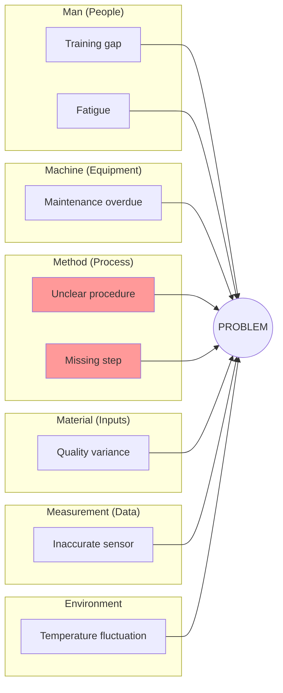

# Root Cause Analysis 命令

使用成熟的技法系统性地诊断问题、定位根因：Fishbone（Ishikawa，鱼骨图）做类别式探索，5 Whys 用于逐层深挖到根因。并产出可落地的 CAPA 方案。

## 参数

- `<problem-statement>`：要分析的问题描述
- `--mode`：分析技法（默认：`full`）
  - `fishbone`：按 6M 分类的鱼骨图（约 4K tokens）
  - `5whys`：5 Whys 深挖技法（约 3K tokens）
  - `full`：两种技法结合（约 8K tokens）
- `--output`：输出格式（默认：`both`）
  - `yaml`：用于下游处理的结构化 YAML
  - `mermaid`：Mermaid 图示可视化
  - `both`：两种都输出

- `--dir`：输出目录（默认：`docs/analysis/`）

## 执行流程

### 步骤 1：解析参数

从参数中提取问题陈述、mode 与输出格式。

如果未提供问题，则询问用户：
"你想针对什么问题做根因分析？"

默认 mode 为 `full`。默认输出为 `both`。

### 步骤 2：加载 Root Cause Analysis skill

调用 `root-cause-analysis` skill 以获得：

- Fishbone（6M）分类
- 5 Whys 方法论
- CAPA 规划模板
- 问题定义框架
- 需要规避的常见陷阱

### 步骤 3：定义问题

开始分析前先把问题说清楚：

```markdown
## Problem Definition

**Problem Statement:** [Clear, specific description]
**Impact:** [Who/what is affected and how]
**Frequency:** [How often does it occur]
**First Observed:** [When was it first noticed]
**Current State:** [What's happening now]
**Desired State:** [What should be happening]
**Data Available:** [Evidence and metrics]
```

自检：这是真问题，还是只是症状？

### 步骤 4：按 mode 执行

#### Fishbone 模式（6M 分类）

在 6M 的全部类别中探索可能的原因：

1. **Man（人）**：人的因素
   - 培训、技能、动机、疲劳、沟通

2. **Machine（设备）**：设备因素
   - 维保、校准、老化、产能、可靠性

3. **Method（方法/流程）**：流程因素
   - 程序、标准、顺序、设计、文档

4. **Material（物料/输入）**：输入因素
   - 质量、规格、供应商、存储、搬运

5. **Measurement（测量/数据）**：数据因素
   - 准确性、频率、仪器、定义、采集

6. **Mother Nature（环境）**：环境因素
   - 温度、湿度、照明、工位、外部条件

对每个类别：

- 头脑风暴潜在原因
- 为每项原因收集证据
- 评估可能性（高/中/低）
- 识别各原因之间的关系

#### 5 Whys 模式（逐层深挖）

用递进式提问追溯到根因：

```text
Problem: [Observed effect]

Why 1: Why does [problem] happen?
→ Because [cause 1]

Why 2: Why does [cause 1] happen?
→ Because [cause 2]

Why 3: Why does [cause 2] happen?
→ Because [cause 3]

Why 4: Why does [cause 3] happen?
→ Because [cause 4]

Why 5: Why does [cause 4] happen?
→ Because [ROOT CAUSE]
```

验证：如果我们解决了 [ROOT CAUSE]，问题就会被消除吗？

可能只需要不到 5 次 why，也可能需要更多 — 直到挖到一个**可行动**的原因才停下来。

#### Full 模式（综合分析）

派生 `problem-solver` agent 做综合分析：

```text
Analyze this problem and identify root causes:

Problem: [Problem statement]

Requirements:
1. Define problem clearly with impact and evidence
2. Perform Fishbone analysis across all 6M categories
3. Apply 5 Whys to top 3 potential causes
4. Consolidate root causes with confidence ratings
5. Develop CAPA plan with immediate and preventive actions
6. Generate both YAML and Mermaid outputs
```

该 agent 将：

- 校验问题定义
- 系统性地探索所有原因类别
- 深挖到根因
- 产出可落地的 CAPA 方案

### 步骤 5：整合根因

汇总发现：

```markdown
## Root Causes Identified

| # | Root Cause | Evidence | Confidence | Category |
|---|------------|----------|------------|----------|
| 1 | [Root cause 1] | [Data] | High | Method |
| 2 | [Root cause 2] | [Data] | Medium | Man |

**Primary Root Cause:** [Most significant cause]
**Contributing Factors:** [Secondary causes]
```

### 步骤 6：制定 CAPA 方案

制定纠正措施与预防措施：

```markdown
## CAPA Plan

### Immediate Corrections
| Action | Owner | Target Date | Status |
|--------|-------|-------------|--------|
| [Quick fix] | [Name] | [Date] | Not Started |

### Corrective Actions (Address Root Cause)
| Action | Root Cause Addressed | Owner | Target Date |
|--------|---------------------|-------|-------------|
| [Fix action] | RC-1 | [Name] | [Date] |

### Preventive Actions (Prevent Recurrence)
| Action | What it Prevents | Owner | Target Date |
|--------|------------------|-------|-------------|
| [Prevention] | [Future issue] | [Name] | [Date] |

### Verification Plan
| Action | Verification Method | Success Criteria | Date |
|--------|---------------------|------------------|------|
| [Action] | [How to verify] | [What success looks like] | [Date] |
```

### 步骤 7：生成输出产物

#### YAML 输出

```yaml
root_cause_analysis:
  version: "1.0"
  date: "[ISO Date]"
  analyst: "problem-solver"

  problem_definition:
    statement: "[Problem description]"
    impact: "[Who/what affected]"
    frequency: "[How often]"
    first_observed: "[When]"

  fishbone_analysis:
    man:
      - cause: "[Cause]"
        evidence: "[Data]"
        likelihood: high
    machine:
      - cause: "[Cause]"
        evidence: "[Data]"
        likelihood: medium
    method:
      - cause: "[Cause]"
        evidence: "[Data]"
        likelihood: high
    material:
      - cause: "[Cause]"
        evidence: "[Data]"
        likelihood: low
    measurement:
      - cause: "[Cause]"
        evidence: "[Data]"
        likelihood: medium
    mother_nature:
      - cause: "[Cause]"
        evidence: "[Data]"
        likelihood: low

  five_whys_chains:
    - starting_cause: "[Initial cause]"
      chain:
        - why: 1
          question: "Why does [X] happen?"
          answer: "[Because Y]"
        - why: 2
          question: "Why does [Y] happen?"
          answer: "[Because Z]"
      root_cause: "[Final root cause]"
      verified: true

  root_causes:
    primary: "[Main root cause]"
    contributing:
      - "[Contributing cause 1]"
      - "[Contributing cause 2]"

  capa_plan:
    immediate:
      - action: "[Quick fix]"
        owner: "[Name]"
        target_date: "[Date]"
    corrective:
      - action: "[Fix action]"
        root_cause: "RC-1"
        owner: "[Name]"
        target_date: "[Date]"
    preventive:
      - action: "[Prevention]"
        prevents: "[Future issue]"
        owner: "[Name]"
        target_date: "[Date]"
```

#### Mermaid 输出

**鱼骨图：**



#### 汇总报告

```markdown
## Root Cause Analysis: [Problem]

**Date:** [ISO Date]
**Mode:** [fishbone|5whys|full]
**Analyst:** problem-solver

### Problem Summary

[Brief problem description with impact]

### Root Causes Identified

1. **Primary**: [Root cause] (Confidence: High)
2. **Contributing**: [Secondary causes]

### Key Findings

| Category | Top Cause | Evidence |
|----------|-----------|----------|
| Method | [Cause] | [Data] |
| Man | [Cause] | [Data] |

### CAPA Summary

- **Immediate Actions**: [Count]
- **Corrective Actions**: [Count]
- **Preventive Actions**: [Count]

### Recommendations

1. [Priority action]
2. [Secondary action]
3. [Monitoring action]
```

### 步骤 8：保存结果

根据格式参数保存输出：

**YAML 文件：**

- `docs/analysis/root-cause-analysis.yaml`

**Mermaid 图：**

- `docs/analysis/root-cause-analysis.md`

使用 `--dir` 可指定自定义输出目录。

### 步骤 9：建议后续行动

分析完成后：

```markdown
## Suggested Next Steps

1. **Risk Register**: Use `/ba:risk-register` to track identified threats
2. **Process Improvement**: Use `/ba:value-stream` to optimize the process
3. **Decision Analysis**: Use decision-analysis skill to evaluate corrective options
4. **Monitoring**: Set up metrics to verify CAPA effectiveness
```
