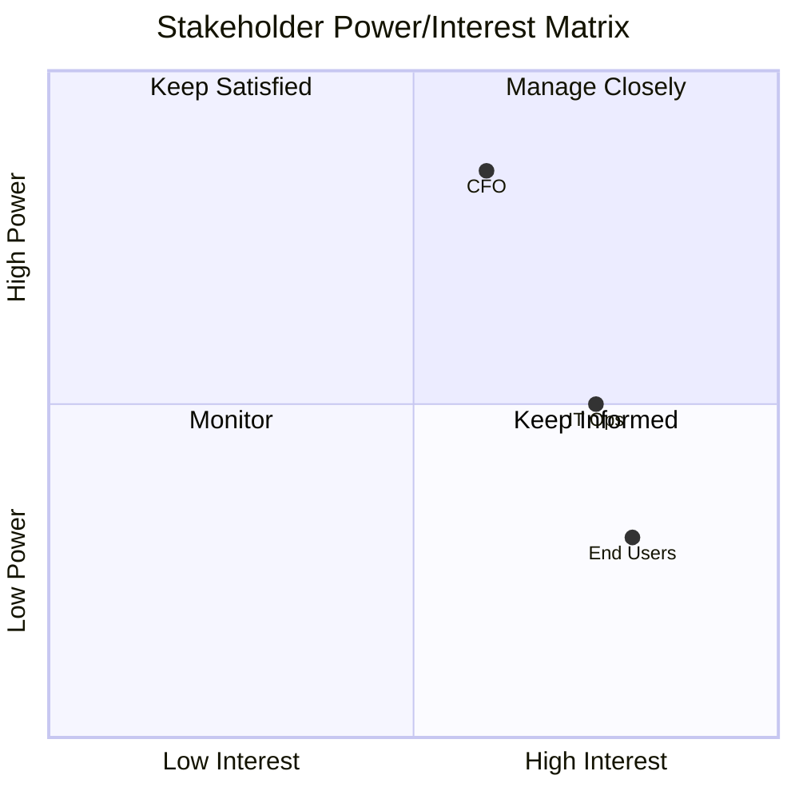

# Stakeholder Analyze 命令

识别、分析并规划某个 initiative、项目或变革中涉及的 stakeholder 的参与方式。

## 参数

- `<initiative-description>`：要分析 stakeholder 的 initiative、项目或变革的描述
- `--mode`：分析模式（默认：`guided`）
  - `full`：多 persona 模拟、多视角综合分析（约 10K tokens）
  - `quick`：快速 stakeholder 识别（约 3K tokens）
  - `guided`：交互式 stakeholder 挖掘（耗时不固定）
- `--output`：输出产物（默认：`all`）
  - `register`：仅 stakeholder 登记表
  - `matrix`：仅 Power/Interest 矩阵
  - `raci`：仅 RACI 矩阵
  - `all`：全部产物

- `--dir`：输出目录（默认：`docs/analysis/`）

## 执行流程

### 步骤 1：解析参数

从参数中提取 initiative 描述、mode 与输出格式。

如果未提供描述，则询问用户：
"你想针对哪个 initiative、项目或变革做 stakeholder 分析？"

默认 mode 为 `guided`。默认输出为 `all`。

### 步骤 2：加载 Stakeholder Analysis skill

调用 `stakeholder-analysis` skill 以获得：

- Stakeholder 分类框架
- Power/Interest 矩阵方法论
- RACI 矩阵规则
- 沟通计划模板

### 步骤 3：按 mode 执行

#### Full 模式（多 Persona 模拟）

派生 `stakeholder-facilitator` agent 做综合分析：

```text
Analyze stakeholders for this initiative:

[Initiative description]

Requirements:
1. Simulate perspectives from multiple organizational viewpoints
2. Use systematic stakeholder categories (sponsors, users, operators, etc.)
3. Assess Power, Interest, Influence, and Attitude for each
4. Create Power/Interest matrix with engagement strategies
5. Develop RACI matrix for key deliverables
6. Create communication plan
7. Identify potential resistance and mitigation strategies
```

该 agent 可以再派生出其他 persona agent：

- `executive-sponsor-persona`：战略视角、预算
- `end-user-persona`：日常使用、痛点
- `operations-persona`：支持、运维方面的关切
- `compliance-persona`：合规、审计需求
- `devils-advocate`：风险、被忽视的 stakeholder

#### Quick 模式（快速评估）

快速识别 stakeholder：

1. 从 initiative 描述中识别显而易见的 stakeholder
2. 按标准群组分类（RACI 风格）
3. 采用默认的参与策略
4. 跳过详细的影响力分析
5. 生成最简登记表与矩阵

#### Guided 模式（交互式）

通过结构化问题交互式地挖掘 stakeholder。

##### 子步骤 G1：初始上下文收集

使用 AskUserQuestion 预先收集关键上下文：

```yaml
# Question 1: Stakeholder Group Discovery (MCP: stakeholder facilitation patterns)
question: "What stakeholder groups are most critical to this initiative?"
header: "Stakeholders"
multiSelect: true
options:
  - label: "Executive Sponsors"
    description: "C-level or senior leadership providing strategic direction and funding"
  - label: "End Users"
    description: "People who will use the system daily"
  - label: "Technical Teams"
    description: "Developers, architects, IT operations"
  - label: "External Partners"
    description: "Vendors, regulators, customers, partners"

# Question 2: Analysis Depth (MCP: CLI best practices - scope selection)
question: "What level of analysis do you need?"
header: "Depth"
options:
  - label: "Quick Assessment (Recommended)"
    description: "Power/Interest matrix only (~15 min)"
  - label: "Standard Analysis"
    description: "Matrix + RACI chart (~30 min)"
  - label: "Full Workshop"
    description: "Matrix + RACI + communication plan (~60 min)"
```

##### 子步骤 G2：分类扫描

根据选定的 stakeholder 群组，逐一走查每个类别：

- "谁是这个 initiative 的 sponsor / 资金方？"
- "谁会使用该方案？"
- "谁来运维所涉及的系统？"
- "谁必须审批，或谁能叫停？"
- "还有谁会被这次变更影响？"

##### 子步骤 G3：评估

对每个识别出的 stakeholder 评估：

- Power 等级（高/中/低）
- Interest 等级（高/中/低）
- 当前态度（Supporter / Neutral / Resistor）

##### 子步骤 G4：矩阵定位

确认每个 stakeholder 所处的象限与对应的参与策略。

##### 子步骤 G5：额外产物

根据 G1 中选择的深度：

- Quick：仅 Power/Interest 矩阵
- Standard：增加关键交付物的 RACI 矩阵
- Full：再加一份沟通计划，包含频率、channel、信息

### 步骤 4：生成输出产物

#### Stakeholder 登记表

```markdown
## Stakeholder Register: [Initiative Name]

**Date:** [ISO Date]
**Mode:** [full|quick|guided]

| ID | Name/Role | Category | Power | Interest | Attitude | Influence |
|----|-----------|----------|-------|----------|----------|-----------|
| S01 | CFO | Sponsor | High | Medium | Neutral | High |
| S02 | End Users | User | Low | High | Supporter | Medium |
| S03 | IT Operations | Operator | Medium | High | Resistor | Medium |
```

#### Power/Interest 矩阵



```markdown
### Engagement Strategies

**Manage Closely (High Power, High Interest):**
- [Stakeholder]: [Specific strategy]

**Keep Satisfied (High Power, Low Interest):**
- [Stakeholder]: [Specific strategy]

**Keep Informed (Low Power, High Interest):**
- [Stakeholder]: [Specific strategy]

**Monitor (Low Power, Low Interest):**
- [Stakeholder]: [Specific strategy]
```

#### RACI 矩阵

```markdown
### RACI Matrix

| Deliverable | CFO | End Users | IT Ops | PM | Dev Team |
|-------------|-----|-----------|--------|-----|----------|
| Requirements | I | C | C | A | R |
| Design | I | C | C | A | R |
| Testing | I | R | C | A | R |
| Go-Live | A | I | R | R | C |

**Legend:** R=Responsible, A=Accountable, C=Consulted, I=Informed
```

#### 沟通计划

```markdown
### Communication Plan

| Stakeholder | Message Theme | Frequency | Channel | Owner |
|-------------|---------------|-----------|---------|-------|
| CFO | ROI, risk, timeline | Monthly | Executive brief | PM |
| End Users | Impact, training | Bi-weekly | Email, workshops | Change Lead |
| IT Ops | Technical needs | Weekly | Stand-ups | Tech Lead |
```

#### 抵制分析

```markdown
### Potential Resistance

| Stakeholder | Concern | Risk Level | Mitigation Strategy |
|-------------|---------|------------|---------------------|
| IT Ops | Job security | High | Involve early, retraining plan |
| [Other] | [Concern] | [Risk] | [Strategy] |
```

### 步骤 5：保存结果

将输出保存到：

- `docs/analysis/stakeholder-analysis.md`

使用 `--dir` 可指定自定义输出目录。

### 步骤 6：建议后续行动

```markdown
## Suggested Next Steps

1. **Capability Ownership**: Use `/ba:capability-map` to link stakeholders to capabilities
2. **Journey Impact**: Use `/ba:journey-map` to understand stakeholder experiences
3. **Change Management**: Develop detailed change management plan for resistors
4. **Communication Kick-off**: Schedule initial stakeholder briefings per plan
```
