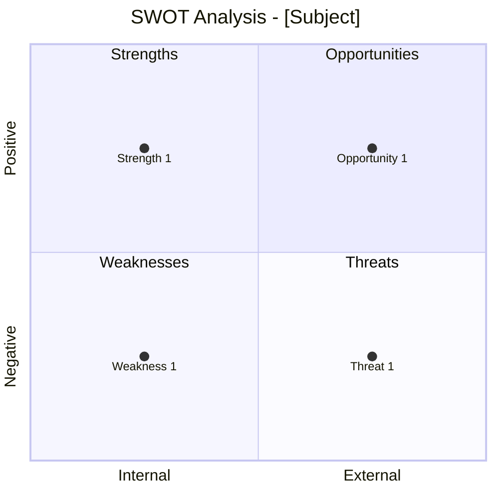

# SWOT 分析命令

使用 SWOT（Strengths、Weaknesses、Opportunities、Threats）以及配套的框架进行战略分析，理解竞争态势与环境因素。

## 参数

- `<subject>`：要分析的组织、产品、市场或某项 initiative
- `--mode`：分析框架（默认：`swot`）
  - `swot`：仅做 SWOT 分析（约 4K tokens）
  - `full`：SWOT + PESTLE + 波特五力（约 12K tokens）
  - `pestle`：仅做宏观环境分析（约 4K tokens）
  - `porter`：仅做行业结构分析（约 4K tokens）
- `--output`：输出格式（默认：`both`）
  - `yaml`：用于下游处理的结构化 YAML
  - `mermaid`：Mermaid 图示可视化
  - `both`：两种都输出

- `--dir`：输出目录（默认：`docs/analysis/`）

## 执行流程

### 步骤 1：解析参数

从参数中提取 subject、mode 与输出格式。

如果未提供 subject，则询问用户：
"你想分析哪个组织、产品、市场或 initiative？"

默认 mode 为 `swot`。默认输出为 `both`。

### 步骤 2：加载 SWOT-PESTLE 分析 skill

调用 `swot-pestle-analysis` skill 以获得：

- SWOT 矩阵结构
- PESTLE 分类
- 波特五力框架
- 战略启示的方法论
- Mermaid 图模板

### 步骤 3：按 mode 执行

#### SWOT 模式（默认）

分析内外部因素：

1. **Strengths（内部优势）**：subject 做得好的方面？竞争优势？
2. **Weaknesses（内部劣势）**：哪些地方需要改进？资源缺口？
3. **Opportunities（外部机会）**：哪些趋势或变化可以借力？
4. **Threats（外部威胁）**：哪些外部因素可能带来损害？

生成战略启示：

- S-O 策略：用优势抓住机会
- W-O 策略：改进劣势以抓住机会
- S-T 策略：用优势对抗威胁
- W-T 策略：最小化劣势并避开威胁

#### Full 模式（所有框架）

派生 `strategic-analyst` agent 做综合分析：

```text
Perform comprehensive strategic analysis:

Subject: [Subject description]

Requirements:
1. Complete SWOT analysis with evidence
2. PESTLE macro-environment scan
3. Porter's Five Forces industry analysis
4. Cross-framework synthesis
5. Prioritized strategic implications
6. Generate both YAML and Mermaid outputs
```

该 agent 将：

- 研究当前市场数据
- 在多个框架间交叉引用
- 识别相互关联的因素
- 产出综合性的战略评估

#### PESTLE 模式（宏观环境）

分析外部宏观环境因素：

1. **Political（政治）**：政府政策、稳定性、贸易法规
2. **Economic（经济）**：GDP、通胀、利率、就业
3. **Social（社会）**：人口结构、文化、生活方式趋势
4. **Technological（技术）**：创新、自动化、研发
5. **Legal（法律）**：法规、合规、诉讼
6. **Environmental（环境）**：气候、可持续性、资源

对每个因素按影响（高/中/低）和可能性评分。

#### Porter 模式（行业分析）

分析行业竞争结构：

1. **Competitive Rivalry**：竞争强度
2. **Threat of New Entrants**：进入壁垒
3. **Threat of Substitutes**：替代产品/服务
4. **Bargaining Power of Suppliers**：供应商集中度
5. **Bargaining Power of Buyers**：客户议价能力

对每个力量评分（强/中/弱）并给出证据。

### 步骤 4：生成输出产物

#### YAML 输出

```yaml
strategic_analysis:
  version: "1.0"
  subject: "[Subject Name]"
  date: "[ISO Date]"
  mode: "[swot|full|pestle|porter]"
  analyst: "strategic-analyst"

  swot:
    strengths:
      - factor: "[Strength 1]"
        evidence: "[Supporting data]"
        impact: high
    weaknesses:
      - factor: "[Weakness 1]"
        evidence: "[Supporting data]"
        impact: medium
    opportunities:
      - factor: "[Opportunity 1]"
        evidence: "[Supporting data]"
        likelihood: high
    threats:
      - factor: "[Threat 1]"
        evidence: "[Supporting data]"
        likelihood: medium

  strategic_implications:
    offensive:  # S-O strategies
      - "[Strategy]"
    developmental:  # W-O strategies
      - "[Strategy]"
    defensive:  # S-T strategies
      - "[Strategy]"
    survival:  # W-T strategies
      - "[Strategy]"
```

#### Mermaid 输出



#### 汇总报告

```markdown
## Strategic Analysis: [Subject]

**Date:** [ISO Date]
**Mode:** [swot|full|pestle|porter]
**Analyst:** strategic-analyst

### SWOT Summary

| Strengths | Weaknesses |
|-----------|------------|
| [S1] | [W1] |
| [S2] | [W2] |

| Opportunities | Threats |
|---------------|---------|
| [O1] | [T1] |
| [O2] | [T2] |

### Strategic Priorities

1. **Offensive (S-O)**: [Top priority]
2. **Developmental (W-O)**: [Development area]
3. **Defensive (S-T)**: [Protection focus]

### Recommendations

1. [Priority recommendation]
2. [Secondary recommendation]
3. [Long-term consideration]
```

### 步骤 5：保存结果

根据格式参数保存输出：

**YAML 文件：**

- `docs/analysis/swot-analysis.yaml`

**Mermaid 图：**

- `docs/analysis/swot-analysis.md`

使用 `--dir` 可指定自定义输出目录。

### 步骤 6：建议后续行动

分析完成后：

```markdown
## Suggested Next Steps

1. **Business Model Review**: Use `/ba:business-model-canvas` to align model with strategic findings
2. **Capability Assessment**: Use `/ba:capability-map` to identify capability gaps
3. **Risk Analysis**: Use `/ba:risk-register` to elaborate on threats
4. **Decision Analysis**: Use decision-analysis skill to evaluate strategic options
```
