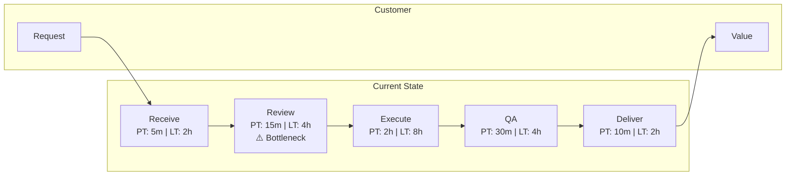
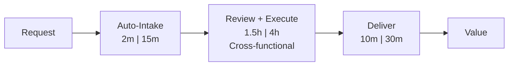

# Value Stream 命令

使用 Lean（精益）原则分析 value stream，识别浪费、瓶颈和改进机会。

## 参数

- `<process-description>`：要分析的 value stream 或流程的描述
- `--mode`：分析模式（默认：`guided`）
  - `full`：包含当前/未来状态图的综合分析（约 12K tokens）
  - `quick`：快速浪费识别（约 4K tokens）
  - `guided`：交互式 value stream mapping（耗时不固定）
- `--output`：输出格式（默认：`both`）
  - `current`：仅当前状态图
  - `future`：仅未来状态图
  - `both`：当前与未来状态都输出

- `--dir`：输出目录（默认：`docs/analysis/`）

## 执行流程

### 步骤 1：解析参数

从参数中提取流程描述、mode 与输出格式。

如果未提供描述，则询问用户：
"你想分析哪条 value stream 或流程？请描述：

- 交付给客户的价值是什么？
- 什么触发这个流程的开始？
- 什么标志着成功完成？"

默认 mode 为 `guided`。默认输出为 `both`。

### 步骤 2：加载 Value Stream Mapping skill

调用 `value-stream-mapping` skill 以获得：

- VSM 方法论与符号
- TIMWOODS 浪费分类
- 流动指标的定义
- 改进模式库

### 步骤 3：按 mode 执行

#### Full 模式（综合分析）

派生 `value-stream-analyst` agent 做深入分析：

```text
Analyze this value stream end-to-end:

[Process description]

Requirements:
1. Map current state with Process Time, Lead Time, %C&A for each step
2. Calculate flow efficiency
3. Identify waste by TIMWOODS category
4. Identify the system bottleneck (Theory of Constraints)
5. Design future state with improvement targets
6. Create prioritized improvement roadmap
7. Propose Kaizen events for top improvements
```

该 agent 将：

- 带指标地完整映射当前状态
- 系统性分析浪费
- 设计切实可行的未来状态
- 产出可落地的改进路线图

#### Quick 模式（快速评估）

快速识别浪费：

1. 识别主要流程步骤
2. 粗估 lead time
3. 识别显而易见的浪费（等待、交接、返工）
4. 粗算 flow efficiency
5. 标记最明显的瓶颈
6. 提出 3-5 个 quick wins

#### Guided 模式（交互式）

以交互方式完成 value stream mapping：

1. **定义范围**：明确客户、触发器与结束状态
2. **梳理步骤**：逐一走查每个流程步骤
   - 这一步发生了什么？
   - 实际动手工作耗时多久（Process Time）？
   - 多久才流转到下一步（Lead Time）？
   - 一次性做对的比例是多少（%C&A）？
   - 谁来执行这一步？
3. **计算指标**：计算 flow efficiency
4. **识别浪费**：对每一步逐项检查 TIMWOODS 分类
5. **找出瓶颈**：识别约束
6. **设计未来**：提出改进与目标

### 步骤 4：生成输出产物

#### 当前状态图

```markdown
## Current State Value Stream Map

**Value Stream:** [Name]
**Customer:** [Who receives value]
**Trigger:** [What starts the flow]
**End State:** [What marks completion]
**Date:** [ISO Date]

### Process Steps

| Step | Owner | PT | LT | %C&A | WIP | Notes |
|------|-------|-----|-----|------|-----|-------|
| Receive Request | Customer Service | 5m | 2h | 90% | 15 | Manual entry |
| Review & Prioritize | Manager | 15m | 4h | 85% | 20 | Bottleneck |
| Execute Work | Team | 2h | 8h | 95% | 10 | |
| Quality Check | QA | 30m | 4h | 80% | 8 | High rework |
| Deliver | Delivery | 10m | 2h | 99% | 5 | |

### Summary Metrics

- **Total Process Time:** 3h 0m
- **Total Lead Time:** 20h
- **Flow Efficiency:** 15%
- **Bottleneck:** Review & Prioritize (highest WIP)

### Waste Analysis (TIMWOODS)

| Waste Type | Location | Impact | Root Cause |
|------------|----------|--------|------------|
| **W**aiting | Review queue | 4h delay | Manager availability |
| **I**nventory | 20 items in review | WIP buildup | Batch processing |
| **D**efects | QA rework | 20% rework | Unclear requirements |
| **T**ransportation | Handoffs | 3 handoffs | Siloed teams |
```

#### 流动图



#### 未来状态图

```markdown
## Future State Value Stream Map

### Improvement Targets

| Metric | Current | Target | Improvement |
|--------|---------|--------|-------------|
| Lead Time | 20h | 8h | 60% reduction |
| Flow Efficiency | 15% | 40% | 2.7x improvement |
| %C&A (End-to-End) | 58% | 85% | 46% improvement |

### Proposed Changes

| Change | Addresses | Impact | Effort |
|--------|-----------|--------|--------|
| Cross-train reviewers | Bottleneck wait | -3h LT | Medium |
| Inline quality checks | Rework loop | -2h LT | Low |
| Automate intake | Manual entry | -1h LT | Medium |
| WIP limits | Inventory buildup | Better flow | Low |

### Future State Flow



#### 改进路线图

```markdown
### Improvement Roadmap

**Priority 1 - Quick Wins (1-2 weeks)**

1. **WIP Limits**: Cap review queue at 10 items
2. **Visual Management**: Add Kanban board for visibility
3. **Clear standards**: Document definition of done

**Priority 2 - Process Changes (1-2 months)**

4. **Cross-training**: Train 2 additional reviewers
5. **Inline QA**: Move quality checks earlier in process

**Priority 3 - Automation (3-6 months)**

6. **Automated intake**: Build self-service intake form
7. **Workflow automation**: Automate routing and notifications

### Kaizen Event Proposals

| Event | Focus | Duration | Expected Outcome |
|-------|-------|----------|------------------|
| Bottleneck Blitz | Review step | 3 days | 50% wait reduction |
| Quality Workshop | QA rework | 2 days | Clear acceptance criteria |
```

### 步骤 5：保存结果

将输出保存到：

- `docs/analysis/value-stream-[name].md`

使用 `--dir` 可指定自定义输出目录。

### 步骤 6：建议后续行动

```markdown
## Suggested Next Steps

1. **Stakeholder Buy-in**: Use `/ba:stakeholder-analyze` to plan change management
2. **Journey Impact**: Use `/ba:journey-map` to understand customer experience impact
3. **Capability Alignment**: Use `/ba:capability-map` to link process to capabilities
4. **Architecture Review**: Use `/ea-document` to align systems with future state
```
