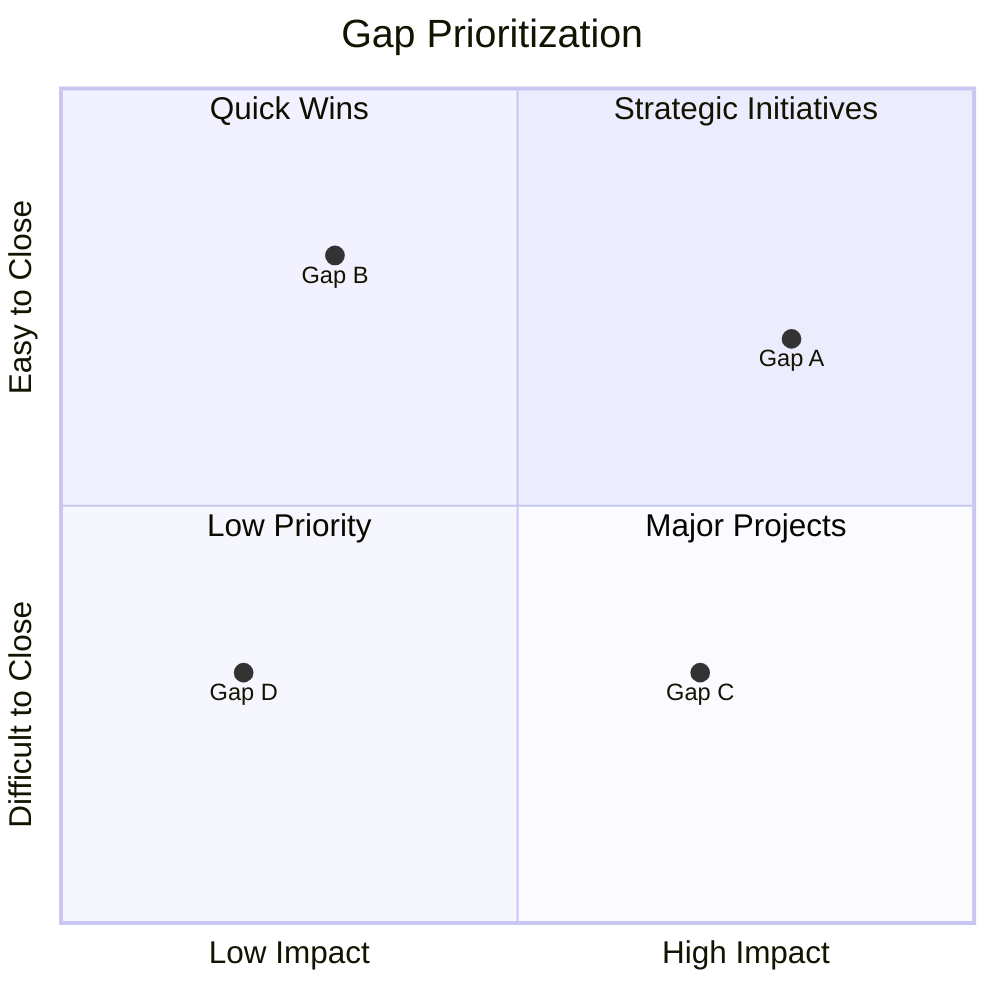
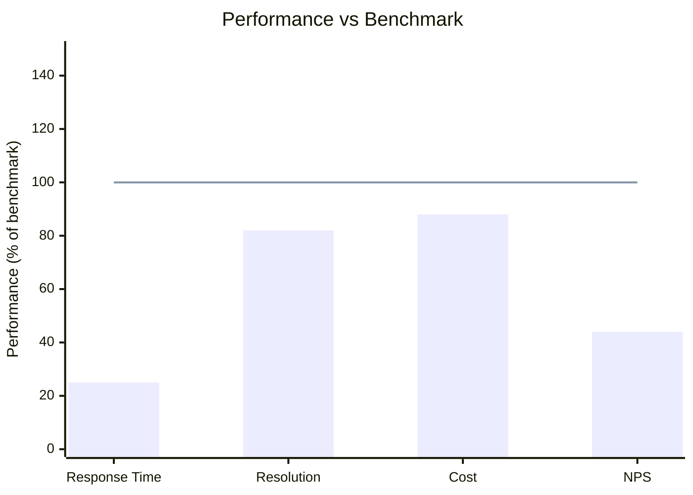

# Benchmarking（对标分析）

## 何时使用本 skill

在以下场景使用：

- **Benchmarking 任务** — 做对标与竞争分析；针对行业标准、竞争对手、最佳实践组织，比较绩效、流程与做法
- **规划或设计** — 需要对标方法的指引
- **最佳实践** — 想遵循成熟的模式与标准

## 概览

系统性地将自己的绩效、流程与做法，与内部单元、竞争对手、行业标准或最佳实践组织进行比较，识别差距与改进机会。

## 什么是 Benchmarking？

**Benchmarking（对标）** 是把自己组织的流程、产品或服务，与公认的领先者进行度量比较，以识别差距与改进机会的过程。

### 对标的目的

| 目标 | 描述 |
|------|-------------|
| **Identify Gaps（识别差距）** | 我们在哪些地方落后于领先者？ |
| **Set Targets（设定目标）** | 可达到的绩效水平是多少？ |
| **Learn Practices（学习做法）** | 领先者如何取得卓越成绩？ |
| **Drive Improvement（推动改进）** | 哪些改变能缩小差距？ |

### Benchmarking vs Competitive Analysis

| 维度 | Benchmarking | Competitive Analysis |
|--------|--------------|---------------------|
| 关注点 | 流程与做法 | 产品与市场地位 |
| 目标 | 提升自身绩效 | 理解竞争对手 |
| 范围 | 可以包含非竞争对手 | 直接竞争对手 |
| 产出 | 改进计划 | 竞争战略 |

## 对标的类型

### Internal Benchmarking（内部对标）

在内部单元、团队、地点之间比较：

| 优点 | 缺点 |
|-----------|--------------|
| 数据易获取 | 上限只是"内部最好" |
| 上下文一致 | 可能忽视外部创新 |
| 实施快 | 有办公室政治顾虑 |
| 成本低 | 可能固化平庸 |

**何时使用：** 多地点、绩效差异大、作为起点

### Competitive Benchmarking（竞争对标）

与直接竞争对手比较：

| 优点 | 缺点 |
|-----------|--------------|
| 可比性相关性强 | 数据难获取 |
| 直接匹配市场语境 | 可能片面/不完整 |
| stakeholder 易理解 | 涉及法律考量 |
| 战略相关 | 竞争对手未必最优 |

**何时使用：** 市场定位、产品对比、定价

### Functional Benchmarking（职能对标）

跨行业对比相似职能：

| 优点 | 缺点 |
|-----------|--------------|
| 可学到最佳实践 | 上下文差异 |
| 能带来创新思路 | 不一定能直接移植 |
| 竞争敏感性低 | 较难安排 |
| 视角更广 | 适配更复杂 |

**何时使用：** 流程改进、突破性思考

### Strategic Benchmarking（战略对标）

对比战略与商业模式：

| 优点 | 缺点 |
|-----------|--------------|
| 提供战略洞见 | 层次高、可操作性低 |
| 具备变革潜力 | 实施周期长 |
| 带来颠覆性想法 | 难度量 |
| 协助确立愿景 | 可能需要大规模变革 |

**何时使用：** 战略制定、转型、颠覆

## 对标流程

### Phase 1：规划

#### Step 1：定义范围

```markdown
## Benchmarking Scope

**Subject:** [What to benchmark]
**Type:** [Internal/Competitive/Functional/Strategic]
**Objective:** [Why benchmarking]
**Owner:** [Who's leading]
**Timeline:** [Start to finish]

### Success Criteria

- [What constitutes a successful benchmark study]
- [How results will be used]
```

#### Step 2：识别度量指标

```markdown
## Key Performance Indicators

| Category | Metric | Current | Definition |
|----------|--------|---------|------------|
| Efficiency | [Metric 1] | [Value] | [How measured] |
| Quality | [Metric 2] | [Value] | [How measured] |
| Speed | [Metric 3] | [Value] | [How measured] |
| Cost | [Metric 4] | [Value] | [How measured] |
```

#### Step 3：选择对标伙伴

| 准则 | 描述 |
|----------|-------------|
| **Relevant（相关）** | 流程或挑战类似 |
| **Best-in-class（业界标杆）** | 在该领域表现卓越 |
| **Willing（愿意）** | 愿意分享 |
| **Accessible（可触达）** | 有公开数据或可建立联系 |

### Phase 2：收集数据

#### Step 1：收集内部数据

```markdown
## Internal Performance Data

| Process/Area | Metric | Current Performance | Trend |
|--------------|--------|--------------------:|-------|
| [Process 1] | [Metric] | [Value] | [Up/Down/Stable] |
| [Process 2] | [Metric] | [Value] | [Up/Down/Stable] |
```

#### Step 2：收集外部数据

| 来源 | 类型 | 可靠性 |
|--------|------|-------------|
| 行业报告 | 二手 | 中-高 |
| 公开披露文件 | 二手 | 高 |
| 问卷调研 | 一手 | 中 |
| 实地访问 | 一手 | 高 |
| 会议/峰会 | 二手 | 中 |
| 已发表的案例研究 | 二手 | 中 |

#### Step 3：规范化数据

确保可比性：

- 统一定义
- 相同时间口径
- 范围等价
- 货币/单位换算
- 规模调整（如按人均、按营收占比）

### Phase 3：分析

#### Step 1：计算差距

```markdown
## Gap Analysis

| Metric | Our Performance | Benchmark | Gap | Gap % |
|--------|----------------:|----------:|----:|------:|
| [Metric 1] | 85% | 95% | -10% | -11% |
| [Metric 2] | 24h | 4h | +20h | +500% |
| [Metric 3] | $50 | $30 | +$20 | +67% |
```

#### Step 2：识别根因

对每个重要差距：

- 为什么存在这个差距？
- 哪些做法支撑了卓越表现？
- 我们闭合差距的障碍是什么？
- 需要哪些资源？

#### Step 3：差距优先级排序



### Phase 4：调整适配

#### Step 1：制定改进动作

```markdown
## Improvement Plan

### Gap: [Metric] - [Our Value] vs [Benchmark Value]

**Root Cause:** [Why the gap exists]

**Best Practice:** [What benchmark leaders do differently]

**Adaptation:**
| Action | Owner | Timeline | Resources | Expected Impact |
|--------|-------|----------|-----------|-----------------|
| [Action 1] | [Name] | [Date] | [Cost] | [Target] |
| [Action 2] | [Name] | [Date] | [Cost] | [Target] |

**Success Metric:** [How we'll measure improvement]
```

#### Step 2：设定目标

| 策略 | 描述 | 何时使用 |
|----------|-------------|-------------|
| 匹配对标 | 达到相同水平 | 现实可行，已被证实可达 |
| 超越对标 | 超过 best-in-class | 谋求竞争优势 |
| 渐进 | 缩小差距 X% | 资源受限 |
| 突破 | 跃升到新台阶 | 变革性改进 |

#### Step 3：实施与监控

- 执行改进动作
- 对照目标追踪进度
- 汇报差距闭合情况
- 迭代优化

## 竞争分析框架

### Porter's Five Forces 上下文

| 力量 | 对标关注点 |
|-------|-------------------|
| 行业竞争（Rivalry） | 直接竞争对手对比 |
| 新进入者（New Entrants） | 新兴竞争者的做法 |
| 替代品（Substitutes） | 替代方案的基准 |
| 供应商议价（Supplier Power） | 供应链效率 |
| 买方议价（Buyer Power） | 客户满意度指标 |

### Competitive Profile Matrix（竞争档案矩阵）

```markdown
## Competitive Profile Matrix

| Success Factor | Weight | Company A | Company B | Company C |
|----------------|-------:|----------:|----------:|----------:|
| | | Rating | Score | Rating | Score | Rating | Score |
| Product Quality | 0.20 | 4 | 0.80 | 3 | 0.60 | 5 | 1.00 |
| Price | 0.15 | 3 | 0.45 | 4 | 0.60 | 2 | 0.30 |
| Market Share | 0.15 | 4 | 0.60 | 2 | 0.30 | 5 | 0.75 |
| Customer Service | 0.20 | 3 | 0.60 | 4 | 0.80 | 3 | 0.60 |
| Innovation | 0.15 | 2 | 0.30 | 3 | 0.45 | 5 | 0.75 |
| Distribution | 0.15 | 4 | 0.60 | 3 | 0.45 | 4 | 0.60 |
| **Total** | **1.00** | | **3.35** | | **3.20** | | **4.00** |

Rating: 1=Major Weakness, 2=Minor Weakness, 3=Neutral, 4=Minor Strength, 5=Major Strength
```

### 与 SWOT 结合

对标结果可以反馈到 SWOT：

| SWOT 元素 | 对标输入 |
|--------------|-------------------|
| Strengths | 我们超越基准的地方 |
| Weaknesses | 我们落后的地方 |
| Opportunities | 值得借鉴的最佳实践 |
| Threats | 竞争对手的优势 |

## 输出格式

### 叙述式摘要

```markdown
## Benchmarking Summary

**Subject:** [What was benchmarked]
**Date:** [ISO date]
**Type:** [Internal/Competitive/Functional/Strategic]
**Analyst:** benchmarking-analyst

### Executive Summary

[2-3 sentence overview of key findings]

### Benchmarking Partners

| Partner | Type | Why Selected |
|---------|------|--------------|
| [Partner 1] | [Type] | [Reason] |
| [Partner 2] | [Type] | [Reason] |

### Key Findings

#### Gap 1: [Area]
- **Our Performance:** [Value]
- **Benchmark:** [Value]
- **Gap:** [Delta]
- **Root Cause:** [Why]
- **Best Practice:** [What leaders do]

#### Gap 2: [Area]
[Same structure]

### Recommendations

| Priority | Gap | Action | Impact | Effort |
|----------|-----|--------|--------|--------|
| 1 | [Gap] | [Action] | High | Medium |
| 2 | [Gap] | [Action] | Medium | Low |

### Next Steps

1. [Immediate action]
2. [Short-term action]
3. [Long-term initiative]
```

### 结构化数据（YAML）

```yaml
benchmarking:
  version: "1.0"
  date: "2025-01-15"
  subject: "Customer Service Operations"
  type: "competitive"
  analyst: "benchmarking-analyst"

  partners:
    - name: "Company A"
      type: "direct_competitor"
      selection_reason: "Market leader"
    - name: "Industry Average"
      type: "industry_benchmark"
      source: "Gartner Report 2024"

  metrics:
    - name: "First Response Time"
      category: "speed"
      our_performance:
        value: 24
        unit: "hours"
      benchmark:
        value: 4
        unit: "hours"
        source: "Company A"
      gap:
        absolute: 20
        percentage: 500
      priority: "critical"

    - name: "Customer Satisfaction"
      category: "quality"
      our_performance:
        value: 78
        unit: "percent"
      benchmark:
        value: 92
        unit: "percent"
        source: "Industry Average"
      gap:
        absolute: -14
        percentage: -15
      priority: "high"

  findings:
    - gap: "First Response Time"
      root_cause: "Manual ticket routing, no AI triage"
      best_practice: "AI-powered auto-routing and chatbot first response"
      impact: "high"
      effort: "medium"

  recommendations:
    - priority: 1
      gap: "First Response Time"
      action: "Implement AI ticket triage"
      owner: "Support Director"
      timeline: "Q2 2025"
      expected_improvement: "80% reduction"
      investment: "$50,000"

  targets:
    - metric: "First Response Time"
      current: 24
      target: 4
      timeline: "6 months"
    - metric: "Customer Satisfaction"
      current: 78
      target: 90
      timeline: "12 months"
```

### 对比表

```markdown
## Competitive Comparison

| Dimension | Us | Competitor A | Competitor B | Industry Avg | Best-in-Class |
|-----------|---:|-------------:|-------------:|-------------:|--------------:|
| Response Time | 24h | 8h | 12h | 10h | 1h |
| Resolution Rate | 78% | 85% | 82% | 80% | 95% |
| Cost per Ticket | $45 | $35 | $40 | $38 | $20 |
| NPS Score | 32 | 45 | 38 | 35 | 72 |

**Legend:** Green = above average, Yellow = average, Red = below average
```

### 差距可视化



## 对标的伦理

### 应该做的

- 使用公开可得的信息
- 实地参访/访谈前取得许可
- 若参与 consortium，要适度分享
- 保护机密信息
- 注明来源致谢

### 不应做的

- 使用欺骗手段收集数据
- 违反 NDA 或侵犯商业机密
- 歪曲对标数据
- 不合伦理地使用竞争情报
- 忽视法律与反垄断考量

## 常见陷阱

| 陷阱 | 如何规避 |
|---------|------------|
| 选错指标 | 与战略目标对齐 |
| 选错伙伴 | 挑选真正的 best-in-class |
| 风马牛对比 | 仔细规范化数据 |
| 光有数据无行动 | 聚焦可执行的洞察 |
| 一次性活动 | 建立持续改进循环 |
| 盲目照搬 | 结合自身语境调整 |

## 集成

### 上游

- **swot-pestle-analysis** — 战略上下文
- **stakeholder-analysis** — 谁关心这些基准
- **Requirements** — 绩效类需求

### 下游

- **Gap analysis** — 改进优先级
- **prioritization** — 资源分配
- **Roadmap** — 改进 initiative

## 相关 skill

- `swot-pestle-analysis` — 战略环境分析
- `prioritization` — 对改进行动排序
- `decision-analysis` — 评估改进方案
- `capability-mapping` — 能力成熟度对标

## 版本历史

- **v1.0.0**（2025-12-26）：首次发布
