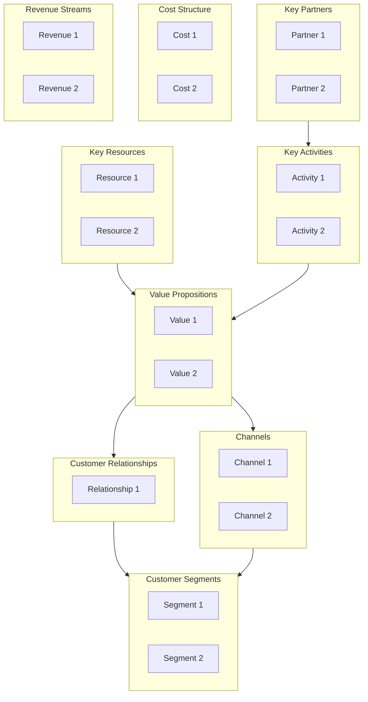

# Business Model Canvas（商业模式画布）

使用 Osterwalder 的 Business Model Canvas 与 Lean Canvas 设计并分析商业模式。产出结构化的 9 宫格画布，支持商业模式创新、创业验证与战略规划。

## 什么是 Business Model Canvas？

**Business Model Canvas（商业模式画布，BMC）** 是一种用于开发新业务或记录现有业务的战略管理模板。它是一幅可视化图表，描述公司的价值主张、基础设施、客户与财务。

| 维度 | Business Model Canvas | Lean Canvas |
|--------|----------------------|-------------|
| **提出者** | Alexander Osterwalder | Ash Maurya |
| **焦点** | 成熟业务 | 创业公司、早期阶段 |
| **重点** | 价值创造与交付 | Problem-solution fit |
| **关键差异** | Key Partners、Key Resources | Problem、Solution、Unfair Advantage |

## 9 个构建块

### Business Model Canvas 各 block

```text
┌─────────────────┬─────────────────┬─────────────────┬─────────────────┬─────────────────┐
│ Key Partners    │ Key Activities  │ Value           │ Customer        │ Customer        │
│                 │                 │ Propositions    │ Relationships   │ Segments        │
│ Who helps us?   │ What do we do?  │                 │                 │                 │
│                 │                 │ What value do   │ How do we       │ Who do we       │
│                 ├─────────────────┤ we deliver?     │ interact?       │ serve?          │
│                 │ Key Resources   │                 │                 │                 │
│                 │                 │                 ├─────────────────┤                 │
│                 │ What do we      │                 │ Channels        │                 │
│                 │ need?           │                 │                 │                 │
│                 │                 │                 │ How do we       │                 │
│                 │                 │                 │ reach them?     │                 │
├─────────────────┴─────────────────┴─────────────────┴─────────────────┴─────────────────┤
│ Cost Structure                                      │ Revenue Streams                   │
│ What does it cost?                                  │ How do we earn?                   │
└─────────────────────────────────────────────────────┴───────────────────────────────────┘
```

### block 定义

| Block | 核心问题 | 示例 |
|-------|----------|----------|
| **Customer Segments** | 最重要的客户是谁？ | Mass market、Niche、Segmented、Diversified |
| **Value Propositions** | 我们交付什么价值？解决什么问题？ | Newness、Performance、Customization、Price |
| **Channels** | 如何触达并交付给客户？ | Direct、Indirect、Own、Partner |
| **Customer Relationships** | 如何与每个 segment 互动？ | Personal、Automated、Self-service、Communities |
| **Revenue Streams** | 每个 segment 如何付费？ | Asset sale、Subscription、Licensing、Advertising |
| **Key Resources** | 为交付价值主张需要什么？ | Physical、Intellectual、Human、Financial |
| **Key Activities** | 我们必须做好什么？ | Production、Problem Solving、Platform/Network |
| **Key Partnerships** | 谁在帮我们？ | Strategic alliances、Suppliers、Joint ventures |
| **Cost Structure** | 主要成本是什么？ | Fixed、Variable、Economies of scale/scope |

## 工作流

### Phase 1：准备

#### Step 1：定义上下文

```markdown
## Canvas Context

**Organization:** [Company / Product / Initiative]
**Purpose:** [New business / Innovation / Documentation / Pivot]
**Scope:** [Entire business / Product line / Service]
**Date:** [ISO date]
**Facilitator:** canvas-facilitator
```

#### Step 2：收集输入

在填画布前：

- 既有业务计划、战略文档
- 客户调研、persona
- 竞品分析
- 财务数据（若用于记录现有模式）

### Phase 2：填写画布（从右到左）

从 Customer Segments（需求侧）开始，再到 Value Proposition 与基础设施（供给侧）。

#### Step 1：Customer Segments

```markdown
## Customer Segments

| Segment | Description | Size | Priority |
|---------|-------------|------|----------|
| [Name] | [Who are they? Demographics, needs] | [Market size] | Primary/Secondary |

**Questions to answer:**
- For whom are we creating value?
- Who are our most important customers?
- What are their jobs-to-be-done?
```

##### Segment 类型

| 类型 | 描述 | 示例 |
|------|-------------|---------|
| **Mass Market** | 大规模群体，需求相似 | 消费电子 |
| **Niche Market** | 专门化、需求具体 | 奢侈品 |
| **Segmented** | 多个独立 segment，需求相关 | 银行（零售 vs 财富管理） |
| **Diversified** | 互不相关的 segment | Amazon（零售 + AWS） |
| **Multi-sided** | 互相依存的 segment | 平台（用户 + 广告主） |

#### Step 2：Value Propositions

```markdown
## Value Propositions

| Segment | Value Proposition | Type | Differentiation |
|---------|-------------------|------|-----------------|
| [Segment] | [What value delivered?] | [Type] | [Why us over competitors?] |

**Questions to answer:**
- What value do we deliver to each segment?
- Which customer problems are we solving?
- What bundles of products/services do we offer?
```

##### Value Proposition 类型

| 类型 | 描述 |
|------|-------------|
| **Newness** | 新事物，之前没有 |
| **Performance** | 性能更好 |
| **Customization** | 按需定制 |
| **Getting the Job Done** | 帮客户完成某项任务 |
| **Design** | 卓越设计 |
| **Brand/Status** | 品牌或身份价值 |
| **Price** | 价格更低 |
| **Cost Reduction** | 降低客户成本 |
| **Risk Reduction** | 降低客户风险 |
| **Accessibility** | 让新用户也能用上 |
| **Convenience** | 更易用 |

#### Step 3：Channels

```markdown
## Channels

| Phase | Channel | Type | Effectiveness |
|-------|---------|------|---------------|
| Awareness | [How do customers learn about us?] | Own/Partner | High/Med/Low |
| Evaluation | [How do they evaluate?] | Own/Partner | High/Med/Low |
| Purchase | [How do they buy?] | Own/Partner | High/Med/Low |
| Delivery | [How do we deliver?] | Own/Partner | High/Med/Low |
| After Sales | [How do we support?] | Own/Partner | High/Med/Low |
```

#### Step 4：Customer Relationships

```markdown
## Customer Relationships

| Segment | Relationship Type | Purpose | Cost |
|---------|-------------------|---------|------|
| [Segment] | [Type] | Acquisition/Retention/Upselling | High/Med/Low |
```

##### 关系类型

| 类型 | 描述 |
|------|-------------|
| **Personal Assistance** | 人工互动 |
| **Dedicated Personal** | 指定专属代表 |
| **Self-Service** | 无直接关系 |
| **Automated Services** | 自动化的个性化服务 |
| **Communities** | 用户社区 |
| **Co-creation** | 客户共创价值 |

#### Step 5：Revenue Streams

```markdown
## Revenue Streams

| Segment | Revenue Type | Pricing Model | % of Revenue |
|---------|--------------|---------------|--------------|
| [Segment] | [Type] | Fixed/Dynamic | [Percentage] |
```

##### 收入类型

| 类型 | 描述 | 定价 |
|------|-------------|---------|
| **Asset Sale** | 出售所有权 | 定价、Volume、谈判 |
| **Usage Fee** | 按使用付费 | 按次、分层 |
| **Subscription** | 周期性付费 | 月付、年付 |
| **Lending/Renting** | 临时使用 | 按时长 |
| **Licensing** | 授权使用 IP | 按 license、Royalty |
| **Brokerage** | 中介费 | 佣金 |
| **Advertising** | 展示广告 | CPM、CPC、CPA |

#### Step 6：Key Resources

```markdown
## Key Resources

| Resource | Category | Source | Strategic Importance |
|----------|----------|--------|---------------------|
| [Resource] | Physical/IP/Human/Financial | Own/Lease/Partner | Critical/Important/Supporting |
```

#### Step 7：Key Activities

```markdown
## Key Activities

| Activity | Category | Importance | Insource/Outsource |
|----------|----------|------------|-------------------|
| [Activity] | Production/Problem Solving/Platform | Critical/Important | Insource/Outsource |
```

#### Step 8：Key Partnerships

```markdown
## Key Partnerships

| Partner | Type | Motivation | Resources Provided |
|---------|------|------------|-------------------|
| [Partner] | Strategic Alliance/Coopetition/JV/Supplier | Optimization/Risk/Acquisition | [What they provide] |
```

##### 合作动机

- **Optimization and Economy of Scale** — 降低成本
- **Reduction of Risk and Uncertainty** — 共担风险
- **Acquisition of Resources and Activities** — 获取能力

#### Step 9：Cost Structure

```markdown
## Cost Structure

| Cost Category | Type | Driver | % of Total |
|---------------|------|--------|------------|
| [Cost] | Fixed/Variable | [What drives it] | [Percentage] |

**Cost Focus:** ☐ Cost-Driven ☐ Value-Driven
```

### Phase 3：分析与验证

#### Step 1：检查一致性

| 检查 | 问题 | 通过？ |
|-------|----------|-------|
| **Value-Customer Fit** | value proposition 是否匹配 segment 需求？ | ☐ |
| **Channel-Segment Fit** | channels 能否有效触达 segment？ | ☐ |
| **Revenue-Cost Balance** | revenue 是否覆盖 cost？ | ☐ |
| **Resource-Activity Alignment** | resources 是否支撑 key activities？ | ☐ |
| **Partnership Logic** | partnerships 是否填补能力缺口？ | ☐ |

#### Step 2：识别风险

```markdown
## Business Model Risks

| Block | Risk | Likelihood | Impact | Mitigation |
|-------|------|------------|--------|------------|
| [Block] | [Risk description] | H/M/L | H/M/L | [Action] |
```

## Lean Canvas（可选）

创业公司或早期项目可用 Lean Canvas，它替换了部分 block：

| BMC Block | Lean Canvas Block | 替换原因 |
|-----------|-------------------|----------------|
| Key Partners | Problem | 专注于验证问题 |
| Key Activities | Solution | 专注于验证解决方案 |
| Key Resources | Key Metrics | 度量真正关键的指标 |
| Customer Relationships | Unfair Advantage | 竞争护城河 |

### Lean Canvas 模板

```markdown
## Lean Canvas: [Product/Startup]

**Date:** [ISO date]
**Iteration:** [1, 2, 3...]

### Problem (Top 3)
1. [Most critical problem]
2. [Second problem]
3. [Third problem]

**Existing Alternatives:** [How do customers solve this today?]

### Customer Segments
**Early Adopters:** [Who will use first?]

### Unique Value Proposition
**Single, clear message:** [One sentence that explains why you're different and worth attention]

**High-Level Concept:** [X for Y analogy, e.g., "Uber for dog walking"]

### Solution (Top 3 Features)
1. [Feature addressing Problem 1]
2. [Feature addressing Problem 2]
3. [Feature addressing Problem 3]

### Channels
[Path to customers - how will you reach early adopters?]

### Revenue Streams
[Revenue model, pricing, lifetime value]

### Cost Structure
[Customer acquisition costs, hosting, people, etc.]

### Key Metrics
[The numbers that tell you how you're doing]

### Unfair Advantage
[Something that cannot easily be copied or bought]
```

## 输出格式

### 叙述式摘要

```markdown
## Business Model Summary: [Organization]

**Date:** [ISO date]
**Analyst:** canvas-analyst
**Type:** Business Model Canvas / Lean Canvas

### Executive Summary
[2-3 sentence summary of the business model]

### Customer Focus
- **Primary Segment:** [Description]
- **Value Delivered:** [Core value proposition]
- **Channels:** [Primary channels]

### Value Creation
- **Key Activities:** [Core activities]
- **Key Resources:** [Critical resources]
- **Key Partners:** [Strategic partners]

### Financial Model
- **Revenue Model:** [How money is made]
- **Cost Structure:** [Major cost drivers]
- **Unit Economics:** [Key metrics]

### Risks and Opportunities
| Type | Description | Priority |
|------|-------------|----------|
| Risk | [Top risk] | High |
| Opportunity | [Top opportunity] | High |

### Recommendations
1. [Priority recommendation]
2. [Secondary recommendation]
```

### 结构化数据（YAML）

```yaml
business_model_canvas:
  version: "1.0"
  date: "2025-01-15"
  organization: "Acme Corp"
  analyst: "canvas-analyst"
  type: "business_model_canvas"  # or "lean_canvas"

  customer_segments:
    - name: "SMB Owners"
      description: "Small business owners seeking efficiency"
      size: "5M in target market"
      priority: primary
      jobs_to_be_done:
        - "Manage invoicing"
        - "Track expenses"

  value_propositions:
    - segment: "SMB Owners"
      proposition: "Automated bookkeeping that saves 10 hours/week"
      type: convenience
      differentiation: "AI-powered categorization"

  channels:
    - phase: awareness
      channel: "Content marketing"
      type: own
      effectiveness: high
    - phase: purchase
      channel: "Website"
      type: own
      effectiveness: high

  customer_relationships:
    - segment: "SMB Owners"
      type: self_service
      purpose: retention
      cost: low

  revenue_streams:
    - segment: "SMB Owners"
      type: subscription
      pricing: "fixed"
      amount: "$29/month"
      percentage: 85

  key_resources:
    - name: "AI/ML Platform"
      category: intellectual
      source: own
      importance: critical

  key_activities:
    - activity: "Platform development"
      category: production
      importance: critical
      insource: true

  key_partnerships:
    - partner: "Accounting Firms"
      type: strategic_alliance
      motivation: acquisition
      provides: "Referrals, expertise"

  cost_structure:
    focus: value_driven
    costs:
      - category: "Engineering"
        type: fixed
        percentage: 40
      - category: "Cloud hosting"
        type: variable
        percentage: 15

  validation:
    value_customer_fit: true
    channel_segment_fit: true
    revenue_cost_balance: true
```

### Mermaid 图



## 何时使用

| 场景 | 是否使用 Business Model Canvas？ |
|----------|---------------------------|
| 新业务规划 | 是 — 完整画布 |
| 创业验证 | 是 — 优先 Lean Canvas |
| 商业模式创新 | 是 — 探索替代方案 |
| 战略规划 | 是 — 记录当前状态 |
| M&A 分析 | 是 — 对比不同模式 |
| 产品线分析 | 部分适用 — 聚焦画布 |

## 集成

### 上游

- **stakeholder-analysis** — 识别 customer segment
- **swot-pestle-analysis** — 环境上下文
- **journey-mapping** — 客户体验洞察

### 下游

- **Requirements** — 从 value proposition 推导功能需求
- **Financial modeling** — 收入与成本预测
- **Roadmaps** — initiative 优先级

## 相关 skill

- `stakeholder-analysis` — 客户与合作方分析
- `swot-pestle-analysis` — 战略上下文
- `value-stream-mapping` — 运营效率
- `capability-mapping` — 组织能力
- `decision-analysis` — 商业模式决策

## 版本历史

- **v1.0.0**（2025-12-26）：首次发布
