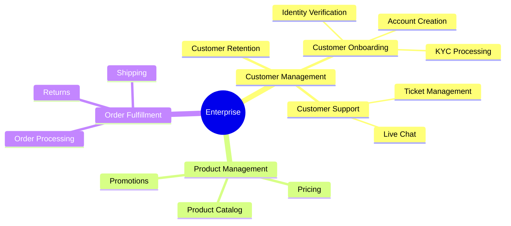

# Business Capability Mapping（业务能力地图）

构建能连接战略与架构的分层业务能力模型。基于 BABOK v3 的 Business Capability Analysis（10.6）。

## 什么是业务能力？

**业务能力（business capability）** 定义的是企业本质上"做什么"，与以下维度无关：

- **How（怎么做）**：流程
- **Who（谁做）**：组织结构
- **Where（在哪做）**：地点

即便流程、技术与组织结构发生变化，能力本身仍会长期保持稳定。

## 能力层级

| 层级 | 范围 | 示例 | 描述 |
|-------|-------|---------|-------------|
| **L1** | Domain | Customer Management | 战略性能力领域（通常 8-15 个） |
| **L2** | Sub-Domain | Customer Onboarding | L1 的下拆（每个 L1 拆出 3-7 个） |
| **L3** | Activity | Identity Verification | 具体活动（每个 L2 拆 3-10 个） |
| **L4+** | Optional | KYC Document Processing | 更细粒度（映射到 SOA service） |

## 能力类型

| 类型 | 描述 | 投入优先级 |
|------|-------------|---------------------|
| **Strategic（战略型）** | 驱动竞争优势 | 高 — 用来做差异化 |
| **Core（核心型）** | 价值交付所必需 | 中 — 做优化 |
| **Supporting（支撑型）** | 使能其他能力 | 低 — 做商品化或外包 |

## 工作流

### Phase 1：Discovery（发现）

绘制能力地图之前，先理解业务领域：

1. **分析已有文档**
   - 复盘业务流程、组织结构图、战略文档
   - 识别出 actor、工作对象、活动

2. **做 stakeholder 访谈**
   - 调用 `stakeholder-analysis` skill 识别关键 stakeholder
   - 访谈领域专家，获取能力洞察

3. 将发现的模式作为 L1 能力的候选

### Phase 2：能力识别

#### 步骤 1：定义 L1 能力

从行业框架起步，然后做本地化：

```markdown
## L1 Capabilities (Example: Retail)

| # | Capability | Type | Description |
|---|------------|------|-------------|
| 1 | Product Management | Core | Manage product lifecycle |
| 2 | Customer Management | Core | Manage customer relationships |
| 3 | Order Fulfillment | Core | Process and deliver orders |
| 4 | Supply Chain | Core | Manage suppliers and inventory |
| 5 | Finance & Accounting | Supporting | Financial operations |
| 6 | Human Resources | Supporting | People management |
| 7 | IT Services | Supporting | Technology operations |
| 8 | Marketing | Strategic | Brand and customer acquisition |
```

#### 步骤 2：向 L2 拆解

对每个 L1，识别其子能力：

```markdown
## L2 Decomposition: Customer Management

| L2 Capability | Owner | Maturity | Systems |
|---------------|-------|----------|---------|
| Customer Onboarding | Customer Success | 3 | CRM, KYC |
| Customer Support | Support Team | 4 | Ticketing, Chat |
| Customer Retention | Marketing | 2 | CRM, Analytics |
| Customer Analytics | Data Team | 2 | BI Platform |
```

#### 步骤 3：按需向 L3 拆解

仅在规划需要更细颗粒度时才继续拆解：

```markdown
## L3 Decomposition: Customer Onboarding

| L3 Capability | Description | Status |
|---------------|-------------|--------|
| Identity Verification | Verify customer identity | Automated |
| Account Creation | Create customer account | Automated |
| KYC Processing | Know Your Customer compliance | Semi-manual |
| Welcome Communication | Onboarding emails/guides | Automated |
```

### Phase 3：交叉映射

把能力映射到其他领域，做战略分析：

| 交叉领域 | 目的 | 典型问题 |
|------------------|---------|-------------------|
| **People（人）** | Ownership | 这项能力由谁 own？ |
| **Process（流程）** | 执行 | 由哪些流程实现？ |
| **Technology（技术）** | 使能 | 有哪些系统在支撑？ |
| **Strategy（战略）** | 对齐 | 它如何支持战略？ |
| **Investment（投入）** | 优先级 | 应该在哪里投入？ |
| **Risk（风险）** | 风险敞口 | 存在哪些风险？ |

### Phase 4：评估

对每项能力在成熟度与战略重要性上打分：

**成熟度量表（1-5）：**

1. Initial — 临时、被动响应
2. Developing — 有一定结构
3. Defined — 标准化流程
4. Managed — 度量并可控
5. Optimizing — 持续改进

**热力图可视化：**

```markdown
## Capability Heat Map

| Capability | Maturity | Importance | Gap | Action |
|------------|----------|------------|-----|--------|
| Customer Onboarding | 3 | High | Low | Maintain |
| Customer Analytics | 2 | High | High | Invest |
| IT Services | 4 | Medium | Low | Maintain |
| HR Admin | 3 | Low | Low | Outsource? |
```

## 输出格式

### 叙述式摘要

给出人类可读的分析：

```markdown
## Capability Map Summary

**Organization:** [Name]
**Scope:** [Enterprise / Business Unit / Domain]
**Date:** [ISO date]

### Key Findings

1. **Strategic Capabilities:** [List with assessment]
2. **Investment Priorities:** [Capabilities needing attention]
3. **Optimization Opportunities:** [Capabilities to streamline]

### Recommendations

1. [Specific, actionable recommendation]
2. [...]
```

### 结构化数据（YAML）

```yaml
capability_model:
  version: "1.0"
  organization: "Acme Corp"
  scope: enterprise
  generated: "{ISO-8601-date}"
  generated_by: capability-analyst

  capabilities:
    - id: CAP-001
      name: "Customer Management"
      level: 1
      type: core
      description: "Manage customer lifecycle and relationships"
      owner: "Chief Customer Officer"
      children:
        - id: CAP-001-01
          name: "Customer Onboarding"
          level: 2
          owner: "Customer Success Director"
          maturity: 3
          importance: high
          systems:
            - CRM
            - KYC Platform
          processes:
            - "Customer Registration"
            - "Identity Verification"
          children:
            - id: CAP-001-01-01
              name: "Identity Verification"
              level: 3
              maturity: 4
              automation: high
```

### Mermaid 图



## 集成点

### 上游（Discovery）

- **stakeholder-analysis** — 识别能力 owner 和领域专家
- **process-modeling** — 了解 AS-IS（现状）流程
- **value-stream-mapping** — 了解价值流动

### 下游（消费者）

- **Requirements** — Capability → Requirements 的可追溯
- **Systems design** — Capability → System 的映射
- **Investment planning** — Capability → 预算分配

## 何时使用

| 场景 | 用不用能力地图？ |
|----------|------------------------|
| 战略规划 | 用 — 对齐投入 |
| M&A（并购）集成 | 用 — 识别重叠 |
| 数字化转型 | 用 — 给 initiative 排优先级 |
| 应用资产梳理 | 用 — 把应用映射到能力 |
| 流程改进 | 部分 — 与 process modeling 结合使用 |
| 具体功能设计 | 不用 — 粒度太粗 |

## 参考资料

- 加载 `references/capability-hierarchy.md` 获取更详细的层级指南
- 正式的技法定义见 BABOK v3 第 10.6 节

## 相关 skill

- `stakeholder-analysis` — 识别能力 owner
- `value-stream-mapping` — 映射跨能力的价值流
- `benchmarking` — 把能力成熟度与行业标准对标
- `prioritization` — 给能力投入排优先级
- `swot-pestle-analysis` — 能力所处的战略情境
- `decision-analysis` — 评估能力投入的方案

## 版本历史

- **v1.0.0**（2025-12-26）：首次发布
