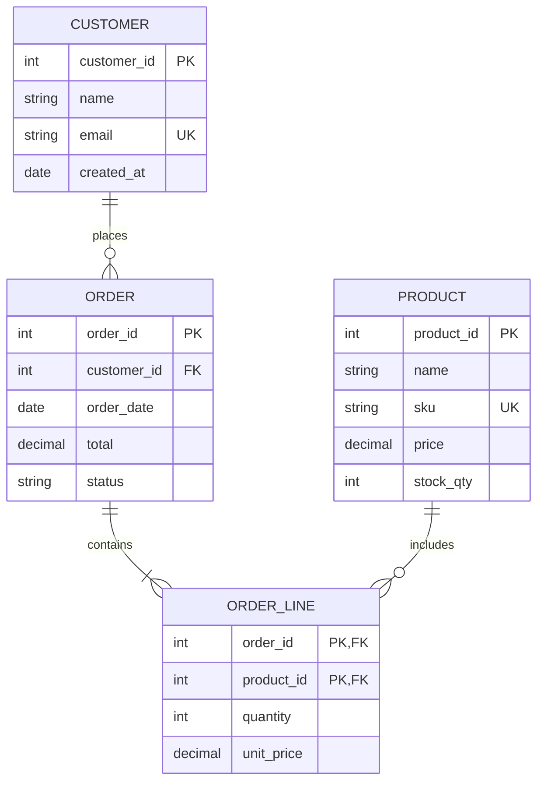
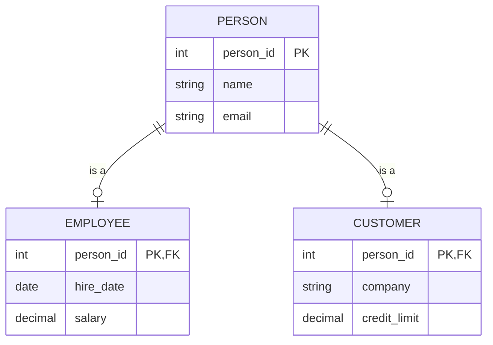
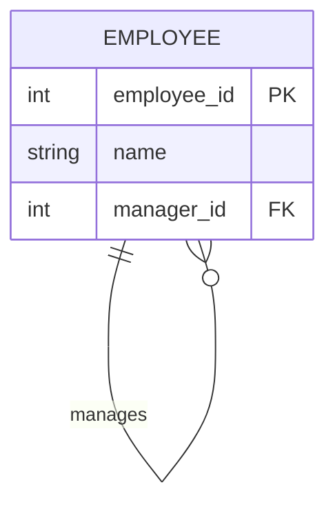
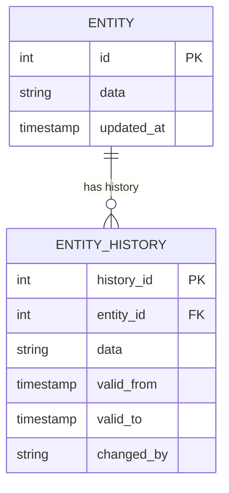

# Data Modeling（数据建模）

## 何时使用本 skill

在以下场景使用：

- **Data Modeling 任务** — 使用 Entity-Relationship Diagram（ERD）、数据字典和概念/逻辑/物理模型做数据建模；记录数据结构、关系与属性
- **规划或设计** — 需要数据建模方法的指引
- **最佳实践** — 想遵循成熟的模式与标准

## 概览

使用 Entity-Relationship Diagram（ERD）、数据字典和结构化数据模型来创建并记录数据结构。支持概念（conceptual）、逻辑（logical）和物理（physical）三个建模层次，用于数据库设计与数据架构。

## 什么是 Data Modeling？

**数据建模（data modeling）** 是把数据元素及其关系用可视化和结构化方式表达出来。它记录了：

- **Entities（实体）**：需要存储数据的"事物"
- **Attributes（属性）**：实体的属性
- **Relationships（关系）**：实体之间的关联方式
- **Constraints（约束）**：数据需要遵守的规则

## 建模层次

| 层次 | 目的 | 受众 | 细节 |
|-------|---------|----------|--------|
| **Conceptual（概念）** | 业务概念 | 业务用户 | 实体、高层关系 |
| **Logical（逻辑）** | 数据结构 | 分析师、设计师 | 实体、属性、全部关系 |
| **Physical（物理）** | 实现 | 开发、DBA | 表、列、类型、索引 |

### Conceptual Model（概念模型）

业务概念的高层视图：

- 只画主要实体
- 关键关系
- 没有属性（或极少）
- 不含技术细节

### Logical Model（逻辑模型）

与技术无关的数据结构：

- 所有实体和属性
- primary key 与 foreign key
- 所有关系及其 cardinality
- 做过规范化
- 不含物理实现细节

### Physical Model（物理模型）

针对具体数据库的实现：

- 表名（物理命名）
- 列名与数据类型
- 索引与约束
- 视图与存储过程
- 数据库特定的特性

## ERD 记号

### Entity（矩形）

一个 entity 代表一个需要存储数据的事物。

```text
┌─────────────────┐
│    CUSTOMER     │
├─────────────────┤
│ customer_id PK  │
│ name            │
│ email           │
│ created_at      │
└─────────────────┘
```

**Entity 类型：**

| 类型 | 描述 | 示例 |
|------|-------------|---------|
| **Strong（强实体）** | 独立存在 | Customer、Product |
| **Weak（弱实体）** | 依附于其他实体 | Order Line（依附于 Order） |
| **Associative（关联实体）** | 解决 M:N 关系 | Enrollment（Student-Course） |

### Attributes（属性）

| 类型 | 符号 | 描述 |
|------|--------|-------------|
| **Primary Key (PK)** | 下划线/PK | 唯一标识 |
| **Foreign Key (FK)** | FK | 引用其他实体 |
| **Required（必填）** | * 或 NOT NULL | 必须有值 |
| **Optional（可选）** | ○ 或 NULL | 可以为空 |
| **Derived（派生）** | / | 由其他属性计算得出 |
| **Composite（复合）** | {attrs} | 由多个子属性组成 |
| **Multi-valued（多值）** | [attr] | 可以有多个值 |

### Relationships（连线）

**记号风格：**

| 风格 | 用于 |
|-------|---------|
| Chen | 学术、概念层 |
| Crow's Foot | 工业界标准 |
| UML | 软件设计 |
| IDEF1X | 政府、结构化 |

**Crow's Foot 记号：**

| 符号 | 含义 |
|--------|---------|
| `──` | 一个（必须） |
| `──○` | 零或一（可选） |
| `──<` | 多个 |
| `──○<` | 零或多个 |

### Cardinality（基数）

| 记号 | 含义 | 示例 |
|----------|---------|---------|
| 1:1 | 一对一 | Employee → Workstation |
| 1:M | 一对多 | Customer → Orders |
| M:N | 多对多 | Students ↔ Courses |

**怎么读 Cardinality：**

"一个 [Entity A] 对应 [min]..[max] 个 [Entity B]"

示例："一个 Customer 对应 0..多个 Order"

## 工作流

### Phase 1：识别 Entity

#### Step 1：从需求中抽取名词

从业务需求里识别：

- 业务会追踪的"事物"
- 业务规则的主语
- 数据的来源与去向

#### Step 2：筛选候选

| 保留 | 剔除 |
|------|---------|
| 独立概念 | 属性（属于实体的属性） |
| 有多个实例的事物 | 同义词（同一概念不同叫法） |
| 需要存储数据的事物 | 动作（动词而非名词） |

#### Step 3：记录 Entity

```markdown
## Entities

| Entity | Description | Example |
|--------|-------------|---------|
| Customer | Person or organization that purchases | John Smith, Acme Corp |
| Order | Purchase transaction | Order #12345 |
| Product | Item available for sale | Widget, Gadget |
```

### Phase 2：定义 Attribute

#### Step 1：为每个实体列出属性

对每个实体，思考：

- 关于这个实体我们需要知道什么？
- 什么能唯一标识它？
- 业务会引用哪些数据？

#### Step 2：对属性分类

| Attribute | Type | Required | Notes |
|-----------|------|----------|-------|
| customer_id | PK | Yes | Surrogate key |
| email | Unique | Yes | Business key |
| name | String | Yes | |
| phone | String | No | Optional |

#### Step 3：识别 Key

- **Primary Key (PK)**：唯一标识
- **Natural Key**：具有业务含义的标识
- **Surrogate Key**：系统生成的标识
- **Composite Key**：由多个属性组合而成

### Phase 3：定义 Relationship

#### Step 1：识别关联

对每对实体：

- 业务上是否存在关联？
- 关系的本质是什么？
- cardinality 是多少？

#### Step 2：记录关系

```markdown
## Relationships

| Relationship | From | To | Cardinality | Description |
|--------------|------|-----|-------------|-------------|
| places | Customer | Order | 1:M | Customer places orders |
| contains | Order | Product | M:N | Order contains products |
```

#### Step 3：拆解多对多

M:N 关系需要借助 associative entity：

```text
Student ──M:N── Course

Becomes:

Student ──1:M── Enrollment ──M:1── Course
```

### Phase 4：规范化（逻辑模型）

**范式（Normal Form）：**

| 范式 | 规则 | 违反示例 |
|------|------|-------------------|
| **1NF** | 原子值，无重复组 | Phone1、Phone2、Phone3 |
| **2NF** | 无部分依赖 | 非键字段依赖于复合键的一部分 |
| **3NF** | 无传递依赖 | 非键字段依赖于另一个非键字段 |
| **BCNF** | 每个决定因子都是候选键 | 候选键之间存在重叠 |

**何时反范式化：**

- 读性能极其关键
- 报表/分析类场景
- 数据仓库设计
- 有清晰的 trade-off 分析支撑

### Phase 5：构建物理模型

#### Step 1：映射到物理类型

| 逻辑类型 | 物理类型（PostgreSQL） | 物理类型（SQL Server） |
|--------------|----------------------|----------------------|
| String(50) | VARCHAR(50) | NVARCHAR(50) |
| Integer | INTEGER | INT |
| Decimal(10,2) | NUMERIC(10,2) | DECIMAL(10,2) |
| Date | DATE | DATE |
| Timestamp | TIMESTAMP | DATETIME2 |
| Boolean | BOOLEAN | BIT |

#### Step 2：定义约束

- primary key 约束
- foreign key 约束
- unique 约束
- check 约束
- 默认值

#### Step 3：规划索引

- primary key（自动）
- foreign key（用于 join）
- 高频查询的列
- 覆盖索引以提升性能

## 输出格式

### Mermaid ERD



### 数据字典

```markdown
## Data Dictionary

### CUSTOMER

| Column | Type | Null | Key | Default | Description |
|--------|------|------|-----|---------|-------------|
| customer_id | INT | No | PK | AUTO | Unique identifier |
| name | VARCHAR(100) | No | | | Customer full name |
| email | VARCHAR(255) | No | UK | | Contact email |
| phone | VARCHAR(20) | Yes | | NULL | Contact phone |
| created_at | TIMESTAMP | No | | NOW() | Record creation |

**Indexes:**
- `pk_customer` (customer_id) - Primary
- `uk_customer_email` (email) - Unique
- `ix_customer_name` (name) - Search

**Constraints:**
- Email format validation (CHECK)
- Name length minimum 2 characters
```

### 结构化数据（YAML）

```yaml
data_model:
  name: "E-Commerce"
  version: "1.0"
  date: "2025-01-15"
  level: "logical"  # conceptual, logical, physical
  analyst: "data-modeler"

  entities:
    - name: "Customer"
      type: "strong"
      description: "Person or organization that makes purchases"
      attributes:
        - name: "customer_id"
          type: "integer"
          key: "primary"
          required: true
          generated: true

        - name: "email"
          type: "string"
          length: 255
          key: "unique"
          required: true

        - name: "name"
          type: "string"
          length: 100
          required: true

    - name: "Order"
      type: "strong"
      description: "Purchase transaction"
      attributes:
        - name: "order_id"
          type: "integer"
          key: "primary"
          required: true

        - name: "customer_id"
          type: "integer"
          key: "foreign"
          references: "Customer.customer_id"
          required: true

  relationships:
    - name: "places"
      from: "Customer"
      to: "Order"
      cardinality: "1:M"
      from_participation: "optional"  # 0..1
      to_participation: "mandatory"   # 1..M
      description: "Customer places orders"

  constraints:
    - entity: "Customer"
      type: "check"
      expression: "LENGTH(name) >= 2"
      description: "Name minimum length"

  indexes:
    - entity: "Order"
      name: "ix_order_date"
      columns: ["order_date"]
      purpose: "Date range queries"
```

### 叙述式摘要

```markdown
## Data Model: E-Commerce

**Version:** 1.0
**Date:** [ISO Date]
**Level:** Logical

### Entity Summary

| Entity | Description | Key Relationships |
|--------|-------------|-------------------|
| Customer | Purchasers | Places Orders |
| Order | Transactions | Belongs to Customer, Contains Products |
| Product | Items for sale | Included in Orders |
| Order Line | Order details | Links Order to Product |

### Key Relationships

1. **Customer → Order (1:M)**
   - One customer can place many orders
   - Each order belongs to exactly one customer

2. **Order ↔ Product (M:N via Order Line)**
   - An order can contain many products
   - A product can appear in many orders

### Data Integrity Rules

1. Orders cannot exist without a customer
2. Order lines must reference valid order and product
3. Stock quantity cannot be negative
4. Email must be unique per customer

### Notes

- Consider partitioning Orders by date for large volumes
- Product price stored in Order Line for historical accuracy
```

## 常见模式

### 继承（Subtype/Supertype）



### 自引用



### 审计轨迹（Audit Trail）



## 集成

### 上游

- **Requirements** — 数据需求的来源
- **domain-storytelling** — 领域概念
- **process-modeling** — 流程中的数据

### 下游

- **Database design** — 物理实现
- **API design** — 数据契约
- **Integration** — 数据交换

## 相关 skill

- `process-modeling` — 数据的流程上下文
- `journey-mapping` — 客户数据触点
- `decision-analysis` — 基于数据的决策
- `capability-mapping` — 支撑能力的数据

## 版本历史

- **v1.0.0**（2025-12-26）：首次发布
