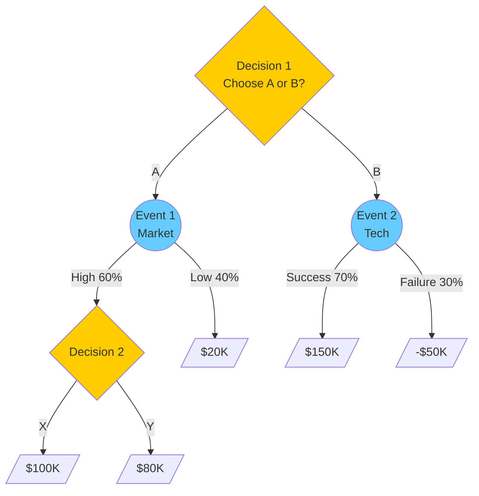
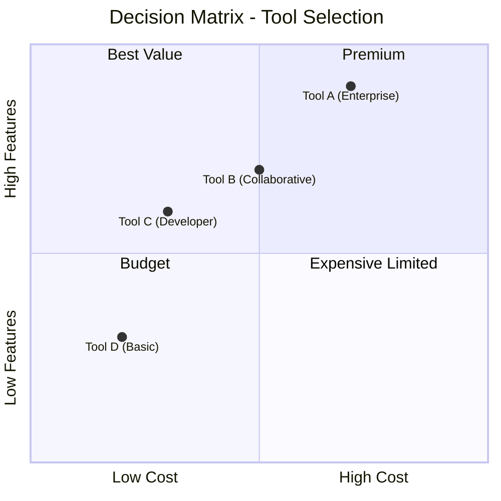

# Decision Analysis（决策分析）

使用结构化技术对复杂决策进行建模与分析：decision table、加权评分矩阵、决策树。产出清晰、可辩护、理由可追溯的决策框架。

## 什么是 Decision Analysis？

**Decision Analysis（决策分析）** 是一种系统化方法，把复杂选择拆解为：目标、备选项、准则、取舍。它把主观判断转化为结构化、透明的推理。

| 技术 | 适用场景 | 产出 |
|-----------|----------|--------|
| **Decision Table** | 规则型逻辑、条件多 | 基于条件组合的动作 |
| **Weighted Scoring Matrix** | 多准则比较 | 有分值的备选项排名 |
| **Decision Tree** | 序贯决策、有不确定性 | 带概率的最优路径 |
| **Pugh Matrix** | 概念选型、设计决策 | 相对基线的最佳概念 |

## 技术 1：Decision Table（决策表）

### 什么是 Decision Table？

**Decision table（决策表）** 以紧凑的网格格式捕获复杂的条件逻辑。它列出所有条件组合及其对应的动作。

| 组成 | 描述 | 示例 |
|-----------|-------------|---------|
| **Conditions** | 输入变量/状态 | Customer type、Order value |
| **Actions** | 结果/响应 | Apply discount、Require approval |
| **Rules** | 条件组合 | IF Premium AND >$1000 THEN 20% off |

### Decision Table 工作流

#### Step 1：识别 Condition 与 Action

```markdown
## Decision Context

**Decision:** [What are we deciding?]
**Trigger:** [When is this decision made?]

### Conditions (Inputs)
| # | Condition | Possible Values |
|---|-----------|-----------------|
| C1 | [Condition 1] | [Value A / Value B / ...] |
| C2 | [Condition 2] | [Yes / No] |
| C3 | [Condition 3] | [Low / Medium / High] |

### Actions (Outputs)
| # | Action | Description |
|---|--------|-------------|
| A1 | [Action 1] | [What happens] |
| A2 | [Action 2] | [What happens] |
```

#### Step 2：构建 Decision Table

```markdown
## Decision Table: [Name]

| Rule | C1 | C2 | C3 | A1 | A2 |
|------|----|----|----|----|----|
| R1 | Premium | Yes | High | X | - |
| R2 | Premium | Yes | Low | X | X |
| R3 | Standard | Yes | - | - | X |
| R4 | Standard | No | High | - | - |
| R5 | - | No | Low | - | X |

**Legend:** X = Execute action, - = Skip, [blank] = Any value
```

#### Step 3：校验完整性

| 检查 | 问题 | 通过？ |
|-------|----------|-------|
| **Completeness（完整性）** | 所有条件组合是否覆盖？ | ☐ |
| **Consistency（一致性）** | 是否存在相互矛盾的规则？ | ☐ |
| **Uniqueness（唯一性）** | 每个组合是否只映射到一个结果？ | ☐ |
| **Simplification（可简化）** | 规则能否合并？ | ☐ |

### Decision Table 模板

```markdown
## Decision Table: [Decision Name]

**Context:** [Business context]
**Owner:** [Decision owner]
**Last Updated:** [ISO date]

### Conditions
| ID | Condition | Values |
|----|-----------|--------|
| C1 | | |
| C2 | | |

### Actions
| ID | Action | Description |
|----|--------|-------------|
| A1 | | |
| A2 | | |

### Rules
| Rule | C1 | C2 | → | A1 | A2 | Notes |
|------|----|----|---|----|----|-------|
| R1 | | | | | | |
| R2 | | | | | | |

### Validation
- [ ] All combinations covered
- [ ] No contradictions
- [ ] Rules simplified
```

## 技术 2：Weighted Scoring Matrix（加权评分矩阵）

### 什么是 Weighted Scoring Matrix？

**Weighted scoring matrix（加权评分矩阵）**（又称 decision matrix 或 Pugh matrix），针对加权准则评估多个备选项，产出排名列表。

| 组成 | 描述 |
|-----------|-------------|
| **Alternatives** | 被比较的备选项 |
| **Criteria** | 评估维度 |
| **Weights** | 各准则的重要性（加总为 100%） |
| **Scores** | 每个备选项在每个准则上的打分 |
| **Weighted Score** | Score × Weight，按准则求和 |

### Weighted Scoring 工作流

#### Step 1：定义决策

```markdown
## Decision Context

**Decision:** [What are we choosing?]
**Objective:** [What outcome do we want?]
**Constraints:** [Non-negotiable requirements]
**Timeline:** [When must we decide?]
```

#### Step 2：识别备选项

```markdown
## Alternatives

| # | Alternative | Description | Source |
|---|-------------|-------------|--------|
| A | [Option A] | [Brief description] | [How identified] |
| B | [Option B] | [Brief description] | [How identified] |
| C | [Option C] | [Brief description] | [How identified] |
```

#### Step 3：定义并赋权准则

```markdown
## Criteria

| # | Criterion | Description | Weight | Rationale |
|---|-----------|-------------|--------|-----------|
| 1 | [Criterion 1] | [What it measures] | 30% | [Why this weight] |
| 2 | [Criterion 2] | [What it measures] | 25% | [Why this weight] |
| 3 | [Criterion 3] | [What it measures] | 25% | [Why this weight] |
| 4 | [Criterion 4] | [What it measures] | 20% | [Why this weight] |
|   | **Total** | | **100%** | |
```

**赋权方法：**

| 方法 | 描述 | 何时使用 |
|--------|-------------|-------------|
| **Direct Assignment（直接赋权）** | stakeholder 直接给权重 | 优先级清晰、经验丰富的团队 |
| **Pairwise Comparison（两两比较）** | 比较准则两两大小（AHP） | 优先级不清、需要共识 |
| **Ranking（排序法）** | 对准则排序再转权重 | 快速、近似 |
| **Equal Weights（等权）** | 所有准则等权 | 无明确优先级、初步分析 |

#### Step 4：对备选项打分

```markdown
## Scoring Scale

| Score | Meaning |
|-------|---------|
| 5 | Excellent - Fully meets/exceeds criterion |
| 4 | Good - Mostly meets criterion |
| 3 | Adequate - Partially meets criterion |
| 2 | Poor - Minimally meets criterion |
| 1 | Unacceptable - Does not meet criterion |
```

#### Step 5：计算加权分值

```markdown
## Decision Matrix

| Criterion | Weight | Alt A | Alt B | Alt C |
|-----------|--------|-------|-------|-------|
| Criterion 1 | 30% | 4 | 3 | 5 |
| Criterion 2 | 25% | 3 | 5 | 4 |
| Criterion 3 | 25% | 5 | 4 | 3 |
| Criterion 4 | 20% | 4 | 4 | 4 |
| **Weighted Score** | | **3.95** | **3.95** | **4.05** |
| **Rank** | | 2 | 3 | 1 |

**Calculation:** Weighted Score = Σ(Score × Weight)
```

#### Step 6：敏感性分析

测试权重变化时结果如何变化：

```markdown
## Sensitivity Analysis

| Scenario | Weight Change | Winner | Confidence |
|----------|---------------|--------|------------|
| Baseline | As defined | Alt C | - |
| Cost +10% | C1: 40%, others adjusted | Alt A | Low |
| Quality +10% | C2: 35%, others adjusted | Alt C | High |

**Robustness:** [Is the winner stable across scenarios?]
```

### Pugh Matrix（概念选型）

一种把备选项与基线比较的特殊评分矩阵：

```markdown
## Pugh Matrix: [Decision]

**Baseline:** [Reference option - usually current state or simplest option]

| Criterion | Weight | Alt A vs Baseline | Alt B vs Baseline | Alt C vs Baseline |
|-----------|--------|-------------------|-------------------|-------------------|
| Criterion 1 | 30% | + | S | ++ |
| Criterion 2 | 25% | - | + | S |
| Criterion 3 | 25% | S | + | - |
| Criterion 4 | 20% | + | S | + |
| **Σ Plus** | | 2 | 2 | 2 |
| **Σ Minus** | | 1 | 0 | 1 |
| **Σ Same** | | 1 | 2 | 1 |
| **Net Score** | | +1 | +2 | +1 |

**Legend:** ++ Much better, + Better, S Same, - Worse, -- Much worse
```

## 技术 3：Decision Tree（决策树）

### 什么是 Decision Tree？

**Decision tree（决策树）** 把序贯决策和不确定事件映射出来，可视化所有可能路径与结果。适合多阶段或带概率的决策。

| 节点类型 | 符号 | 描述 |
|-----------|--------|-------------|
| **Decision Node（决策节点）** | □ | 你能控制的选择点 |
| **Chance Node（机会节点）** | ○ | 不确定事件（带概率） |
| **End Node（终点节点）** | △ | 最终结果（带值） |

### Decision Tree 工作流

#### Step 1：界定决策

```markdown
## Decision Tree Context

**Decision:** [Primary decision]
**Objective:** [What we're optimizing - NPV, utility, etc.]
**Time Horizon:** [How far into future]
**Key Uncertainties:** [Major unknown factors]
```

#### Step 2：识别决策点与不确定性

```markdown
## Structure

### Decision Points
| # | Decision | Options |
|---|----------|---------|
| D1 | [First decision] | Option A, Option B |
| D2 | [Subsequent decision] | Option X, Option Y |

### Chance Events
| # | Event | Outcomes | Probabilities |
|---|-------|----------|---------------|
| E1 | [Uncertainty 1] | High, Low | 60%, 40% |
| E2 | [Uncertainty 2] | Success, Failure | 70%, 30% |
```

#### Step 3：赋值与赋概率

```markdown
## Outcomes

| Path | Sequence | Probability | Value | Expected Value |
|------|----------|-------------|-------|----------------|
| P1 | D1:A → E1:High → D2:X | 0.60 | $100K | $60K |
| P2 | D1:A → E1:High → D2:Y | 0.60 | $80K | $48K |
| P3 | D1:A → E1:Low | 0.40 | $20K | $8K |
| P4 | D1:B → E2:Success | 0.70 | $150K | $105K |
| P5 | D1:B → E2:Failure | 0.30 | -$50K | -$15K |
```

#### Step 4：计算期望值（回溯 Rollback）

从终点节点反向推：

```markdown
## Rollback Analysis

### Chance Node E1 (after D1:A)
EV = (0.60 × max($100K, $80K)) + (0.40 × $20K)
EV = (0.60 × $100K) + $8K = $68K

### Chance Node E2 (after D1:B)
EV = (0.70 × $150K) + (0.30 × -$50K)
EV = $105K - $15K = $90K

### Decision Node D1
Choose B: EV = $90K > $68K

**Recommendation:** Choose Option B
```

### Decision Tree Mermaid 图



## DMN-Lite：Decision Model Notation

对简单、可重复的决策，使用轻量级 DMN 方式：

```markdown
## Decision: [Name]

**Decision ID:** DEC-001
**Business Context:** [When this decision is made]

### Input Data
| Input | Type | Source |
|-------|------|--------|
| Customer Segment | Text | CRM |
| Order Value | Currency | Order System |
| Credit Score | Number | Credit Bureau |

### Decision Logic

```text
IF Customer Segment = "Premium" AND Order Value > 1000
  THEN Discount = 20%
ELSE IF Customer Segment = "Premium"
  THEN Discount = 10%
ELSE IF Order Value > 5000
  THEN Discount = 15%
ELSE
  THEN Discount = 0%
```

### Output（输出）

| Output | Type | Range |
|--------|------|-------|
| Discount | Percentage | 0% - 20% |

## 输出格式

### 叙述式摘要

```markdown
## Decision Analysis Summary

**Decision:** [What was decided]
**Date:** [ISO date]
**Analyst:** decision-analyst

### Context
[2-3 sentences on why this decision was needed]

### Approach
- **Technique Used:** [Decision Table / Weighted Matrix / Decision Tree]
- **Alternatives Considered:** [Count and brief list]
- **Criteria Applied:** [Count and key criteria]

### Recommendation
**Recommended Option:** [Name]
**Rationale:** [Key reasons - 2-3 points]
**Confidence:** High / Medium / Low

### Key Trade-offs
| Factor | Recommended Option | Runner-up |
|--------|-------------------|-----------|
| [Factor 1] | [Assessment] | [Assessment] |
| [Factor 2] | [Assessment] | [Assessment] |

### Risks and Mitigations
| Risk | Likelihood | Impact | Mitigation |
|------|------------|--------|------------|
| [Risk 1] | H/M/L | H/M/L | [Action] |

### Next Steps
1. [Immediate action]
2. [Follow-up action]
```

### 结构化数据（YAML）

```yaml
decision_analysis:
  version: "1.0"
  date: "2025-01-15"
  analyst: "decision-analyst"

  context:
    decision: "Select project management tool"
    objective: "Maximize team productivity while minimizing cost"
    constraints:
      - "Budget under $500/month"
      - "Must integrate with team messaging platform"
    timeline: "Decision by end of Q1"

  technique: "weighted_scoring_matrix"

  alternatives:
    - id: A
      name: "Tool A (Enterprise)"
      description: "Enterprise-grade, feature-rich work item tracking"
    - id: B
      name: "Tool B (Collaborative)"
      description: "User-friendly, good collaboration features"
    - id: C
      name: "Tool C (Developer-Focused)"
      description: "Modern, developer-focused interface"

  criteria:
    - id: C1
      name: "Ease of Use"
      weight: 0.30
      rationale: "Team adoption is critical"
    - id: C2
      name: "Feature Set"
      weight: 0.25
      rationale: "Must handle complex workflows"
    - id: C3
      name: "Integration"
      weight: 0.25
      rationale: "Slack integration required"
    - id: C4
      name: "Cost"
      weight: 0.20
      rationale: "Within budget constraint"

  scores:
    - alternative: A
      scores: {C1: 3, C2: 5, C3: 4, C4: 3}
      weighted_total: 3.75
    - alternative: B
      scores: {C1: 5, C2: 4, C3: 5, C4: 4}
      weighted_total: 4.50
    - alternative: C
      scores: {C1: 4, C2: 4, C3: 3, C4: 5}
      weighted_total: 3.95

  ranking:
    - rank: 1
      alternative: B
      score: 4.50
    - rank: 2
      alternative: C
      score: 3.95
    - rank: 3
      alternative: A
      score: 3.75

  sensitivity:
    - scenario: "Cost weight +10%"
      winner: C
      stable: false
    - scenario: "Ease of Use weight +10%"
      winner: B
      stable: true

  recommendation:
    choice: B
    confidence: high
    rationale:
      - "Highest weighted score (4.50)"
      - "Stable across sensitivity scenarios"
      - "Best ease of use for team adoption"

  risks:
    - description: "Asana pricing may increase"
      likelihood: medium
      impact: low
      mitigation: "Negotiate annual contract"
```

### 决策矩阵的 Mermaid 可视化



## 何时使用

| 场景 | 技术 |
|----------|-----------|
| 条件多的规则型逻辑 | Decision Table |
| 基于准则比较多个选项 | Weighted Scoring Matrix |
| 带不确定性的序贯决策 | Decision Tree |
| 相对基线的概念选型 | Pugh Matrix |
| 简单可重复的业务规则 | DMN-Lite |
| 快速做相对比较 | Pugh Matrix |
| 需要 stakeholder 共识 | Weighted Scoring（透明） |

## 集成

### 上游

- **stakeholder-analysis** — 识别决策者与准则来源
- **root-cause-analysis** — 在选方案前先理解问题
- **swot-pestle-analysis** — 决策的战略上下文

### 下游

- **Requirements** — 决策驱动需求优先级
- **Risk registers** — 记录决策相关风险
- **Implementation plans** — 执行所选方案

## 相关 skill

- `prioritization` — MoSCoW、Kano 等功能优先级方法
- `risk-analysis` — 对备选项做风险评估
- `root-cause-analysis` — 选型前的问题分析
- `business-model-canvas` — 战略型商业决策
- `stakeholder-analysis` — 决策者识别

## 版本历史

- **v1.0.0**（2025-12-26）：首次发布
