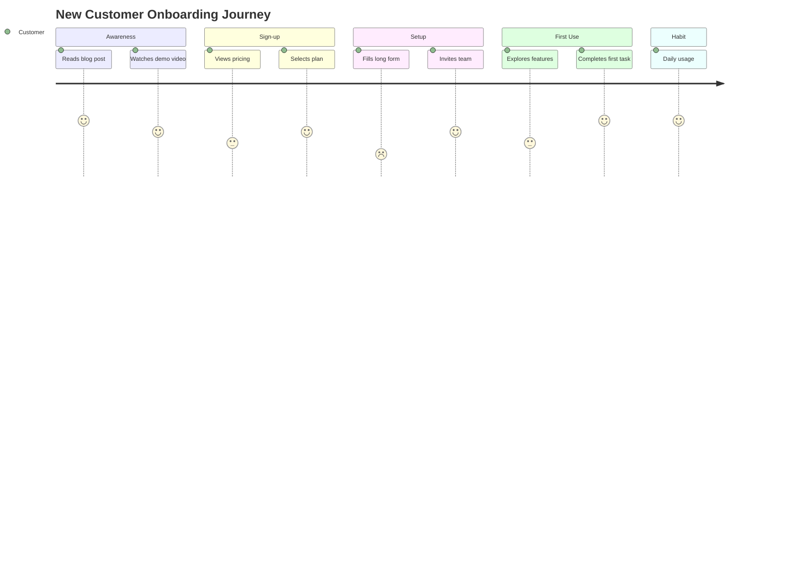
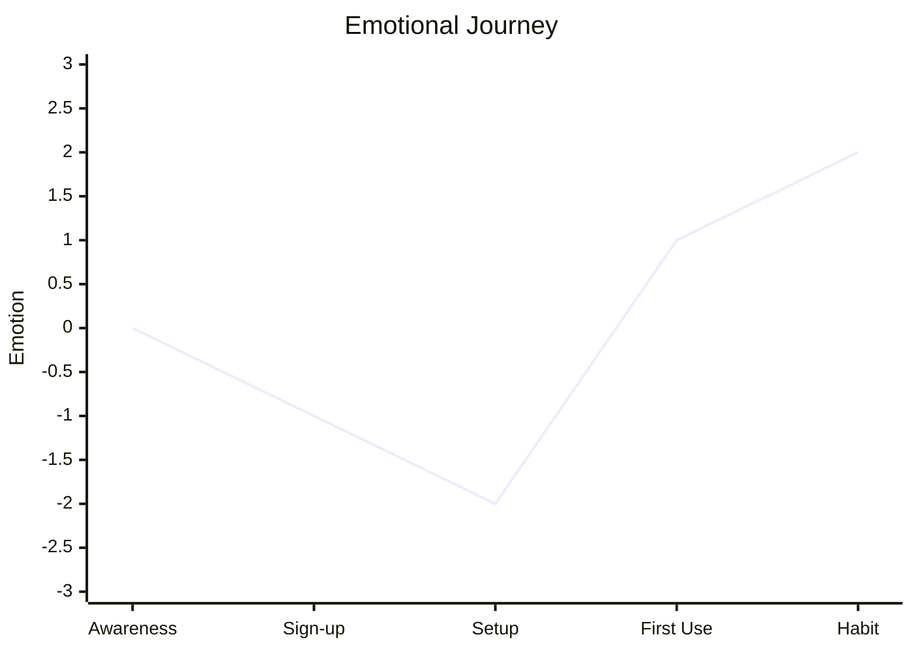

# Journey Mapping（旅程地图）

绘制用户与客户旅程地图，用于理解体验、识别痛点、发现改进机会。是对聚焦流程的 value stream mapping 的一种以人为中心的补充。

## 什么是 Journey Map？

**Journey map（旅程地图）** 把用户完成某个目标的过程，按时间线可视化地呈现其体验。与流程图（展示"发生了什么"）不同，旅程地图展示的是用户视角下**"感受如何"**。

| 元素 | 定义 | 目的 |
|---------|------------|---------|
| **Persona** | 走这段旅程的是谁 | 聚焦具体用户类型 |
| **Phases** | 旅程的主要阶段 | 组织整段体验 |
| **Touchpoints** | 与系统的交互点 | 识别接触点 |
| **Actions** | 用户做了什么 | 理解行为 |
| **Thoughts** | 用户在想什么 | 理解心理 |
| **Emotions** | 用户感觉如何 | 识别情绪高低点 |
| **Pain Points** | 阻力与挫败 | 瞄准改进目标 |
| **Opportunities** | 改进途径 | 对改进排序 |

## 旅程类型

| 类型 | 范围 | 何时使用 |
|------|-------|-------------|
| **Current State（现状）** | 如今是怎样 | 识别问题 |
| **Future State（未来态）** | 期望的体验 | 设计方案 |
| **Day-in-the-Life（一日切片）** | 跨场景的完整一天 | 理解更大的上下文 |
| **Service Blueprint（服务蓝图）** | 旅程 + 后台运营 | 设计服务交付 |

## 工作流

### Phase 1：准备

#### Step 1：定义旅程范围

```markdown
## Journey Definition

**Journey Name:** New Customer Onboarding
**Persona:** Sarah - First-time SaaS Buyer
**Goal:** Successfully adopt the product and get first value
**Trigger:** Signs up for trial
**End State:** Completes first project successfully
**Time Frame:** First 30 days
```

#### Step 2：选择或创建 Persona

```markdown
## Persona: Sarah - First-time SaaS Buyer

**Demographics:**
- Age: 32
- Role: Marketing Manager
- Company: Mid-size B2B
- Tech Savviness: Moderate

**Goals:**
- Streamline team workflows
- Prove ROI to leadership
- Look good to her team

**Frustrations:**
- Limited time to learn new tools
- Past bad experiences with complex software
- Pressure to show quick results

**Quote:** "I need something that works out of the box."
```

### Phase 2：绘制旅程

#### Step 1：识别阶段

典型的旅程阶段：

| 领域 | 常见阶段 |
|--------|---------------|
| **Purchase（购买）** | Awareness → Consideration → Decision → Purchase |
| **Onboarding（初始体验）** | Sign-up → Setup → First Use → Habit Formation |
| **Support（支持）** | Issue → Search → Contact → Resolution → Follow-up |
| **Renewal（续约）** | Review → Evaluate → Negotiate → Renew/Churn |

#### Step 2：绘制 touchpoint 与 action

对每个阶段：

```markdown
## Phase: Setup

### Touchpoints
- Welcome email
- Product UI (setup wizard)
- Help documentation
- Onboarding video

### Actions
1. Opens welcome email
2. Clicks "Get Started"
3. Enters company info
4. Invites team members
5. Configures first workspace
```

#### Step 3：记录想法与情绪

```markdown
## Phase: Setup - Experience

| Step | Thought | Emotion | Intensity |
|------|---------|---------|-----------|
| Opens email | "Let's see if this is worth it" | Curious, skeptical | Neutral |
| Clicks Get Started | "Okay, here we go" | Hopeful | Slightly positive |
| Company info form | "Why so many fields?" | Frustrated | Negative |
| Invites team | "Easy enough" | Relieved | Positive |
| First workspace | "This is actually nice!" | Pleased | Very positive |
```

#### Step 4：识别痛点

```markdown
## Pain Points - Setup Phase

| Pain Point | Severity | Evidence | Root Cause |
|------------|----------|----------|------------|
| Too many required fields | High | Drop-off data, complaints | Legacy form design |
| Unclear field labels | Medium | Support tickets | Jargon-heavy copy |
| No save-and-continue | High | Abandoned setups | Technical limitation |
| Team invite confusion | Medium | Support volume | Poor UX |
```

#### Step 5：识别机会

```markdown
## Opportunities - Setup Phase

| Opportunity | Impact | Effort | Priority |
|-------------|--------|--------|----------|
| Progressive disclosure (fewer upfront fields) | High | Low | 1 |
| Save progress functionality | High | Medium | 2 |
| Contextual help tooltips | Medium | Low | 3 |
| Interactive setup tutorial | Medium | High | 4 |
```

### Phase 3：把旅程可视化

#### 标准旅程地图格式

```text
PHASE:      | Awareness    | Sign-up      | Setup        | First Use    | Habit
------------|--------------|--------------|--------------|--------------|--------
TOUCHPOINTS | Ads, blog    | Landing page | Email, UI    | Product      | Product
            |              | pricing page | docs         |              | email
------------|--------------|--------------|--------------|--------------|--------
ACTIONS     | Researches   | Compares     | Creates      | Explores     | Daily
            | solutions    | plans        | account      | features     | usage
------------|--------------|--------------|--------------|--------------|--------
THOUGHTS    | "Is there    | "Which plan  | "This is     | "How do I    | "This
            | a better     | is right?"   | taking       | do X?"       | saves
            | way?"        |              | too long"    |              | time"
------------|--------------|--------------|--------------|--------------|--------
EMOTIONS    |     😐       |      🤔      |      😣      |      😕      |     😊
            |  Neutral     |   Uncertain  |  Frustrated  |   Confused   |  Happy
------------|--------------|--------------|--------------|--------------|--------
PAIN POINTS | Too many     | Pricing      | Long form    | Feature      | None
            | options      | confusion    | No save      | discoverability
------------|--------------|--------------|--------------|--------------|--------
OPPORTUN-   | Clear        | Simpler      | Reduce       | Better       | Celebrate
ITIES       | comparisons  | pricing      | friction     | onboarding   | wins
```

### Phase 4：情绪曲线

可视化情绪的高点与低点：

```text
EMOTION
  😊 +2  |                                              ___/
  😌 +1  |         ___/\                              /
  😐  0  |____/\__/      \            ___           /
  😕 -1  |                \          /   \__      _/
  😣 -2  |                 \________/          \_/

         |--Awareness--|--Sign-up--|--Setup--|--First Use--|--Habit--|
                                      ↑
                               Pain Point: Long form
```

### Phase 5：识别 Moments of Truth

**Moments of Truth（关键时刻）** 是对整体体验有不成比例巨大影响的关键交互：

| 类型 | 定义 | 示例 |
|-------------|------------|---------|
| **Zero Moment of Truth（ZMOT）** | 购买前的调研 | 查看评价 |
| **First Moment of Truth（FMOT）** | 初次相遇 | 落地页 |
| **Second Moment of Truth（SMOT）** | 使用产品时 | 第一次走完工作流 |
| **Ultimate Moment of Truth（UMOT）** | 分享体验 | 推荐/评价 |

```markdown
## Moments of Truth

| Moment | Phase | Current Experience | Desired Experience |
|--------|-------|-------------------|-------------------|
| FMOT | Landing | Overwhelming options | Clear value prop |
| SMOT | First Use | Confusion, need help | Guided success |
| UMOT | Habit | No celebration | Achievement sharing |
```

## 输出格式

### 叙述式摘要

```markdown
## Journey Map Summary

**Journey:** [Name]
**Persona:** [Name]
**Date:** [ISO date]
**Analyst:** journey-facilitator

### Journey Overview
[2-3 sentence summary of the end-to-end experience]

### Emotional Journey
- **Highest Point:** [Phase] - [Why]
- **Lowest Point:** [Phase] - [Why]
- **Overall Arc:** [Description]

### Critical Pain Points
1. **[Pain Point]** (Phase: [X]) - [Impact and evidence]
2. **[Pain Point]** (Phase: [X]) - [Impact and evidence]

### Top Opportunities
1. **[Opportunity]** - Impact: High, Effort: Low
2. **[Opportunity]** - Impact: High, Effort: Medium

### Moments of Truth
- **Make or Break Moment:** [Description]
- **Current State:** [Assessment]
- **Recommendation:** [Action]
```

### 结构化数据（YAML）

```yaml
journey_map:
  name: "New Customer Onboarding"
  version: "1.0"
  date: "{ISO-8601-date}"
  analyst: "journey-facilitator"
  type: current_state

  persona:
    name: "Sarah"
    archetype: "First-time SaaS Buyer"
    goals:
      - "Get value quickly"
      - "Look good to leadership"
    frustrations:
      - "Limited time"
      - "Complex tools"

  journey:
    goal: "Successfully adopt and get first value"
    trigger: "Signs up for trial"
    end_state: "Completes first project"
    time_frame: "30 days"

  phases:
    - name: "Awareness"
      order: 1
      touchpoints:
        - channel: "Web"
          type: "Blog post"
        - channel: "Email"
          type: "Marketing email"
      actions:
        - "Researches solutions"
        - "Reads comparison articles"
      thoughts:
        - "Is there a better way?"
      emotions:
        overall: neutral
        intensity: 0
      pain_points: []
      opportunities:
        - name: "Clear comparison content"
          impact: medium
          effort: low

    - name: "Setup"
      order: 3
      touchpoints:
        - channel: "Email"
          type: "Welcome email"
        - channel: "Product"
          type: "Setup wizard"
      actions:
        - "Opens welcome email"
        - "Starts setup wizard"
        - "Enters company info"
      thoughts:
        - "This is taking too long"
        - "Why so many fields?"
      emotions:
        overall: frustrated
        intensity: -2
      pain_points:
        - description: "Long form with many required fields"
          severity: high
          evidence: "40% drop-off rate"
        - description: "No save-and-continue"
          severity: high
          evidence: "Support tickets"
      opportunities:
        - name: "Progressive disclosure"
          impact: high
          effort: low
        - name: "Save progress"
          impact: high
          effort: medium

  moments_of_truth:
    - type: "First Moment (FMOT)"
      phase: "Sign-up"
      current_state: "Overwhelming options"
      desired_state: "Clear value proposition"
      priority: high

    - type: "Second Moment (SMOT)"
      phase: "First Use"
      current_state: "Confusion, needs help"
      desired_state: "Guided success path"
      priority: high

  summary:
    emotion_arc: "Curious → Frustrated → Confused → Satisfied"
    highest_point:
      phase: "Habit"
      reason: "Realizes time savings"
    lowest_point:
      phase: "Setup"
      reason: "Long form, no progress saving"
    top_recommendation: "Reduce setup friction through progressive disclosure"
```

### Mermaid 图

**Journey Flow：**



**情绪曲线（Mermaid XYChart）：**



## 多 persona 工作坊

做全面的旅程分析时，并行运行多个 persona agent：

| Persona Agent | 视角 | 关注点 |
|---------------|-------------|-------|
| `first-time-user-persona` | 产品新用户 | 初始体验的摩擦 |
| `power-user-persona` | 老练用户 | 进阶需求 |
| `admin-persona` | 管理方 | 配置、监管 |
| `support-seeker-persona` | 需要帮助的用户 | 支持体验 |

## 何时使用

| 场景 | 是否使用 Journey Mapping？ |
|----------|---------------------|
| UX 重设计 | 是 — 理解现状体验 |
| 服务设计 | 是 — 设计端到端体验 |
| 客户投诉 | 是 — 找出痛点 |
| 初始体验优化 | 是 — 提升转化 |
| 流程改进 | 部分 — 与 VSM 搭配使用 |
| 技术架构 | 否 — 抽象层级不对 |

## 集成

### 上游

- **stakeholder-analysis** — 理解用户相关的 stakeholder
- **process-modeling** — 流程上下文
- **Persona research** — 用户研究输入

### 下游

- **Requirements** — 体验类需求
- **UX design** — 设计改进
- **value-stream-mapping** — 运营改进

## 相关 skill

- `value-stream-mapping` — 流程效率视角
- `stakeholder-analysis` — stakeholder 需求
- `capability-mapping` — 能力接触点
- `root-cause-analysis` — 调查痛点的根因
- `prioritization` — 对机会排序
- `decision-analysis` — 评估改进方案

## 版本历史

- **v1.0.0**（2025-12-26）：首次发布
