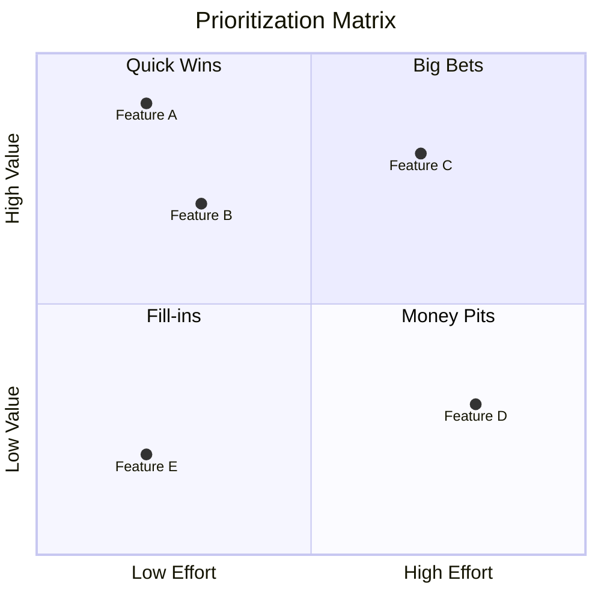
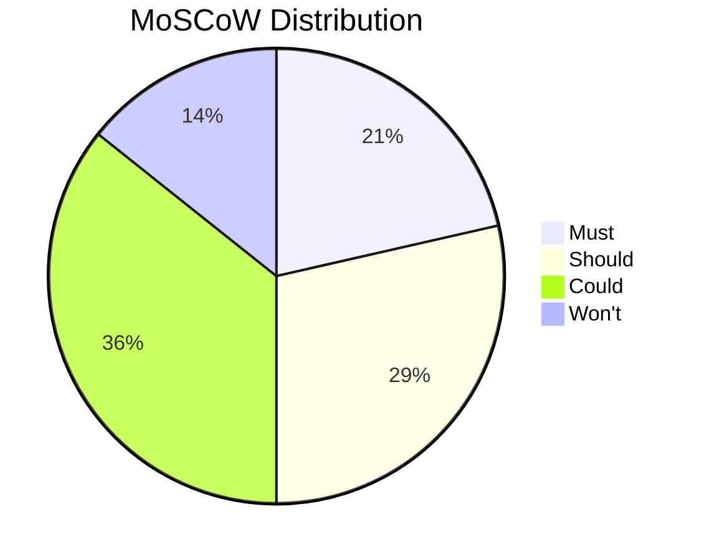

# Prioritization（优先级排序）

使用成熟的优先级框架系统性地对需求、feature、backlog item 与 initiative 进行排序。支持 MoSCoW、Kano 模型、加权评分与 value-effort 分析。

## 什么是 Prioritization？

**Prioritization（优先级排序）** 是判定各项事项的相对重要性与先后顺序、把资源集中投入到最重要事项的过程。有效的优先级排序需要平衡：

- **Value（价值）**：对客户或业务的收益
- **Effort（投入）**：成本、时间与资源
- **Risk（风险）**：不确定性与潜在的负面影响
- **Dependencies（依赖）**：约束与先后顺序

## 优先级排序技法

### MoSCoW 方法

面向时间盒交付的分类式优先级排序：

| 类别 | 定义 | 说明 |
|----------|------------|----------|
| **Must** | 不可妥协、成败必备 | 没有它，交付即失败 |
| **Should** | 重要但非关键 | 价值显著，有变通方案 |
| **Could** | 资源允许时就做 | 锦上添花 |
| **Won't** | 这次明确不做 | 当前不做，以后再说 |

**适用场景：** sprint 规划、发布范围界定、MVP 定义、时间盒项目

**规则：**

- Must 项应约占产能的 60%（为未知留余量）
- Won't 必须明确声明（而不是悄悄省掉）
- 类别是相对于该时间盒的，不是绝对的

### Kano 模型

基于客户满意度的分类：

| 类别 | 如果具备 | 如果缺失 | 识别方式 |
|----------|------------|-----------|-----------|
| **Basic（必备型）** | 满意度不提升 | 强烈不满 | 客户默认它存在 |
| **Performance（线性型）** | 满意度线性增加 | 不满线性增加 | 客户会明确提出 |
| **Delighter（兴奋型）** | 大幅提升满意度 | 不造成不满 | 客户预期不到 |
| **Indifferent（无差别型）** | 无影响 | 无影响 | 客户无反应 |
| **Reverse（反向型）** | 造成不满 | 提升满意 | 某些客户反而不喜欢 |

**适用场景：** 产品 feature 优先级、理解客户需求、与竞品做差异化

**Kano 问卷：**

- Functional（正向）："如果具备该 feature，你会有什么感受？"
- Dysfunctional（反向）："如果缺失该 feature，你会有什么感受？"

**选项：** 喜欢、期待、中性、可以接受、讨厌

### 加权评分矩阵

多维度量化对比：

#### 步骤 1：定义评估维度

| 维度 | 权重 | 描述 |
|-----------|--------|-------------|
| Customer Value | 40% | 对客户满意度的影响 |
| Strategic Fit | 25% | 与目标的对齐度 |
| Effort | 20% | 开发成本（反向） |
| Risk | 15% | 不确定性/失败可能（反向） |

#### 步骤 2：对每项打分

| 事项 | Customer Value (1-5) | Strategic Fit (1-5) | Effort (1-5) | Risk (1-5) | 加权分 |
|------|---------------------|---------------------|--------------|------------|----------------|
| A | 5 | 4 | 3 | 4 | 4.15 |
| B | 3 | 5 | 4 | 3 | 3.75 |

#### 步骤 3：计算加权分

```text
Score = Σ (Weight × Score)
Item A = (0.40×5) + (0.25×4) + (0.20×3) + (0.15×4) = 4.20
```

**适用场景：** 复杂权衡、多 stakeholder、需要可辩护的决策

### Value vs Effort 矩阵

用于快速决策的 2×2 优先级矩阵：

```mermaid
quadrantChart
    title Value vs Effort
    x-axis Low Effort --> High Effort
    y-axis Low Value --> High Value
    quadrant-1 Big Bets (Plan carefully)
    quadrant-2 Quick Wins (Do first)
    quadrant-3 Fill-ins (Do if time permits)
    quadrant-4 Money Pits (Avoid)
```

| 象限 | Value | Effort | 行动 |
|----------|-------|--------|--------|
| Quick Wins | 高 | 低 | 优先做 |
| Big Bets | 高 | 高 | 审慎规划 |
| Fill-ins | 低 | 低 | 有空就做 |
| Money Pits | 低 | 高 | 回避或降优先级 |

**适用场景：** 快速初筛、backlog grooming、stakeholder 对齐

### RICE 打分法

产品管理常用的优先级排序：

| 因素 | 定义 | 计算 |
|--------|------------|-------------|
| **R**each | 影响的用户/客户数 | 每个时间段的数量 |
| **I**mpact | 对每个用户的影响 | 0.25（极小）到 3（巨大） |
| **C**onfidence | 估计的置信度 | 0.5（低）到 1（高） |
| **E**ffort | 所需人月 | 数字 |

```text
RICE Score = (Reach × Impact × Confidence) / Effort
```

**适用场景：** 产品 roadmap 优先级、feature 对比

### WSJF（Weighted Shortest Job First）

SAFe/Lean 中用于 flow 的优先级排序：

```text
WSJF = Cost of Delay / Job Duration

Cost of Delay = User/Business Value + Time Criticality + Risk Reduction
```

| 因素 | 分值 (1-20) | 描述 |
|--------|--------------|-------------|
| User/Business Value | 1-20 | 对用户或业务的收益 |
| Time Criticality | 1-20 | 紧迫程度、deadline、价值衰减 |
| Risk Reduction | 1-20 | 化解的风险/机会 |
| Job Duration | 1-20 | 相对规模（取反向） |

**适用场景：** 持续 flow 环境、最大化价值交付

## 工作流

### Phase 1：准备

#### 步骤 1：汇集待排序的事项

```markdown
## Prioritization Session

**Date:** [ISO date]
**Scope:** [What's being prioritized]
**Stakeholders:** [Who's involved]
**Constraint:** [Timebox, budget, capacity]

### Items

| ID | Description | Owner |
|----|-------------|-------|
| 1 | [Item 1] | [Name] |
| 2 | [Item 2] | [Name] |
```

#### 步骤 2：选择优先级技法

| 场景 | 推荐技法 |
|-----------|----------------------|
| Sprint/发布规划 | MoSCoW |
| 产品 feature 决策 | Kano + RICE |
| 权衡式决策 | Weighted Scoring |
| 快速初筛 | Value vs Effort |
| 持续 flow | WSJF |
| 多维度 | Weighted Scoring |

### Phase 2：执行

#### 步骤 1：套用选定的技法

按该技法的具体工作流执行（见上文）。

#### 步骤 2：校验结果

- 头部优先级是否与战略一致？
- 依赖关系是否被尊重？
- 团队是否有产能？
- stakeholder 是否对齐？

#### 步骤 3：记录理由

```markdown
## Prioritization Rationale

### Top Priorities

1. **[Item A]** - Score: X
   - Rationale: [Why this is top priority]
   - Dependencies: [What it depends on]

2. **[Item B]** - Score: Y
   - Rationale: [Why this is second]
   - Dependencies: [What it depends on]

### Deferred Items

- **[Item C]** - Reason: [Why deferred]
```

### Phase 3：沟通

#### 步骤 1：产出排序后的 backlog

```markdown
## Prioritized Backlog

| Rank | Item | Priority/Score | Owner | Target |
|------|------|----------------|-------|--------|
| 1 | [Item A] | Must / 4.5 | [Name] | Sprint 1 |
| 2 | [Item B] | Must / 4.2 | [Name] | Sprint 1 |
| 3 | [Item C] | Should / 3.8 | [Name] | Sprint 2 |
```

#### 步骤 2：同步决策

- 把排序结果告知 stakeholder
- 解释关键决策背后的理由
- 回应被降优先级的事项引发的担忧
- 对"不在范围内"的部分设定预期

## 输出格式

### 叙述式摘要

```markdown
## Prioritization Summary

**Session:** [Scope/context]
**Date:** [ISO date]
**Technique:** [MoSCoW/Kano/Weighted Scoring/etc.]
**Facilitator:** prioritization-analyst

### Results Overview

- **Total Items:** N
- **Top Priority:** [Count]
- **Deferred:** [Count]

### Priority Distribution

| Category | Count | % |
|----------|-------|---|
| Must/Quick Wins | X | Y% |
| Should/Big Bets | X | Y% |
| Could/Fill-ins | X | Y% |
| Won't/Money Pits | X | Y% |

### Key Decisions

1. **[Top Item]**: Prioritized because [reason]
2. **[Deferred Item]**: Deferred because [reason]

### Next Steps

1. Begin work on top priority items
2. Re-prioritize at [next review point]
```

### 结构化数据（YAML）

```yaml
prioritization:
  version: "1.0"
  date: "2025-01-15"
  scope: "Q1 Feature Backlog"
  technique: "weighted_scoring"
  facilitator: "prioritization-analyst"

  criteria:
    - name: "Customer Value"
      weight: 0.40
    - name: "Strategic Fit"
      weight: 0.25
    - name: "Effort"
      weight: 0.20
      inverse: true
    - name: "Risk"
      weight: 0.15
      inverse: true

  items:
    - id: "FEAT-001"
      name: "User Dashboard"
      scores:
        customer_value: 5
        strategic_fit: 4
        effort: 3
        risk: 4
      weighted_score: 4.20
      priority: 1
      rationale: "Highest customer value, manageable effort"

    - id: "FEAT-002"
      name: "API Integration"
      scores:
        customer_value: 3
        strategic_fit: 5
        effort: 4
        risk: 3
      weighted_score: 3.75
      priority: 2
      rationale: "Strong strategic alignment"

  moscow_summary:
    must: ["FEAT-001"]
    should: ["FEAT-002", "FEAT-003"]
    could: ["FEAT-004"]
    wont: ["FEAT-005"]
```

### Mermaid 可视化

**Value-Effort 矩阵：**



**MoSCoW 分布：**



## 各技法的适用场景

| 技法 | 最适合 | 团队规模 | 耗时 |
|-----------|----------|-----------|---------------|
| MoSCoW | Sprint/发布规划 | 任意 | 30-60 分钟 |
| Kano | 产品 feature | 产品团队 | 2-4 小时 |
| Weighted Scoring | 复杂权衡 | 跨职能 | 1-2 小时 |
| Value vs Effort | 快速初筛 | 任意 | 15-30 分钟 |
| RICE | 产品 roadmap | 产品团队 | 1-2 小时 |
| WSJF | 持续 flow | SAFe 团队 | 30-60 分钟 |

## 常见陷阱

| 陷阱 | 如何规避 |
|---------|------------|
| 什么都是 "Must" | 强制类别占比上限（60% 产能） |
| HiPPO（职位最高者的意见） | 使用客观的评分标准 |
| 忽略投入 | 始终考虑成本/投入这个维度 |
| 一次排完永不变 | 随情境变化定期重新排优先级 |
| 过度复杂化 | 从简单入手，必要时才增加复杂度 |
| 忽略依赖 | 在最终确定顺序前先把依赖梳理清楚 |

## 集成

### 上游

- **Requirements** — 待排序的事项
- **stakeholder-analysis** — stakeholder 对价值的输入
- **swot-pestle-analysis** — 战略上下文

### 下游

- **Sprint planning** — 有序的 backlog
- **Roadmaps** — 排好序的 initiative
- **decision-analysis** — 方案细评

## 相关 skill

- `decision-analysis` — 复杂方案评估
- `stakeholder-analysis` — stakeholder 对优先级的输入
- `risk-analysis` — 优先级中的风险维度
- `capability-mapping` — 能力投入的优先级

## 版本历史

- **v1.0.0**（2025-12-26）：首次发布
