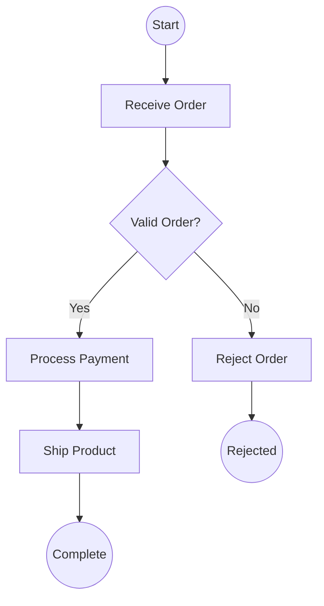
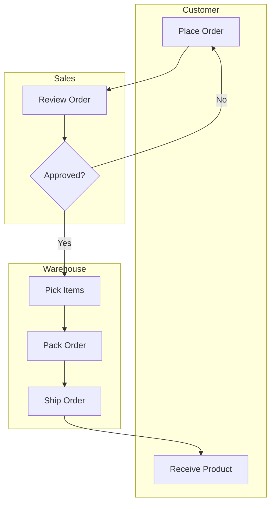
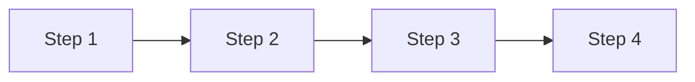
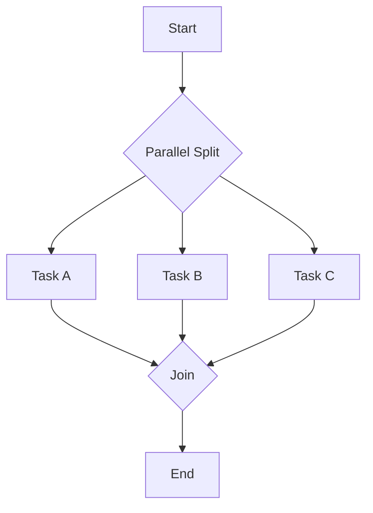
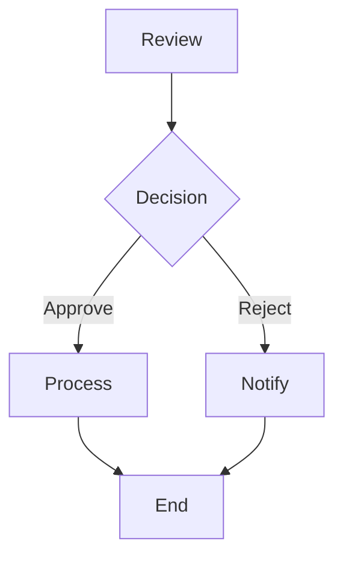
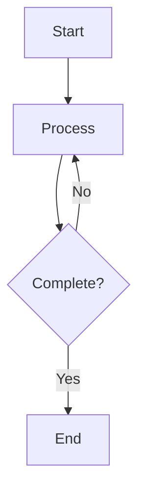
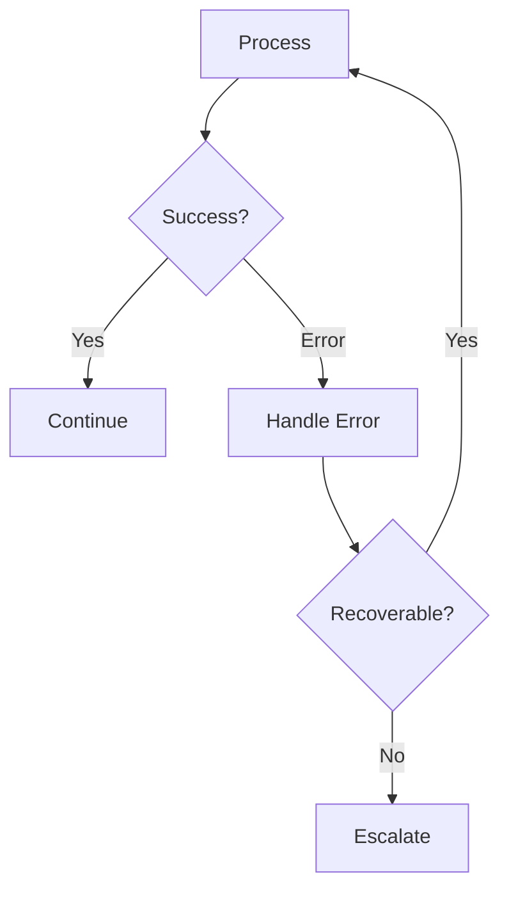

# Process Modeling（流程建模）

## 何时使用本 skill

在以下场景使用：

- **流程建模任务** — 使用 BPMN 记号与流程图模式建模流程，产出含活动、gateway、event、swimlane、决策点的流程图，用于 workflow 文档
- **规划或设计** — 需要流程建模方法的指引
- **最佳实践** — 想遵循成熟的模式与标准

## 概览

使用 BPMN（Business Process Model and Notation）与流程图记号创建并记录业务流程。把活动、决策、事件与参与者交互可视化，以便于流程理解与改进。

## 什么是 Process Modeling？

**流程建模（process modeling）** 是对组织中工作如何流动的可视化表达。它记录了：

- **活动**：执行了什么工作
- **顺序**：活动的先后
- **决策**：抉择点与条件
- **参与者**：每一步由谁执行
- **事件**：什么触发，什么结束

## BPMN 核心元素

### 活动（矩形）

| 类型 | 符号 | 描述 |
|------|--------|-------------|
| **Task** | 矩形 | 原子性的工作单元 |
| **Sub-Process** | 带 + 号的矩形 | 包含子流程 |
| **Call Activity** | 粗边框矩形 | 调用可复用流程 |

**Task 类型：**

| 类型 | 描述 |
|------|-------------|
| User Task | 需要人工交互 |
| Service Task | 系统自动执行 |
| Script Task | 脚本/代码执行 |
| Business Rule Task | 决策表求值 |
| Send Task | 发送消息 |
| Receive Task | 接收消息 |
| Manual Task | 无系统参与的物理操作 |

### 事件（圆形）

| 位置 | 符号 | 描述 |
|----------|--------|-------------|
| **Start** | 细圆 | 流程触发 |
| **Intermediate** | 双层圆 | 流程中途事件 |
| **End** | 粗圆 | 流程终止 |

**事件类型：**

| 类型 | 触发方式 |
|------|---------|
| None | 未指定的 start/end |
| Message | 收到/发出消息 |
| Timer | 基于时间的触发 |
| Error | 错误条件 |
| Signal | 广播信号 |
| Terminate | 终止流程 |

### Gateway（菱形）

| 类型 | 符号 | 描述 |
|------|--------|-------------|
| **Exclusive (XOR)** | 带 X 的菱形 | 根据条件选一条路径 |
| **Parallel (AND)** | 带 + 的菱形 | 所有路径都执行 |
| **Inclusive (OR)** | 带 O 的菱形 | 一条或多条路径 |
| **Event-Based** | 带圆的菱形 | 等待事件触发 |

### 连接线

| 类型 | 符号 | 描述 |
|------|--------|-------------|
| **Sequence Flow** | 实线箭头 | 活动的先后顺序 |
| **Message Flow** | 虚线箭头 | pool 之间的消息 |
| **Association** | 点线 | 把附属物关联到元素 |

### Swimlane（泳道）

| 类型 | 描述 |
|------|-------------|
| **Pool** | 代表一个参与者（组织/系统） |
| **Lane** | pool 内的子划分（角色/部门） |

## 工作流

### Phase 1：定义范围

#### 步骤 1：确定流程边界

```markdown
## Process Definition

**Process Name:** [Name]
**Purpose:** [Why this process exists]
**Scope:**
  - **Starts When:** [Trigger event]
  - **Ends When:** [Completion criteria]
  - **Includes:** [In-scope activities]
  - **Excludes:** [Out-of-scope activities]

**Participants:**
| Pool | Lanes (Roles) |
|------|---------------|
| [Org/System] | [Role 1], [Role 2] |
```

#### 步骤 2：选择模型类型

| 类型 | 何时使用 |
|------|-------------|
| **As-Is（现状）** | 记录当前状态 |
| **To-Be（未来）** | 设计未来状态 |
| **High-Level（高层次）** | 概览、用于沟通 |
| **Detailed（详细）** | 用于实现、自动化 |

### Phase 2：建模流程

#### 步骤 1：梳理主路径（Happy Path）

1. Start 事件（触发）
2. 主干活动序列
3. End 事件（完成）

#### 步骤 2：加入决策点

对每个决策：

- 选择 gateway 类型（XOR/AND/OR）
- 每条路径的条件
- 汇合点

#### 步骤 3：加入异常路径

- 错误处理
- 超时场景
- 升级路径

#### 步骤 4：加入参与者

- 把活动指派到 lane
- 建模参与者之间的沟通
- 在 pool 之间加入 message flow

### Phase 3：校验与记录

#### 步骤 1：校验完整性

| 检查项 | 问题 |
|-------|----------|
| 所有路径都已连接 | 每个活动是否都有入向与出向？ |
| 无死端 | 所有路径是否都能到达一个 end 事件？ |
| gateway 成对 | 分裂的 gateway 是否与汇合的匹配？ |
| 角色已指派 | 每个活动是否都在某个 lane 里？ |
| 触发器已定义 | 每个 start 事件是否都有明确触发？ |

#### 步骤 2：补充文档

```markdown
## Process: [Name]

### Overview

[Brief description of process purpose and flow]

### Triggers

| Event | Description | Frequency |
|-------|-------------|-----------|
| [Trigger] | [What causes it] | [How often] |

### Activities

| # | Activity | Role | System | Duration |
|---|----------|------|--------|----------|
| 1 | [Activity name] | [Role] | [System] | [Time] |

### Decision Points

| # | Decision | Conditions | Paths |
|---|----------|------------|-------|
| 1 | [Decision] | [Criteria] | [Path A], [Path B] |

### Exceptions

| Exception | Handling |
|-----------|----------|
| [Error] | [How handled] |
```

## 输出格式

### Mermaid 流程图（BPMN 风格）



### 泳道图



### 叙述式摘要

```markdown
## Process: Order Fulfillment

**Version:** 1.0
**Date:** [ISO Date]
**Owner:** [Name]

### Summary

This process handles customer orders from receipt to delivery.

### Flow Description

1. **Start**: Customer places order (online or phone)
2. **Review Order**: Sales validates order details
3. **Decision**: Is order valid?
   - Yes: Proceed to fulfillment
   - No: Return to customer for correction
4. **Pick Items**: Warehouse locates products
5. **Pack Order**: Items packaged for shipping
6. **Ship Order**: Handed to carrier
7. **End**: Customer receives product

### Metrics

| Metric | Current | Target |
|--------|---------|--------|
| Cycle Time | 3 days | 2 days |
| Error Rate | 5% | 1% |
| Automation | 40% | 70% |

### Improvement Opportunities

1. Automate order validation
2. Parallel picking for multi-item orders
3. Real-time tracking integration
```

### 结构化数据（YAML）

```yaml
process_model:
  name: "Order Fulfillment"
  version: "1.0"
  date: "2025-01-15"
  type: "as_is"  # or "to_be"
  owner: "Operations"

  boundaries:
    trigger: "Customer places order"
    end_state: "Customer receives product"
    scope:
      includes:
        - "Order receipt"
        - "Payment processing"
        - "Fulfillment"
        - "Shipping"
      excludes:
        - "Returns"
        - "Customer support"

  participants:
    - pool: "Company"
      lanes:
        - name: "Sales"
          activities: ["Review Order"]
        - name: "Warehouse"
          activities: ["Pick Items", "Pack Order", "Ship Order"]
    - pool: "Customer"
      lanes:
        - name: "Buyer"
          activities: ["Place Order", "Receive Product"]

  elements:
    events:
      - id: "start_1"
        type: "start"
        name: "Order Received"
        trigger: "message"

      - id: "end_1"
        type: "end"
        name: "Order Complete"

    activities:
      - id: "task_1"
        type: "user_task"
        name: "Review Order"
        lane: "Sales"
        duration: "15 minutes"

      - id: "task_2"
        type: "service_task"
        name: "Process Payment"
        lane: "Sales"
        system: "Payment Gateway"

    gateways:
      - id: "gw_1"
        type: "exclusive"
        name: "Order Valid?"
        conditions:
          - path: "task_2"
            condition: "Order validated"
          - path: "task_reject"
            condition: "Validation failed"

  sequence_flows:
    - from: "start_1"
      to: "task_1"
    - from: "task_1"
      to: "gw_1"
    - from: "gw_1"
      to: "task_2"
      condition: "valid"

  metrics:
    cycle_time:
      current: "3 days"
      target: "2 days"
    automation_rate:
      current: 40
      target: 70
```

## 常见流程模式

### 顺序流程

严格按顺序一个接一个的活动。



### 并行分裂与汇合

可以同时发生的活动。



### 排他性决策

根据条件只走一条路径。



### 循环/迭代

反复执行直到满足条件。



### 异常处理

处理错误与异常。



## 最佳实践

| 实践 | 描述 |
|----------|-------------|
| 从简单开始 | 先画 happy path，再加复杂度 |
| 一进一出 | 每个 pool 最好只有一个 start 和一个 end |
| 活动命名 | 使用"动词+名词"格式（如 "Review Order"） |
| 标注 gateway | 显式写出决策问题 |
| 标注条件 | 给每条出向路径标注条件 |
| gateway 成对 | split 和 join 使用匹配的类型 |
| 避免线条交叉 | 为清晰度重新布局 |
| 记录异常 | 画出错误处理路径 |

## 集成

### 上游

- **stakeholder-analysis** — 流程参与者
- **domain-storytelling** — 现状流程发现
- **capability-mapping** — 能力上下文

### 下游

- **value-stream-mapping** — 价值流分析
- **Requirements** — 流程需求
- **System design** — 自动化机会

## 相关 skill

- `value-stream-mapping` — 从 Lean 视角看流程
- `data-modeling` — 流程中的数据实体
- `journey-mapping` — 客户体验视角
- `capability-mapping` — 流程与能力对齐

## 版本历史

- **v1.0.0**（2025-12-26）：首次发布
