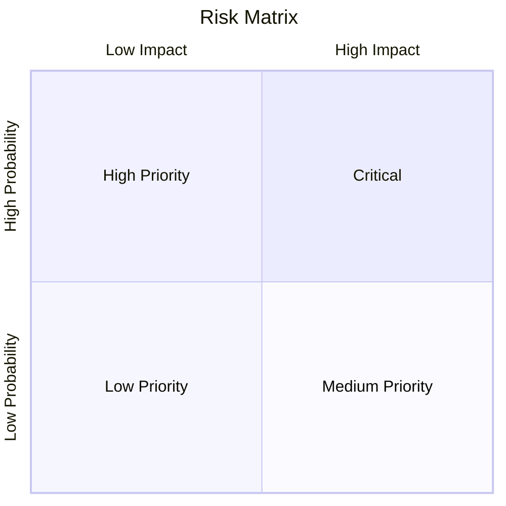
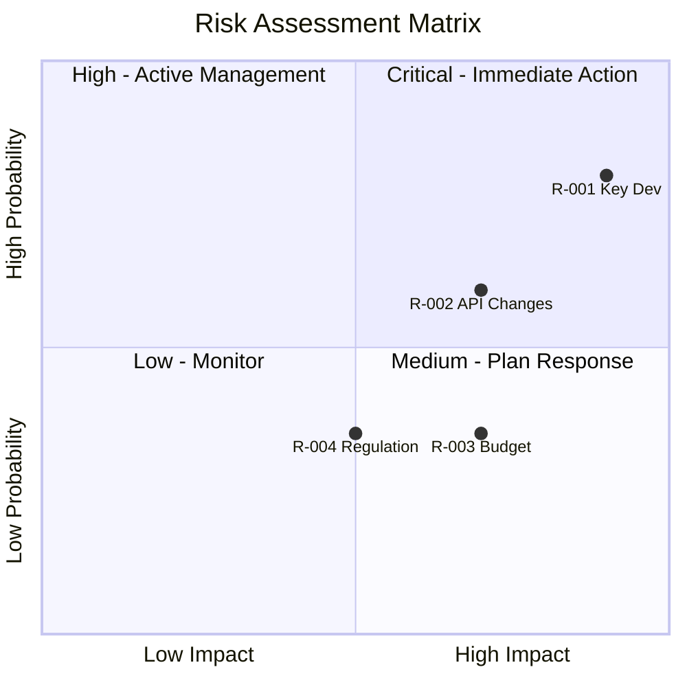

# Risk Analysis（风险分析）

## 何时使用本 skill

在以下场景使用：

- **Risk Analysis 任务** — 用 risk register、概率/影响矩阵以及结构化的应对规划做风险分析；识别、评估并管理项目、业务、技术相关的风险
- **规划或设计** — 需要风险分析方法的指引
- **最佳实践** — 想遵循成熟的模式与标准

## 概览

用 risk register、概率/影响矩阵与结构化的应对规划，系统性地识别、评估并管理风险。支持项目风险、业务风险、技术风险与机会管理。

## 什么是 Risk Analysis？

**Risk（风险）** 是一种不确定的事件或状态，一旦发生，对目标可能产生正面或负面的影响。风险分析包括：

- **Identification（识别）**：可能发生什么？
- **Assessment（评估）**：多大可能？多大影响？
- **Response Planning（应对规划）**：我们打算怎么做？
- **Monitoring（监控）**：持续追踪与更新

### Risk vs Issue

| 概念 | 定义 | 动作 |
|---------|------------|--------|
| **Risk（风险）** | 未来可能发生的事件（不确定） | 规划应对 |
| **Issue（问题）** | 当前已经存在的问题（确定） | 立刻处理 |

### Threat vs Opportunity

| 类型 | 效应 | 应对目标 |
|------|--------|---------------|
| **Threat（威胁）** | 负面影响 | 最小化暴露 |
| **Opportunity（机会）** | 正面影响 | 最大化收益 |

## Risk Register（风险登记表）

所有已识别风险的中央存储：

```markdown
## Risk Register

| ID | Risk Description | Category | Probability | Impact | Score | Owner | Response | Status |
|----|-----------------|----------|-------------|--------|-------|-------|----------|--------|
| R-001 | [Description] | [Category] | H/M/L | H/M/L | [P×I] | [Name] | [Strategy] | Open |
```

### Risk Register 字段

| 字段 | 描述 |
|-------|-------------|
| **ID** | 唯一标识 |
| **Description** | 清晰的风险陈述 |
| **Category** | 风险类型 |
| **Probability** | 发生可能性 |
| **Impact** | 发生后的后果 |
| **Score** | 风险优先级（P × I） |
| **Owner** | 责任人 |
| **Response** | 计划采取的应对策略 |
| **Status** | Open、Mitigated、Closed、Occurred |

### 风险分类

| 类别 | 示例 |
|----------|----------|
| **Technical（技术）** | 技术失败、集成问题 |
| **Schedule（进度）** | 延期、依赖 |
| **Cost（成本）** | 预算超支、资源成本 |
| **Resource（资源）** | 技能缺口、人手不足 |
| **External（外部）** | 供应商、监管、市场 |
| **Organizational（组织）** | 变更阻力、优先级 |
| **Quality（质量）** | 缺陷、性能 |
| **Security（安全）** | 数据泄露、越权访问 |

## 概率/影响矩阵

### 评分量表

**概率量表：**

| 等级 | 分值 | 描述 | 可能性 |
|-------|-------|-------------|------------|
| Very Low | 1 | 罕见 | < 10% |
| Low | 2 | 不太可能 | 10-30% |
| Medium | 3 | 有可能 | 30-50% |
| High | 4 | 很可能 | 50-70% |
| Very High | 5 | 几乎必然 | > 70% |

**影响量表：**

| 等级 | 分值 | 进度 | 成本 | 质量 |
|-------|-------|----------|------|---------|
| Very Low | 1 | < 1 周 | < 5% | 轻微 |
| Low | 2 | 1-2 周 | 5-10% | 可察觉 |
| Medium | 3 | 2-4 周 | 10-20% | 明显 |
| High | 4 | 1-3 个月 | 20-40% | 严重 |
| Very High | 5 | > 3 个月 | > 40% | 灾难级 |

### 风险分值的计算

```text
Risk Score = Probability × Impact

Score Range: 1-25
```

**优先级区段：**

| 分值 | 优先级 | 行动 |
|-------|----------|--------|
| 1-4 | 低 | 接受或仅监测 |
| 5-9 | 中 | 主动管理 |
| 10-14 | 高 | 重点关注 |
| 15-25 | 危急 | 立即行动 |

### 矩阵可视化



## 风险应对策略

### 针对 Threat（负向风险）

| 策略 | 描述 | 何时使用 |
|----------|-------------|-------------|
| **Avoid（规避）** | 消除威胁 | 概率与影响都高 |
| **Transfer（转移）** | 转给第三方 | 财务/合同类风险 |
| **Mitigate（缓解）** | 降低概率或影响 | 最常用的策略 |
| **Accept（接受）** | 承认但不采取行动 | 低优先级的风险 |

### 针对 Opportunity（正向风险）

| 策略 | 描述 | 何时使用 |
|----------|-------------|-------------|
| **Exploit（利用）** | 确保机会发生 | 高价值机会 |
| **Share（共享）** | 合作以增强能力 | 需要外部帮助 |
| **Enhance（强化）** | 提升概率或影响 | 中等机会 |
| **Accept（顺势而为）** | 机会出现时顺势抓住 | 低投入的机会 |

### 应对规划模板

```markdown
## Risk Response Plan: R-001

**Risk:** [Description]
**Strategy:** [Avoid/Transfer/Mitigate/Accept]

### Prevention Actions
| Action | Owner | Due Date | Status |
|--------|-------|----------|--------|
| [Preventive measure] | [Name] | [Date] | [Status] |

### Contingency Plan
**Trigger:** [What indicates risk is occurring]
**Actions:**
1. [Contingency action 1]
2. [Contingency action 2]

### Residual Risk
**After mitigation:**
- Probability: [Reduced level]
- Impact: [Reduced level]
- New Score: [Residual score]
```

## 工作流

### Phase 1：识别风险

#### Step 1：收集输入

识别风险的来源：

- 项目计划与进度
- stakeholder 的顾虑
- 类似项目的历史数据
- SWOT 分析（Threats 部分）
- 技术评估
- 外部环境分析

#### Step 2：头脑风暴

技法：

- **Checklist review**：标准风险分类
- **Expert interviews**：领域专家
- **Assumption analysis**：质疑项目的假设
- **Root cause analysis**：从影响反推原因
- **SWOT**：威胁与机会

#### Step 3：记录风险

风险陈述的格式：

```text
"There is a risk that [CONDITION/CAUSE] may result in [CONSEQUENCE/IMPACT]"

Example:
"There is a risk that key developer leaves may result in schedule delay and knowledge loss"
```

### Phase 2：风险评估

#### Step 1：评估概率

对每个风险：

- 发生的可能性有多大？
- 支持该评估的证据是什么？
- 使用既定量表（1-5）

#### Step 2：评估影响

对每个风险：

- 后果是什么？
- 考虑多个影响维度（进度、成本、质量）
- 取影响最大的维度
- 使用既定量表（1-5）

#### Step 3：计算并排序

```markdown
## Risk Assessment Summary

| ID | Risk | P | I | Score | Priority |
|----|------|---|---|-------|----------|
| R-001 | [Risk 1] | 4 | 5 | 20 | Critical |
| R-002 | [Risk 2] | 3 | 3 | 9 | Medium |
| R-003 | [Risk 3] | 2 | 2 | 4 | Low |
```

### Phase 3：应对规划

#### Step 1：选择应对策略

对每个重要风险：

- 让策略匹配风险特征
- 权衡应对成本与风险暴露
- 指派风险 owner

#### Step 2：定义应对动作

- 具体、可度量的动作
- 明确的 owner 与截止日期
- 明确的应急触发条件

#### Step 3：计算残余风险

在预设缓解措施之后：

- 重新评估概率与影响
- 计算残余风险分值
- 判断是否可接受

### Phase 4：监控

#### Step 1：追踪风险状态

定期复核节奏：

- 危急风险：每周
- 高风险：每两周
- 中风险：每月
- 低风险：每季

#### Step 2：更新 register

- 新发现的风险
- 分值的变化
- 已执行的应对
- 已关闭或已发生的风险

## 输出格式

### Risk Register（Markdown 表格）

```markdown
## Risk Register: [Project/Initiative]

**Date:** [ISO Date]
**Owner:** [Name]
**Review Cycle:** [Weekly/Monthly]

| ID | Risk Description | Category | P | I | Score | Owner | Response | Actions | Status |
|----|-----------------|----------|---|---|-------|-------|----------|---------|--------|
| R-001 | Key developer may leave during critical phase | Resource | 4 | 5 | 20 | PM | Mitigate | Cross-train, document | Open |
| R-002 | Third-party API may have breaking changes | Technical | 3 | 4 | 12 | Tech Lead | Mitigate | Abstraction layer | Open |
| R-003 | Budget approval may be delayed | Cost | 2 | 4 | 8 | Sponsor | Accept | Monitor | Open |
| R-004 | New regulation may require features | External | 2 | 3 | 6 | BA | Accept | Watch | Open |

### Summary
- **Total Risks:** 4
- **Critical (15+):** 1
- **High (10-14):** 1
- **Medium (5-9):** 1
- **Low (1-4):** 1
```

### 风险矩阵可视化



### 结构化数据（YAML）

```yaml
risk_register:
  name: "[Project/Initiative]"
  version: "1.0"
  date: "2025-01-15"
  owner: "Project Manager"
  review_cycle: "weekly"

  risk_appetite:
    overall: "moderate"
    schedule: "low"
    cost: "moderate"
    quality: "low"

  scales:
    probability:
      1: "Rare (<10%)"
      2: "Unlikely (10-30%)"
      3: "Possible (30-50%)"
      4: "Likely (50-70%)"
      5: "Almost Certain (>70%)"
    impact:
      1: "Very Low"
      2: "Low"
      3: "Medium"
      4: "High"
      5: "Very High"

  risks:
    - id: "R-001"
      description: "Key developer may leave during critical phase"
      category: "Resource"
      probability: 4
      impact: 5
      score: 20
      priority: "critical"
      owner: "Project Manager"
      response_strategy: "mitigate"
      response_actions:
        - action: "Cross-train team member"
          owner: "Tech Lead"
          due_date: "2025-02-01"
          status: "in_progress"
        - action: "Document critical knowledge"
          owner: "Developer"
          due_date: "2025-02-15"
          status: "not_started"
      contingency:
        trigger: "Developer gives notice"
        actions:
          - "Accelerate knowledge transfer"
          - "Engage contractor"
      residual_risk:
        probability: 3
        impact: 3
        score: 9
      status: "open"
      created_date: "2025-01-15"
      last_reviewed: "2025-01-15"

  summary:
    total: 4
    by_priority:
      critical: 1
      high: 1
      medium: 1
      low: 1
    by_status:
      open: 4
      mitigated: 0
      closed: 0
      occurred: 0
```

### 叙述式摘要

```markdown
## Risk Assessment Summary

**Project:** [Name]
**Date:** [ISO Date]
**Assessed By:** risk-analyst

### Risk Profile

| Priority | Count | Top Risk |
|----------|-------|----------|
| Critical | 1 | Key developer leaving |
| High | 1 | Third-party API changes |
| Medium | 1 | Budget approval delay |
| Low | 1 | Regulatory changes |

### Critical Risks Requiring Action

#### R-001: Key Developer Departure
- **Score:** 20 (P:4 × I:5)
- **Response:** Mitigate through cross-training and documentation
- **Target Residual:** 9 (P:3 × I:3)
- **Actions:** 2 in progress, 0 completed

### Risk Trends

| Metric | This Period | Last Period | Trend |
|--------|-------------|-------------|-------|
| Total Risks | 4 | 3 | ↑ |
| Critical | 1 | 0 | ↑ |
| Closed | 0 | 1 | ↓ |

### Recommendations

1. **Immediate:** Accelerate R-001 mitigation actions
2. **This Week:** Complete API abstraction layer design
3. **Monitor:** Watch for regulatory announcements
```

## 常见陷阱

| 陷阱 | 如何规避 |
|---------|------------|
| 风险描述含糊 | 使用 "condition may cause consequence" 格式 |
| 评分标准不一致 | 定义并使用统一量表 |
| 无风险 owner | 识别时就指派 owner |
| register 陈旧 | 安排定期复核 |
| 忽略 opportunity | 把正向风险也纳入 |
| 过度分析 | 聚焦高优先级风险 |
| 无 contingency | 为风险发生时做好准备 |

## 集成

### 上游

- **swot-pestle-analysis** — 战略分析得出的威胁
- **stakeholder-analysis** — 把 stakeholder 的顾虑转化为风险
- **decision-analysis** — 风险作为决策输入

### 下游

- **Project planning** — 风险调整后的进度计划
- **Budgeting** — 应急储备
- **Monitoring** — 风险追踪看板

## 相关 skill

- `swot-pestle-analysis` — 战略层面的威胁/机会
- `root-cause-analysis` — 风险真实发生时使用
- `decision-analysis` — 基于风险的决策
- `prioritization` — 风险优先级排序

## 版本历史

- **v1.0.0**（2025-12-26）：首次发布
