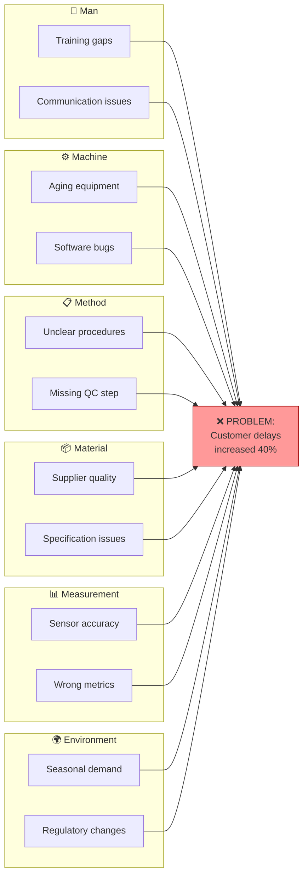
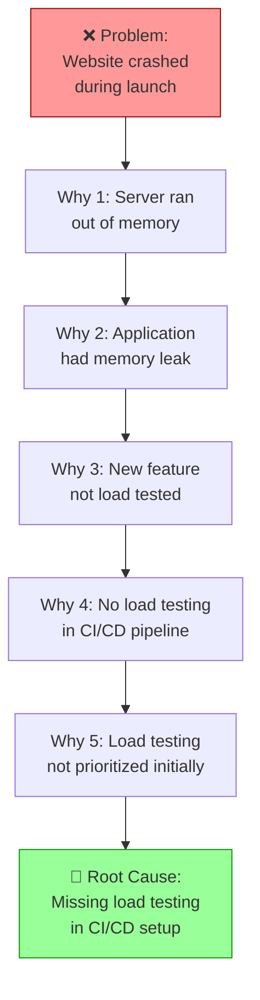

# Root Cause Analysis（根本原因分析）

使用 Fishbone（Ishikawa，鱼骨图）与 5 Whys 技术进行系统化问题解决。识别真正的根本原因，并给出有效的纠正措施建议。

## 什么是 Root Cause Analysis？

**Root Cause Analysis（根本原因分析，RCA）** 是一种结构化方法，用于识别问题的根本原因，而不是处理表面症状。有效的 RCA 能够防止问题再次发生。

| 方法 | 关注点 | 适用场景 |
|----------|-------|----------|
| **Fishbone（Ishikawa）** | 按类别 brainstorm 所有潜在原因 | 有多种潜在原因的复杂问题 |
| **5 Whys** | 沿因果链逐级下钻 | 有线性因果关系的问题 |
| **组合使用** | Fishbone 找出原因，5 Whys 深入钻取 | 全面识别根本原因 |

## 框架 1：Fishbone（Ishikawa）图

### 什么是 Fishbone 图？

**Fishbone 图**（又称 Ishikawa 图或因果图）把潜在原因按类别组织起来，形似鱼骨，问题本身作为"鱼头"。

```text
        ┌─────────────────────────────────────────────────────────┐
        │                                                         │
  Man ──┼──┐                                         ┌──┼── Method
        │  │                                         │  │
        │  └─────────────────────┐   ┌───────────────┘  │
        │                        │   │                  │
        │                        ▼   ▼                  │
        │                    ┌─────────┐                │
        │                    │ PROBLEM │                │
        │                    └─────────┘                │
        │                        ▲   ▲                  │
        │  ┌─────────────────────┘   └───────────────┐  │
        │  │                                         │  │
Machine ┼──┘                                         └──┼── Material
        │                                               │
        │                                               │
Measurement ────────────────────────────────────────────── Mother Nature
        │                                               │
        └───────────────────────────────────────────────┘
```

### 6M 类别

| 类别 | 别称 | 示例原因 |
|----------|-------------|----------------|
| **Man** | People、Personnel | 培训、技能、疲劳、沟通 |
| **Machine** | Equipment、Technology | 硬件、软件、工具、维护 |
| **Method** | Process、Procedure | workflow、文档、规范 |
| **Material** | Inputs、Data | 原料、组件、信息质量 |
| **Measurement** | Metrics、Inspection | 校准、精度、数据采集 |
| **Mother Nature** | Environment | 温度、湿度、法规、市场 |

### 可选的类别集合

| 领域 | 类别 |
|--------|------------|
| **Manufacturing（6M）** | Man、Machine、Method、Material、Measurement、Mother Nature |
| **Service（8P）** | Product、Price、Place、Promotion、People、Process、Physical Evidence、Productivity |
| **Software（5S）** | Systems、Skills、Suppliers、Surroundings、Safety |
| **Custom** | 定义你所在领域相关的类别 |

### Fishbone 工作流

#### Step 1：定义问题

```markdown
## Problem Statement

**Problem:** [Clear, specific, measurable description]
**Impact:** [Quantified impact - cost, time, quality, safety]
**When Discovered:** [Date/time]
**Where:** [Location, system, process]
**Frequency:** [One-time / Recurring / Intermittent]
```

**好的问题陈述：**

- ✅ "Q4 customer order 延迟超过 3 天的比例上升 40%"
- ✅ "11 月产线 3 的 defect rate 从 2% 升到 8%"
- ❌ "事情变慢了"（太模糊）
- ❌ "系统坏了"（不可度量）

#### Step 2：组建团队

纳入具有一手认知的人员：

| 角色 | 贡献 |
|------|--------------|
| **Process Owner** | 总体问责 |
| **Front-line Workers** | 直接观察与一线经验 |
| **Subject Matter Experts** | 技术知识 |
| **Customer Representative** | 影响视角 |
| **Facilitator** | 引导流程 |

#### Step 3：按类别 brainstorm 原因

对每个类别，问："该类别下有什么可能导致这个问题？"

```markdown
## Cause Brainstorming

### Man (People)
| Potential Cause | Evidence | Likelihood |
|-----------------|----------|------------|
| Insufficient training | New hires 60% of errors | High |
| Fatigue (overtime hours) | Errors peak after 8 hours | Medium |
| Communication gaps | Handoff errors documented | High |

### Machine (Equipment)
| Potential Cause | Evidence | Likelihood |
|-----------------|----------|------------|
| Aging equipment | Machine 7 has 40% of failures | High |
| Software bugs | Version 2.1 introduced defects | Medium |

### Method (Process)
| Potential Cause | Evidence | Likelihood |
|-----------------|----------|------------|
| Unclear procedures | 3 different approaches observed | High |
| Missing quality check | No verification step documented | High |

### Material (Inputs)
| Potential Cause | Evidence | Likelihood |
|-----------------|----------|------------|
| Supplier quality issues | Incoming defect rate up 15% | Medium |
| Specification ambiguity | Multiple interpretations possible | Low |

### Measurement (Metrics)
| Potential Cause | Evidence | Likelihood |
|-----------------|----------|------------|
| Inaccurate sensors | Calibration overdue | Medium |
| Wrong metrics tracked | Leading indicators missing | Low |

### Mother Nature (Environment)
| Potential Cause | Evidence | Likelihood |
|-----------------|----------|------------|
| Seasonal demand spike | Q4 always highest volume | High |
| Regulatory changes | New requirements in October | Low |
```

#### Step 4：识别最可能的根本原因

基于以下准则排序：

| 准则 | 问题 |
|-----------|----------|
| **Evidence** | 是否有数据支持该原因？ |
| **Frequency** | 该原因是否与问题频率相关？ |
| **Correlation** | 原因发生时机是否与问题时机吻合？ |
| **Control** | 我们能否测试或消除该原因？ |

#### Step 5：验证根本原因

对每个高可能性原因：

```markdown
## Root Cause Validation

| Cause | Validation Method | Result | Confirmed? |
|-------|-------------------|--------|------------|
| Insufficient training | Compare error rates by tenure | New hires 3x error rate | ✅ Yes |
| Aging equipment | Analyze failures by machine | Machine 7: 40% of all failures | ✅ Yes |
| Unclear procedures | Review documentation | 3 conflicting SOPs found | ✅ Yes |
```

### Fishbone 输出格式

```markdown
## Fishbone Analysis: [Problem]

**Date:** [ISO date]
**Facilitator:** rca-analyst
**Team:** [Participants]

### Problem Statement
[Clear, specific, measurable problem]

### Impact
[Quantified business impact]

### Cause Analysis

#### Man (People)
- [Cause 1] - Evidence: [X] - Status: Confirmed/Suspected
- [Cause 2] - Evidence: [X] - Status: Confirmed/Suspected

#### Machine (Equipment)
- [Cause 1] - Evidence: [X] - Status: Confirmed/Suspected

#### Method (Process)
- [Cause 1] - Evidence: [X] - Status: Confirmed/Suspected

#### Material (Inputs)
- [Cause 1] - Evidence: [X] - Status: Confirmed/Suspected

#### Measurement (Metrics)
- [Cause 1] - Evidence: [X] - Status: Confirmed/Suspected

#### Mother Nature (Environment)
- [Cause 1] - Evidence: [X] - Status: Confirmed/Suspected

### Confirmed Root Causes
| # | Root Cause | Category | Evidence | Contribution |
|---|------------|----------|----------|--------------|
| 1 | [Description] | [6M] | [Data] | [% of problem] |

### Recommended Actions
| # | Action | Addresses | Owner | Due Date |
|---|--------|-----------|-------|----------|
| 1 | [Corrective action] | Root Cause #1 | [Name] | [Date] |
```

### Fishbone Mermaid 图



## 框架 2：5 Whys

### 什么是 5 Whys？

**5 Whys** 是一种迭代式追问技法，通过反复问"为什么？"（通常 5 次，也可更多或更少）从症状下钻到根本原因。

**核心原则：** 上一次的答案成为下一次"为什么"的对象。

### 5 Whys 工作流

#### Step 1：陈述问题

```markdown
## 5 Whys Analysis

**Problem:** [Specific problem statement]
**Date:** [ISO date]
**Analyst:** 5whys-analyst
```

#### Step 2：迭代式追问 Why

```markdown
### Why Chain

**Problem:** The website crashed during the product launch.

**Why 1:** Why did the website crash?
→ The server ran out of memory.

**Why 2:** Why did the server run out of memory?
→ The application had a memory leak.

**Why 3:** Why did the application have a memory leak?
→ The new feature wasn't properly tested under load.

**Why 4:** Why wasn't the new feature tested under load?
→ We don't have load testing in our CI/CD pipeline.

**Why 5:** Why don't we have load testing in CI/CD?
→ It was never prioritized when the pipeline was set up.

**Root Cause:** Load testing was not included in CI/CD pipeline during initial setup.
```

#### Step 3：验证根本原因

| 验证项 | 问题 | 通过？ |
|------------------|----------|-------|
| **Specific（具体）** | 根本原因是否具体且可行动？ | ☐ |
| **Systemic（系统性）** | 处理这个原因是否能防止再次发生？ | ☐ |
| **Controllable（可控）** | 我们真的能修好它吗？ | ☐ |
| **Chain Valid（链条成立）** | 每个 why-answer 是否逻辑上引出下一个？ | ☐ |

### 5 Whys 最佳实践

| Do | Don't |
|----|-------|
| ✅ 关注流程/系统层面的原因 | ❌ 追责个人 |
| ✅ 基于事实与证据回答 | ❌ 无数据地推测 |
| ✅ 问到找到可行动的根因为止 | ❌ 停在症状层面 |
| ✅ 记录整个链条以备后续参考 | ❌ 把"人为失误"当成根本原因 |
| ✅ 考虑多条并行链条 | ❌ 假设只有单一根因 |

### 多条 5 Why 链

复杂问题往往有多个贡献因素。并行跑多条 5 Whys 链：

```markdown
## Multiple Why Chains

**Problem:** Customer complaints increased 50%

### Chain A: Response Time
Why 1: Response time increased → Support queue grew
Why 2: Queue grew → Fewer agents available
Why 3: Fewer agents → High turnover
Why 4: High turnover → Poor working conditions
Why 5: Poor conditions → No ergonomic equipment
**Root Cause A:** Lack of investment in workplace ergonomics

### Chain B: First-Contact Resolution
Why 1: FCR dropped → Agents lack knowledge
Why 2: Lack knowledge → Training inadequate
Why 3: Training inadequate → Product changes not communicated
Why 4: Not communicated → No process for training updates
**Root Cause B:** Missing process for training on product changes

### Chain C: (Additional chains as needed)
```

### 5 Whys 输出格式

```markdown
## 5 Whys Analysis: [Problem]

**Date:** [ISO date]
**Analyst:** 5whys-analyst
**Problem:** [Statement]

### Why Chain

| Level | Question | Answer | Evidence |
|-------|----------|--------|----------|
| Why 1 | Why [problem]? | [Answer] | [Data] |
| Why 2 | Why [answer 1]? | [Answer] | [Data] |
| Why 3 | Why [answer 2]? | [Answer] | [Data] |
| Why 4 | Why [answer 3]? | [Answer] | [Data] |
| Why 5 | Why [answer 4]? | [Answer] | [Data] |

### Root Cause
[Final root cause statement]

### Validation
- [ ] Specific and actionable
- [ ] Systemic (prevents recurrence)
- [ ] Within our control
- [ ] Each step logically connected

### Corrective Action
| Action | Owner | Due | Status |
|--------|-------|-----|--------|
| [Action to address root cause] | [Name] | [Date] | Open |
```

### 5 Whys Mermaid 图



## 组合方法

做全面分析时，组合使用两种技法：

1. **Fishbone** — brainstorm 所有类别下的潜在原因
2. **5 Whys** — 对每个高可能性原因下钻
3. **验证** — 验证找到的多个根因
4. **排序** — 对纠正措施排序

```markdown
## Combined RCA: [Problem]

### Phase 1: Fishbone Brainstorming
[Identify all potential causes by category]

### Phase 2: 5 Whys Drill-Down
For each high-likelihood cause from fishbone:

#### Cause A: [From fishbone]
[5 Whys chain]
Root Cause A: [Result]

#### Cause B: [From fishbone]
[5 Whys chain]
Root Cause B: [Result]

### Phase 3: Root Cause Summary
| # | Root Cause | Source | Validated? | Priority |
|---|------------|--------|------------|----------|
| 1 | [RC-A] | Fishbone + 5 Whys | Yes | High |
| 2 | [RC-B] | Fishbone + 5 Whys | Yes | Medium |

### Phase 4: Corrective Action Plan
[CAPA based on validated root causes]
```

## 纠正措施计划（CAPA）

### 措施类型

| 类型 | 目的 | 示例 |
|------|---------|---------|
| **Immediate/Containment（立即止血）** | 先止住损失 | 下线有问题的 feature |
| **Corrective（纠正）** | 修复当次发生 | 打 bug 补丁 |
| **Preventive（预防）** | 防止再次发生 | 新增自动化测试 |
| **Systemic（系统性）** | 解决组织层面的因素 | 更新培训计划 |

### CAPA 模板

```markdown
## Corrective Action Plan

**Problem:** [Reference to RCA]
**Root Causes:** [List confirmed root causes]

### Actions

| # | Action | Type | Root Cause | Owner | Due | Status |
|---|--------|------|------------|-------|-----|--------|
| 1 | [Description] | Corrective | RC-1 | [Name] | [Date] | Open |
| 2 | [Description] | Preventive | RC-1 | [Name] | [Date] | Open |
| 3 | [Description] | Systemic | RC-2 | [Name] | [Date] | Open |

### Verification
| Action | Verification Method | Criteria | Result |
|--------|---------------------|----------|--------|
| 1 | [How to verify] | [Success criteria] | Pending |

### Follow-up
- **Review Date:** [Date]
- **Responsible:** [Name]
- **Metrics to Monitor:** [KPIs]
```

## 结构化数据（YAML）

```yaml
root_cause_analysis:
  version: "1.0"
  date: "2025-01-15"
  analyst: "rca-analyst"

  problem:
    statement: "Customer order delays increased 40% in Q4"
    impact: "$500K in refunds, 15% churn increase"
    discovered: "2025-01-10"
    frequency: recurring

  fishbone:
    categories:
      man:
        - cause: "Insufficient training"
          evidence: "New hires 3x error rate"
          likelihood: high
          confirmed: true
      machine:
        - cause: "Aging equipment on Line 3"
          evidence: "40% of failures from Machine 7"
          likelihood: high
          confirmed: true
      method:
        - cause: "Unclear procedures"
          evidence: "3 conflicting SOPs"
          likelihood: high
          confirmed: true
      material: []
      measurement: []
      environment:
        - cause: "Q4 demand spike"
          evidence: "Volume up 60%"
          likelihood: high
          confirmed: true

  five_whys:
    - chain_name: "Training Gap"
      problem: "High error rate in new hires"
      whys:
        - question: "Why high error rate?"
          answer: "Insufficient training"
        - question: "Why insufficient training?"
          answer: "Training program not updated"
        - question: "Why not updated?"
          answer: "No owner assigned"
        - question: "Why no owner?"
          answer: "Process not established"
      root_cause: "No process for maintaining training program"

  root_causes:
    - id: "RC-1"
      description: "No process for training program maintenance"
      source: "Fishbone + 5 Whys"
      validated: true
      contribution: 40

  capa:
    - action: "Assign training program owner"
      type: corrective
      root_cause: "RC-1"
      owner: "HR Director"
      due_date: "2025-02-01"
      status: open
```

## 何时使用 RCA

| 场景 | 是否使用 RCA？ | 方法 |
|----------|----------|----------|
| 重大事故 | 是 | 完整的 Fishbone + 5 Whys |
| 反复出现的 defect | 是 | 聚焦的 5 Whys |
| 客诉模式 | 是 | 组合方法 |
| 小的一次性问题 | 视情况 | 快速 5 Whys |
| 主动性改进 | 部分适用 | 用 Fishbone 做构想 |

## 集成

### 上游

- **Incident reports** — RCA 的触发源
- **Quality metrics** — 识别问题
- **stakeholder-analysis** — 识别团队成员

### 下游

- **Process improvement** — 落地纠正措施
- **Training programs** — 解决人员相关的原因
- **value-stream-mapping** — 消除系统性浪费

## 相关 skill

- `decision-analysis` — 评估纠正措施的选项
- `risk-analysis` — 评估根因的风险
- `value-stream-mapping` — 流程改进
- `stakeholder-analysis` — 识别 RCA 参与者

## 版本历史

- **v1.0.0**（2025-12-26）：首次发布
