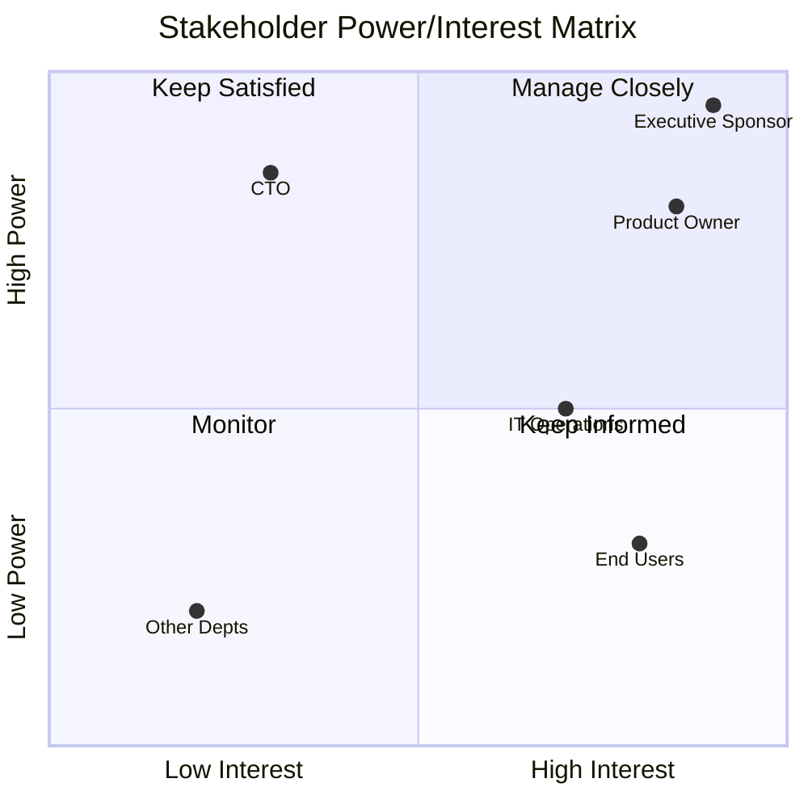

# Stakeholder Analysis（干系人分析）

识别、分析项目和 initiative 中的干系人，并规划相应的参与策略。基于 BABOK v3 的 Elicitation & Collaboration 知识域。

## 什么是 Stakeholder Analysis？

干系人分析系统性地识别所有受到某个 initiative 影响、或能够影响该 initiative 的各方，评估他们的利益和影响力，并制定相应的参与策略。

## 核心交付物

| 交付物 | 用途 | 何时产出 |
|-------------|---------|----------------|
| **Stakeholder Register（干系人登记表）** | 全量干系人清单 | 项目启动 |
| **Power/Interest Matrix（权力/利益矩阵）** | 为参与方式排序 | 分析阶段 |
| **RACI Matrix** | 厘清角色与职责 | 规划阶段 |
| **Communication Plan（沟通计划）** | 结构化的参与策略 | 规划阶段 |

## 工作流

### Phase 1：识别干系人

#### Step 1：按类别头脑风暴

按类别系统性地识别干系人：

| 类别 | 示例 | 要问的问题 |
|----------|----------|------------------|
| **Sponsors（发起人）** | 高层 sponsor、预算 owner | 谁出钱？谁能取消？ |
| **Users（用户）** | 最终用户、高阶用户、管理员 | 谁每天使用这个方案？ |
| **Operators（运维方）** | IT ops、支持团队、维护 | 谁保障它运行？ |
| **Regulators（监管方）** | 合规、法务、审计 | 谁确保我们守规？ |
| **Affected Parties（受影响方）** | 其他部门、被替换的岗位 | 谁会被这次变动影响？ |
| **Subject Matter Experts（SME）** | 领域专家、技术负责人 | 谁掌握关键知识？ |
| **Decision Makers（决策人）** | 指导委员会、架构师 | 谁拍板？ |
| **Influencers（影响者）** | 意见领袖、工会代表 | 谁在塑造认知？ |

#### Step 2：创建 Stakeholder Register

```markdown
## Stakeholder Register

| ID | Name/Role | Category | Organization | Contact | Notes |
|----|-----------|----------|--------------|---------|-------|
| S01 | Jane Smith | Sponsor | Executive | jane@... | Budget authority |
| S02 | IT Operations | Operator | IT | ... | 24/7 support team |
| S03 | Customer Service Reps | User | Customer Care | ... | 50+ daily users |
| S04 | Compliance Officer | Regulator | Legal | ... | GDPR requirements |
```

### Phase 2：分析干系人

#### Step 1：评估每位干系人

对每位干系人，从以下维度评估：

| 维度 | 问题 | 量级 |
|-----------|----------|-------|
| **Power（权力）** | 他们能否中止或显著影响该 initiative？ | Low/Medium/High |
| **Interest（关注度）** | 他们对结果有多在意？ | Low/Medium/High |
| **Attitude（态度）** | 支持、中立，还是反对？ | Supporter/Neutral/Resistor |
| **Influence（影响力）** | 能否左右其他干系人？ | Low/Medium/High |

#### Step 2：绘制 Power/Interest Matrix

```text
                    HIGH INTEREST
                         │
    ┌────────────────────┼────────────────────┐
    │   KEEP SATISFIED   │   MANAGE CLOSELY   │
    │                    │                    │
    │   • Regular updates│   • Active partner │
    │   • Address issues │   • Key decisions  │
    │   • Prevent blocks │   • Regular 1:1s   │
HIGH├────────────────────┼────────────────────┤
POWER                    │                    │
    │   MONITOR          │   KEEP INFORMED    │
    │                    │                    │
    │   • Minimal effort │   • Regular comms  │
    │   • Watch for      │   • Address needs  │
    │     changes        │   • Build support  │
    └────────────────────┼────────────────────┘
                    LOW INTEREST
```

#### Step 3：把干系人标到矩阵上

```markdown
## Power/Interest Analysis

### Manage Closely (High Power, High Interest)
| Stakeholder | Power | Interest | Strategy |
|-------------|-------|----------|----------|
| Executive Sponsor | High | High | Weekly 1:1, all major decisions |
| Product Owner | High | High | Daily stand-ups, backlog collaboration |

### Keep Satisfied (High Power, Low Interest)
| Stakeholder | Power | Interest | Strategy |
|-------------|-------|----------|----------|
| CTO | High | Low | Monthly summary, escalation path |
| Legal | High | Low | Involve on compliance matters only |

### Keep Informed (Low Power, High Interest)
| Stakeholder | Power | Interest | Strategy |
|-------------|-------|----------|----------|
| End Users | Low | High | User group updates, beta programs |
| Help Desk | Low | High | Training, knowledge base updates |

### Monitor (Low Power, Low Interest)
| Stakeholder | Power | Interest | Strategy |
|-------------|-------|----------|----------|
| Other Departments | Low | Low | General announcements only |
```

### Phase 3：职责分配（RACI）

针对关键决策和交付物，构建 RACI 矩阵：

| 标记 | 含义 | 规则 |
|--------|---------|------|
| **R** - Responsible | 干活的人 | 可以有多人 |
| **A** - Accountable | 最终负责人 | 有且只能有一位 |
| **C** - Consulted | 提供输入 | 决策前咨询 |
| **I** - Informed | 知会结果 | 决策后通知 |

```markdown
## RACI Matrix

| Decision/Deliverable | Sponsor | PO | Dev Lead | Users | Ops |
|---------------------|---------|-----|----------|-------|-----|
| Solution Requirements | I | A | R | C | C |
| Technical Architecture | I | C | A | - | C |
| User Acceptance | A | R | C | R | I |
| Go-Live Decision | A | R | C | I | R |
| Production Support | I | I | C | - | A |
```

### Phase 4：沟通计划

#### Step 1：定义沟通需求

对每个干系人群体：

| 问题 | 用途 |
|----------|---------|
| 他们需要知道什么？ | 内容 |
| 什么时候需要？ | 时机 |
| 用什么方式沟通？ | 渠道 |
| 谁来沟通？ | 发送者 |
| 期望怎样的反馈？ | 反馈机制 |

#### Step 2：制定 Communication Plan

```markdown
## Communication Plan

| Stakeholder | Message | Frequency | Channel | Owner | Feedback |
|-------------|---------|-----------|---------|-------|----------|
| Executive Sponsor | Status, risks, decisions | Weekly | 1:1 meeting | PM | Discussion |
| Product Owner | Progress, blockers | Daily | Stand-up | Team Lead | Same day |
| End Users | Training, updates | Bi-weekly | Newsletter | Change Lead | Survey |
| IT Operations | Release plans | Sprint end | Email + meeting | Tech Lead | Sign-off |
| All Stakeholders | Major milestones | As needed | Email blast | PM | None |
```

### Phase 5：参与策略

针对难缠的干系人（反对者、怀疑者），制定有针对性的策略：

#### 阻力分析

```markdown
## Resistance Analysis

| Stakeholder | Current Attitude | Desired Attitude | Resistance Reason | Strategy |
|-------------|-----------------|------------------|-------------------|----------|
| Dept Manager | Resistor | Supporter | Fears job impact | Show how role evolves, not disappears |
| IT Architect | Skeptic | Neutral | Technical concerns | Deep-dive sessions, address concerns |
| Union Rep | Neutral | Supporter | Needs assurance | Early engagement, transparency |
```

## 输出格式

### 叙述式摘要

```markdown
## Stakeholder Analysis Summary

**Initiative:** [Name]
**Analyst:** [Name]
**Date:** [ISO date]

### Key Stakeholders

**Primary Sponsors:**
- [Name] - [Role] - [Key interest/concern]

**Critical Partners (Manage Closely):**
- [List with brief description]

### Risk Areas

1. **[Stakeholder]** - [Risk] - Mitigation: [Strategy]

### Recommendations

1. [Specific engagement recommendation]
2. [...]
```

### 结构化数据（YAML）

```yaml
stakeholder_analysis:
  version: "1.0"
  initiative: "Customer Portal Redesign"
  date: "{ISO-8601-date}"
  analyst: "stakeholder-facilitator"

  stakeholders:
    - id: S01
      name: "Jane Smith"
      role: "VP Customer Experience"
      category: sponsor
      organization: "Customer Care"
      power: high
      interest: high
      attitude: supporter
      influence: high
      strategy: manage_closely
      communication:
        frequency: weekly
        channel: meeting
        owner: "Project Manager"
      concerns:
        - "Timeline for Q2 launch"
        - "Budget constraints"

    - id: S02
      name: "IT Operations Team"
      role: "Platform Support"
      category: operator
      organization: "IT"
      power: medium
      interest: high
      attitude: neutral
      influence: medium
      strategy: keep_informed
      communication:
        frequency: bi-weekly
        channel: email
        owner: "Tech Lead"
      concerns:
        - "Support load increase"
        - "Training requirements"

  raci:
    - deliverable: "Requirements Sign-off"
      responsible: ["Product Owner"]
      accountable: "VP Customer Experience"
      consulted: ["IT Architect", "Users"]
      informed: ["IT Operations"]

  communication_plan:
    - audience: "Executive Sponsor"
      content: "Status, risks, decisions needed"
      frequency: weekly
      channel: "1:1 Meeting"
      owner: "Project Manager"
```

### Mermaid 图表

**Power/Interest 象限图：**



## 多 Persona 工作坊模式

做全面的干系人分析时，可以召开一个多 persona 的 workshop（类似 event storming）：

**要调用的 Persona：**

| Persona | 视角 | 贡献点 |
|---------|-------------|--------------|
| `executive-sponsor-persona` | 战略 | 预算、时间线、成功标准 |
| `end-user-persona` | 运营 | 日常使用、痛点、采纳度 |
| `operations-persona` | 支持 | 维护、可靠性、培训 |
| `compliance-persona` | 合规 | 规则、审计、风险 |
| `devils-advocate` | 批判 | 风险、被忽视的干系人、冲突 |

**编排方式：**

1. 并行启动所有 persona
2. 每个 persona 从自己的视角识别干系人
3. 合并发现，并追踪每条 finding 的来源（provenance）
4. 处理冲突与遗漏

## 何时使用

| 场景 | 是否使用干系人分析？ |
|----------|--------------------------|
| 新项目启动 | 是 — 识别所有受影响方 |
| 变更管理 | 是 — 规划采纳策略 |
| 需求采集 | 是 — 确保对的人被拉进来 |
| 冲突处理 | 是 — 理解各方利益 |
| 日常运营 | 否 — BAU 场景无需 |

## 常见错误

| 错误 | 影响 | 预防 |
|---------|--------|------------|
| 漏掉隐性干系人 | 后期意外、阻力 | 使用系统化分类 |
| 忽略反对者 | 项目失败 | 制定参与策略 |
| 一次分析永不更新 | 认知过时 | 每季度复盘 |
| 对所有人过度沟通 | 信息过载 | 按象限差异化 |

## 参考资料

- 查看 `references/power-interest-matrix.md` 了解矩阵的各类变体
- 查看 `references/raci-matrix.md` 了解 RACI 指南
- 参见 BABOK v3 第 3 章（Elicitation & Collaboration）

## 相关 skill

- `capability-mapping` — 把能力 owner 识别为干系人
- `journey-mapping` — 理解用户干系人的需求
- `risk-analysis` — 评估干系人相关的风险
- `prioritization` — 为干系人参与排优先级
- `decision-analysis` — 干系人决策矩阵
- `process-modeling` — 通过流程分析识别领域干系人

## 版本历史

- **v1.0.0**（2025-12-26）：首次发布
