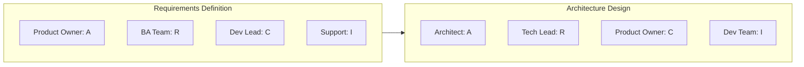

# RACI 矩阵参考

## RACI 定义

| 角色 | 符号 | 定义 | 关键点 |
|------|--------|------------|------------|
| **Responsible（负责执行）** | R | 具体做事的人 | 每个任务可以有多个 |
| **Accountable（最终负责）** | A | 拥有最终决策权 | 每个任务有且只有一个 |
| **Consulted（被咨询）** | C | 在决策**前**提供意见 | 双向沟通 |
| **Informed（被告知）** | I | 决策**后**被通知 | 单向沟通 |

## RACI 规则

### 规则 1：每一行必须有且只有一个 A

- 每个决策/交付物都必须有人负责到底
- 多个 Accountable = 没人真正 Accountable
- 不清晰时，升级讨论以明确

### 规则 2：有 A 但无 R 是警示信号

- Accountable 的人至少应承担部分 Responsibility
- 或者必须和 R 之间存在明确的授权关系

### 规则 3：R 过多 = 混乱

- 多个 Responsible 方 = 协作成本很高
- 考虑把任务拆成更小的片段
- 明确谁牵头

### 规则 4：所有人都是 C = 没有 C

- 什么都要咨询所有人 = 瓶颈
- 对谁提供输入要有选择
- 未被咨询的人可以作为 Informed

### 规则 5：留白是可以的

- 不是每个人在每个任务都需要有角色
- 空白格 = 无需参与
- 但要确认这是有意留白

## 常见的 RACI 错误

| 错误 | 问题 | 修正方式 |
|---------|---------|-----|
| 无 A | 没人认领 | 指定一个 Accountable 的人 |
| 多个 A | 混乱、冲突 | 单一问责点 |
| 全是 R | 协作噩梦 | 一个主 R，其余为辅 R |
| 全是 C | 决策瘫痪 | 收敛到必要的被咨询人 |
| 有 A 无 R | 只问责不做事 | 要么参与，要么明确授权 |
| 遗漏 stakeholder | 沟通有缺口 | 检查完整性 |
| 粒度过细 | 管理成本高 | 上升到更高层级的任务 |
| 范围过粗 | 无法落地 | 拆成更具体的任务 |

## RACI 的变种

### RASCI（加上 Support）

| 角色 | 定义 |
|------|------------|
| R | Responsible（具体做事） |
| A | Accountable（最终拍板） |
| **S** | **Support（辅助 R）** |
| C | Consulted（决策前提供意见） |
| I | Informed（决策后被通知） |

**适用场景：**

- 团队较大、存在辅助角色
- 需要区分主导者和辅助者

### DACI（由 Atlassian 推广）

| 角色 | 定义 |
|------|------------|
| **D** | **Driver（推动到决策）** |
| A | Approver（拥有否决权） |
| C | Contributor（提供输入） |
| I | Informed（被通知） |

**适用场景：**

- 关注决策（而非任务）
- 快节奏团队
- 模型更简单

### RAPID（Bain & Company）

| 角色 | 定义 |
|------|------------|
| **R** | **Recommend（提出建议）** |
| **A** | **Agree（必须签字同意）** |
| **P** | **Perform（负责实施）** |
| **I** | **Input（提供信息）** |
| **D** | **Decide（最终决策权）** |

**适用场景：**

- 需要多方签字同意的复杂决策
- 企业级治理
- 清晰区分"建议"和"决策"

## 按领域划分的 RACI 模板

### 软件开发

| 活动 | PO | Dev Lead | Developers | QA | Ops | Architect |
|----------|-----|----------|------------|-----|-----|-----------|
| 需求 | A | C | C | C | I | C |
| 架构 | I | R | C | I | C | A |
| 开发 | C | A | R | I | I | C |
| code review | I | A | R | C | I | C |
| 测试 | C | C | R | A | I | I |
| 部署 | I | C | R | C | A | I |
| 线上支持 | I | C | C | I | A | C |

### 项目管理

| 活动 | Sponsor | PM | Steering | Team | Vendors |
|----------|---------|-----|----------|------|---------|
| 项目章程 | A | R | C | I | I |
| 预算审批 | A | R | C | I | I |
| 范围变更 | A | R | C | I | I |
| 状态报告 | I | A | I | R | R |
| 风险管理 | I | A | C | R | C |
| Go/No-Go 决策 | A | R | C | I | I |

### 变更管理

| 活动 | Sponsor | Change Lead | Managers | Employees | HR |
|----------|---------|-------------|----------|-----------|-----|
| 变更策略 | A | R | C | I | C |
| 沟通计划 | I | A | C | I | R |
| 培训 | I | A | R | I | R |
| 抵制管理 | C | A | R | I | C |
| 采纳度指标 | I | A | R | I | C |

## 构建一份 RACI

### 步骤 1：列出活动/交付物

先从行开始：

- 关键决策
- 主要交付物
- 流程步骤
- 里程碑

### 步骤 2：识别角色/stakeholder

再确定列：

- 不要写具体个人（角色会变）
- 包含所有受影响的角色
- 不要忘记外部方

### 步骤 3：先分配 R 和 A

对每一行：

1. 谁来做？→ R
2. 谁拥有最终决策权？→ A（有且只有一个）

### 步骤 4：再加 C 和 I

对每一行：

1. 谁必须提供输入？→ C
2. 谁需要被告知？→ I

### 步骤 5：验证

- 每一行有且只有一个 A
- 没有一行全是 C
- stakeholder 认可自己被分配的角色
- 没有关键性的遗漏

## RACI 会议主持

### 会议前

- 准备 RACI 草稿
- 确定需要到场的关键 stakeholder
- 提前分享草稿供审阅

### 会议中

1. **讲解 RACI 定义**（5 分钟）
2. **逐行过一遍**（主要讨论）
   - 先确认 A
   - 再确认 R
   - 最后确认 C 和 I
3. **识别冲突**（记录下来以待解决）
4. **确认理解**（逐人确认）

### 会议后

- 发布定稿的 RACI
- 存放到可访问的位置
- 每季度或关键里程碑时复盘

## RACI 可视化

### 标准矩阵

```markdown
| Task | Role A | Role B | Role C | Role D |
|------|--------|--------|--------|--------|
| Task 1 | A | R | C | I |
| Task 2 | I | A | R | C |
| Task 3 | C | I | A | R |
```

### 颜色编码

用颜色快速区分：

- 🔴 红 = A（Accountable）
- 🟡 黄 = R（Responsible）
- 🔵 蓝 = C（Consulted）
- ⚪ 灰 = I（Informed）

### Mermaid 表达


