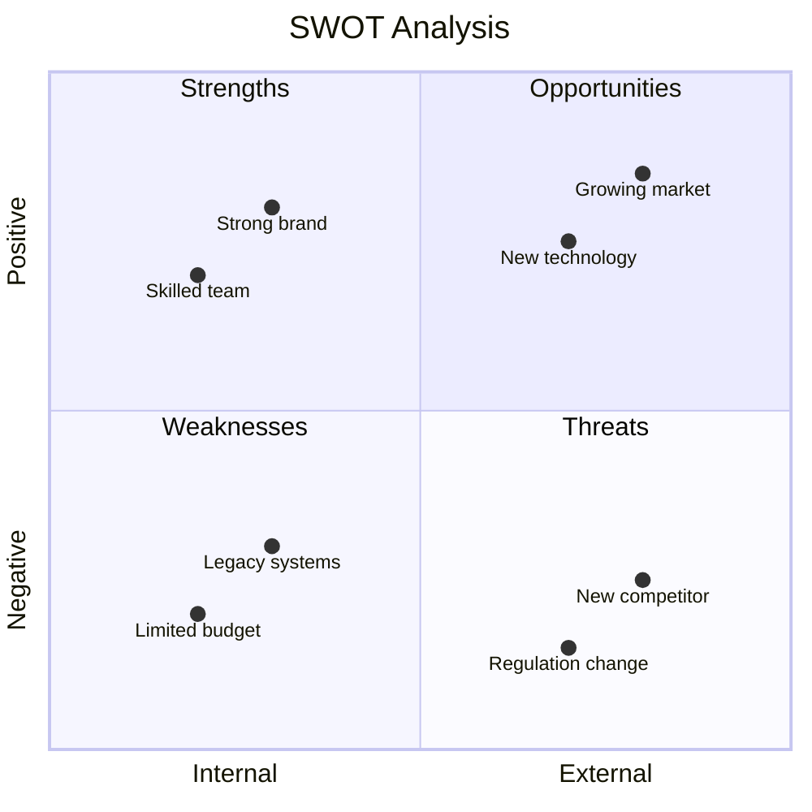
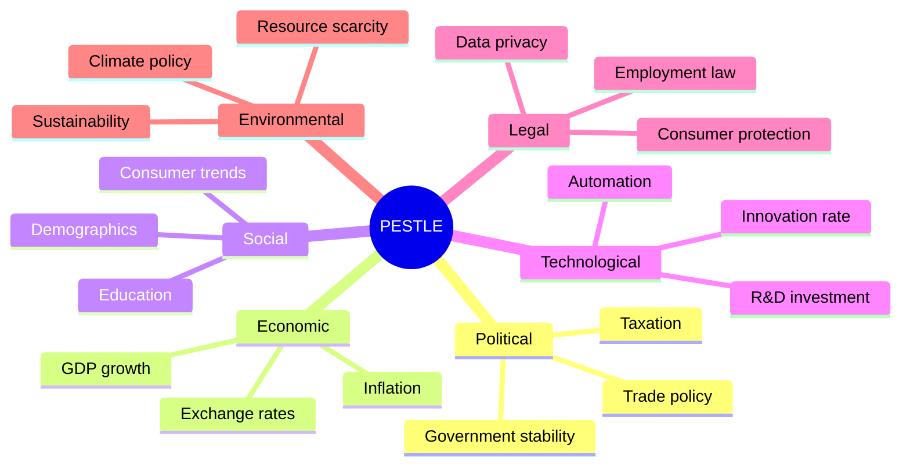
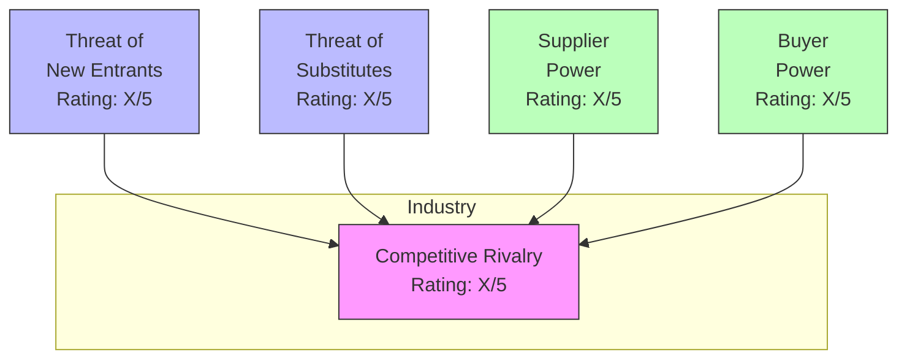

# Strategic Environmental Analysis（战略环境分析）

使用 SWOT、PESTLE 与 Porter's Five Forces 框架进行战略环境分析。产出结构化的评估，支撑竞争定位与战略规划。

## 什么是战略环境分析？

战略环境分析考察影响组织达成目标的内外部因素。三种互补框架提供不同视角：

| 框架 | 关注点 | 视角 | 适用场景 |
|-----------|-------|-------------|----------|
| **SWOT** | 内部 + 外部 | 以组织为中心 | 快速战略评估 |
| **PESTLE** | 外部宏观环境 | 以环境为中心 | 市场进入、监管规划 |
| **Porter's Five Forces** | 行业动态 | 以竞争为中心 | 行业吸引力、定位 |

## 框架 1：SWOT Analysis

### 什么是 SWOT？

SWOT 分析影响战略成败的四个维度：

| 维度 | 类型 | 核心问题 | 关注点 |
|-----------|------|----------|-------|
| **S**trengths（优势） | 内部 | 我们做得好的是什么？ | 发挥 |
| **W**eaknesses（劣势） | 内部 | 我们做得差的是什么？ | 改进或缓解 |
| **O**pportunities（机会） | 外部 | 什么趋势对我们有利？ | 追求 |
| **T**hreats（威胁） | 外部 | 什么会伤害我们？ | 防御 |

### SWOT 工作流

#### Step 1：定义范围

```markdown
## SWOT Scope Definition

**Subject:** [Organization / Product / Initiative]
**Purpose:** [Strategic decision to inform]
**Time Horizon:** [Current state / 1-year / 3-year]
**Analyst:** swot-analyst
**Date:** [ISO date]
```

#### Step 2：识别 Strengths

提供竞争优势的内部能力：

| 类别 | 示例问题 |
|----------|-------------------|
| **Resources** | 有独特资产？财务稳健？关键合作？ |
| **Capabilities** | 核心竞争力？人才到位？技术优势？ |
| **Market Position** | 品牌认知？客户忠诚？市场份额？ |
| **Culture** | 创新文化？敏捷度？员工投入度？ |

#### Step 3：识别 Weaknesses

拖累表现的内部局限：

| 类别 | 示例问题 |
|----------|-------------------|
| **Resources** | 资金不足？基础设施老化？技能缺失？ |
| **Capabilities** | 流程低效？technical debt？能力缺口？ |
| **Market Position** | 品牌弱？流失率高？覆盖有限？ |
| **Culture** | 抗拒变革？部门割裂？领导力不足？ |

#### Step 4：识别 Opportunities

可能对组织有利的外部条件：

| 类别 | 示例问题 |
|----------|-------------------|
| **Market** | 增长中的 segment？未满足的需求？地域扩张？ |
| **Technology** | 新兴技术？自动化潜力？数字化 channel？ |
| **Regulatory** | 有利的监管？放开管制？政策激励？ |
| **Competitive** | 对手弱点？行业整合？ |

#### Step 5：识别 Threats

可能损害组织的外部条件：

| 类别 | 示例问题 |
|----------|-------------------|
| **Market** | 需求下滑？同质化？价格压力？ |
| **Technology** | 被颠覆？被淘汰？网络安全风险？ |
| **Regulatory** | 新合规要求？贸易壁垒？法律风险？ |
| **Competitive** | 新进入者？替代品？进攻性的对手？ |

#### Step 6：战略含义

交叉参照四个象限，识别战略选项：

| 组合 | 战略类型 | 做法 |
|-------------|---------------|----------|
| **S-O** | 进攻型 | 用优势抓住机会 |
| **W-O** | 发展型 | 解决劣势以抓住机会 |
| **S-T** | 防御型 | 用优势对抗威胁 |
| **W-T** | 生存型 | 最小化劣势并规避威胁 |

### SWOT 输出格式

```markdown
## SWOT Analysis: [Subject]

**Date:** [ISO date]
**Analyst:** swot-analyst
**Purpose:** [Strategic context]

### Strengths
| # | Strength | Impact | Evidence |
|---|----------|--------|----------|
| S1 | [Description] | High/Med/Low | [Supporting data] |

### Weaknesses
| # | Weakness | Impact | Evidence |
|---|----------|--------|----------|
| W1 | [Description] | High/Med/Low | [Supporting data] |

### Opportunities
| # | Opportunity | Impact | Timing |
|---|-------------|--------|--------|
| O1 | [Description] | High/Med/Low | Near/Mid/Long term |

### Threats
| # | Threat | Impact | Likelihood |
|---|--------|--------|------------|
| T1 | [Description] | High/Med/Low | High/Med/Low |

### Strategic Implications
| Strategy | S/W | O/T | Recommendation |
|----------|-----|-----|----------------|
| S-O: Offensive | S1, S2 | O1 | [Action] |
| W-O: Developmental | W1 | O2 | [Action] |
| S-T: Defensive | S3 | T1 | [Action] |
| W-T: Survival | W2 | T2 | [Action] |
```

### SWOT Mermaid 图



## 框架 2：PESTLE Analysis

### 什么是 PESTLE？

PESTLE 考察六项宏观环境因素：

| 因素 | 关注点 | 示例考量 |
|--------|-------|------------------------|
| **P**olitical（政治） | 政府、政策 | 选举、贸易政策、稳定性、税收 |
| **E**conomic（经济） | 经济、市场 | GDP、通胀、利率、失业率 |
| **S**ocial（社会） | 社会、人口 | 人口、文化、生活方式、观念 |
| **T**echnological（技术） | 技术、创新 | R&D、自动化、数字化转型 |
| **L**egal（法律） | 法律法规 | 劳动法、消费者保护、IP |
| **E**nvironmental（环境） | 生态、可持续性 | 气候、资源、可持续性强制要求 |

### PESTLE 工作流

#### Step 1：定义上下文

```markdown
## PESTLE Context

**Subject:** [Organization / Market / Initiative]
**Geography:** [Region / Country / Global]
**Time Horizon:** [Current / 1-3 years / 3-5 years]
**Purpose:** [Market entry / Strategy / Risk assessment]
```

#### Step 2：逐项分析

对每个 PESTLE 因素：

1. **识别相关趋势** — 该类别下的趋势
2. **评估影响** — 对组织是正向还是负向
3. **评定重要性** — High/Medium/Low
4. **确定时机** — 立即/近期/远期
5. **识别战略含义**

#### Step 3：评级与优先级排序

| 影响等级 | 描述 |
|---------------|-------------|
| **High** | 对战略至关重要，必须应对 |
| **Medium** | 影响中等，需要监控 |
| **Low** | 影响很小，保持知晓即可 |

### PESTLE 输出格式

```markdown
## PESTLE Analysis: [Subject]

**Date:** [ISO date]
**Geography:** [Scope]
**Analyst:** pestle-analyst

### Political Factors
| Factor | Trend | Impact | Importance | Timing | Implication |
|--------|-------|--------|------------|--------|-------------|
| [Factor] | [↑/↓/→] | +/- | H/M/L | Now/Near/Long | [Action] |

### Economic Factors
| Factor | Trend | Impact | Importance | Timing | Implication |
|--------|-------|--------|------------|--------|-------------|

### Social Factors
| Factor | Trend | Impact | Importance | Timing | Implication |
|--------|-------|--------|------------|--------|-------------|

### Technological Factors
| Factor | Trend | Impact | Importance | Timing | Implication |
|--------|-------|--------|------------|--------|-------------|

### Legal Factors
| Factor | Trend | Impact | Importance | Timing | Implication |
|--------|-------|--------|------------|--------|-------------|

### Environmental Factors
| Factor | Trend | Impact | Importance | Timing | Implication |
|--------|-------|--------|------------|--------|-------------|

### Summary: Key Factors
| Priority | Factor | Category | Strategic Response |
|----------|--------|----------|-------------------|
| 1 | [Most impactful] | [P/E/S/T/L/E] | [Action] |
| 2 | [...] | [...] | [...] |
```

### PESTLE Mermaid 图



## 框架 3：Porter's Five Forces

### 什么是 Five Forces？

Porter's Five Forces 分析行业结构与盈利性：

| 作用力 | 核心问题 | 越高意味着 |
|-------|----------|--------|
| **Competitive Rivalry** | 竞争有多激烈？ | 利润降低 |
| **Threat of New Entrants** | 进入市场有多容易？ | 竞争加剧 |
| **Threat of Substitutes** | 是否存在替代品？ | 价格受压 |
| **Bargaining Power of Suppliers** | 供应商能否决定条款？ | 成本升高 |
| **Bargaining Power of Buyers** | 买方能否决定条款？ | 价格降低 |

### Five Forces 工作流

#### Step 1：界定行业

```markdown
## Five Forces Context

**Industry:** [Specific industry definition]
**Scope:** [Geographic / Segment focus]
**Purpose:** [Entry decision / Positioning / Strategy]
**Date:** [ISO date]
```

#### Step 2：逐项分析

**Competitive Rivalry：**

| 因素 | 评估 |
|--------|------------|
| 竞争者数量 | 少 / 多 |
| 行业增长 | 高 / 低 |
| 产品差异化 | 高 / 低 |
| 退出壁垒 | 高 / 低 |
| 固定成本 | 高 / 低 |

**Threat of New Entrants：**

| 壁垒 | 高度 |
|---------|--------|
| 资本需求 | 高 / 低 |
| 规模经济 | 强 / 弱 |
| 品牌忠诚 | 强 / 弱 |
| 监管壁垒 | 高 / 低 |
| 渠道获取 | 易 / 难 |

**Threat of Substitutes：**

| 因素 | 评估 |
|--------|------------|
| 替代品可得性 | 多 / 少 |
| 切换成本 | 高 / 低 |
| 性价比 | 更好 / 更差 |
| 买方切换倾向 | 高 / 低 |

**Bargaining Power of Suppliers：**

| 因素 | 评估 |
|--------|------------|
| 供应商集中度 | 高 / 低 |
| 输入差异化 | 高 / 低 |
| 切换成本 | 高 / 低 |
| 前向整合威胁 | 高 / 低 |

**Bargaining Power of Buyers：**

| 因素 | 评估 |
|--------|------------|
| 买方集中度 | 高 / 低 |
| 采购量 | 大 / 小 |
| 产品差异化 | 高 / 低 |
| 切换成本 | 高 / 低 |
| 价格敏感度 | 高 / 低 |

#### Step 3：对各作用力打分

| 评级 | 行业吸引力 |
|--------|------------------------|
| 1（Very Strong Force） | 非常不具吸引力 |
| 2（Strong Force） | 不具吸引力 |
| 3（Moderate Force） | 中性 |
| 4（Weak Force） | 具吸引力 |
| 5（Very Weak Force） | 非常具吸引力 |

### Five Forces 输出格式

```markdown
## Porter's Five Forces: [Industry]

**Date:** [ISO date]
**Scope:** [Geography / Segment]
**Analyst:** five-forces-analyst

### Force Analysis

| Force | Rating (1-5) | Key Drivers | Strategic Implication |
|-------|--------------|-------------|----------------------|
| Competitive Rivalry | [1-5] | [Top factors] | [Response] |
| New Entrants | [1-5] | [Barriers] | [Response] |
| Substitutes | [1-5] | [Threats] | [Response] |
| Supplier Power | [1-5] | [Factors] | [Response] |
| Buyer Power | [1-5] | [Factors] | [Response] |

### Industry Attractiveness

**Overall Score:** [Sum/5 = Average]
**Assessment:** [Very Attractive / Attractive / Neutral / Unattractive / Very Unattractive]

### Strategic Recommendations

1. **[Priority 1]:** [Action to address strongest force]
2. **[Priority 2]:** [Action to build competitive advantage]
3. **[Priority 3]:** [Action to improve positioning]
```

### Five Forces Mermaid 图



## 组合分析

### 各框架适用场景

| 场景 | SWOT | PESTLE | Five Forces |
|----------|------|--------|-------------|
| 快速战略评估 | ✅ 主框架 | 辅助 | - |
| 市场进入决策 | 辅助 | ✅ 主框架 | ✅ 主框架 |
| 竞争定位 | ✅ 主框架 | 辅助 | ✅ 主框架 |
| 监管规划 | 辅助 | ✅ 主框架 | - |
| 投资决策 | ✅ 主框架 | ✅ 主框架 | ✅ 主框架 |
| 年度战略复盘 | ✅ 主框架 | ✅ 主框架 | 辅助 |

### 综合分析工作流

进行综合战略分析的步骤：

1. **从 PESTLE 开始** — 理解宏观环境
2. **应用 Five Forces** — 分析行业动态
3. **做 SWOT** — 把组织放在上下文中定位
4. **综合** — 形成统一的战略建议

### 结构化数据（YAML）

```yaml
strategic_analysis:
  version: "1.0"
  date: "2025-01-15"
  analyst: "strategic-analyst"
  subject: "Acme Corp Market Expansion"

  swot:
    strengths:
      - id: S1
        description: "Strong brand recognition"
        impact: high
        evidence: "Top 3 in brand awareness surveys"
    weaknesses:
      - id: W1
        description: "Limited digital presence"
        impact: medium
        evidence: "20% of sales from online"
    opportunities:
      - id: O1
        description: "Growing Asian market"
        impact: high
        timing: near_term
    threats:
      - id: T1
        description: "New market entrant"
        impact: high
        likelihood: high

  pestle:
    political:
      - factor: "Trade agreements"
        trend: positive
        impact: positive
        importance: high
    economic:
      - factor: "Interest rates"
        trend: increasing
        impact: negative
        importance: medium
    # ... other factors

  five_forces:
    competitive_rivalry:
      rating: 3
      key_drivers: ["Many competitors", "Low differentiation"]
    threat_new_entrants:
      rating: 4
      key_drivers: ["High capital requirements"]
    threat_substitutes:
      rating: 2
      key_drivers: ["Digital alternatives emerging"]
    supplier_power:
      rating: 4
      key_drivers: ["Many suppliers available"]
    buyer_power:
      rating: 2
      key_drivers: ["Large buyer concentration"]
    overall_attractiveness: 3.0

  synthesis:
    key_insight: "Market attractive but digital disruption imminent"
    priority_actions:
      - "Accelerate digital transformation (address W1, T1)"
      - "Expand Asian operations (leverage S1, capture O1)"
      - "Build strategic supplier partnerships (counter S-T)"
```

## 何时使用战略分析

| 场景 | 推荐方法 |
|----------|---------------------|
| 年度规划 | SWOT + PESTLE |
| 新市场进入 | PESTLE + Five Forces |
| 竞争回应 | SWOT + Five Forces |
| M&A 尽调 | 三个框架都用 |
| 产品发布 | SWOT（聚焦版） |
| 风险评估 | PESTLE（聚焦版） |

## 集成

### 上游

- **stakeholder-analysis** — 识别输入提供者
- **capability-mapping** — 把优势与能力关联
- **Domain research** — 收集市场数据

### 下游

- **Requirements** — 战略型需求
- **Business cases** — 投资论证
- **Roadmaps** — 战略 initiative

## 相关 skill

- `capability-mapping` — 内部能力评估
- `stakeholder-analysis` — stakeholder 视角
- `value-stream-mapping` — 运营效率
- `benchmarking` — 竞品对标
- `risk-analysis` — 风险识别与缓解

## 版本历史

- **v1.0.0**（2025-12-26）：首次发布
