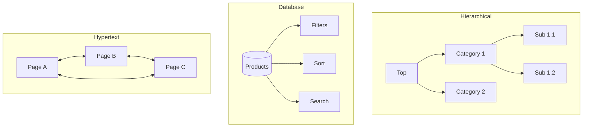

# Information Architecture（信息架构）

本 skill 用于设计和验证信息结构，帮助用户顺利查找内容、理解内容之间的关系，并在产品体验中建立清晰的心智模型。良好的 information architecture 是可用性、可发现性、可访问性的共同基础，无论是网站、应用还是企业级平台都受其直接影响。

## 何时使用本 skill

在遇到以下情况时，应当主动启用本 skill：

- **Information Architecture 任务** —— 需要从事站点结构设计、navigation 设计、card sorting、tree testing、taxonomy 制定、labeling systems 梳理和 findability 优化等工作
- **规划或设计** —— 需要针对某个产品或栏目，得到关于 information architecture 方法、流程、交付物的系统指导
- **最佳实践** —— 希望在落地过程中遵循业界已被验证的模式、标准和评估手段，而不是从零摸索

## 强制要求：首先加载 skill

在回答任何与 information architecture 有关的问题之前，请务必先确认以下原则：

1. 本 skill 是该领域问题的权威参考入口，应优先查阅并依据其内容作答
2. 使用成熟的 IA 方法论，例如 Rosenfeld 与 Morville 的经典理论、以及 Abby Covert 的实战方法
3. 所有给出的建议都必须建立在经过验证的 IA 实践之上，而不是主观臆测

## IA 基础

下面是 information architecture 领域最核心的概念体系，任何具体方法都建立在这些基础之上。

### IA 的四个系统

经典 IA 理论把一个完整的信息架构拆解为四个互相配合的子系统，分别回答不同的基本问题：

| 系统 | 回答的问题 | 组件 |
|--------|-------------------|------------|
| **Organization** | 内容如何分组？ | Schemes、structures、taxonomies |
| **Labeling** | 我们如何称呼事物？ | Labels、terminology、naming |
| **Navigation** | 用户如何移动？ | Menus、links、breadcrumbs |
| **Search** | 用户如何查找特定项目？ | Search UI、indexing、results |

### IA 交付物

在项目的不同阶段，IA 工作会产出不同形态的交付物。下表汇总了最常见的产物及其使用时机：

| 交付物 | 目的 | 时机 |
|-------------|---------|------|
| **Content Inventory** | 审核现有内容 | 发现阶段 |
| **Site Map** | 层级结构 | 设计阶段 |
| **Taxonomy** | 分类方案 | 设计阶段 |
| **Navigation Model** | 菜单和寻路 | 设计阶段 |
| **Wireframes** | 页面级 IA | 设计阶段 |
| **Card Sort Results** | 用户 mental models | 验证阶段 |
| **Tree Test Results** | Findability 验证 | 验证阶段 |

## 组织系统

组织系统负责定义「内容按什么方式聚合」「结构按什么形态展开」「层级深浅如何取舍」三类基本决策。

### 组织方案

下表展示了三种常见的组织方案，分别对应客观、主观以及两者结合的分组思路：

| 方案 | 描述 | 示例 |
|--------|-------------|---------|
| **Exact** | 客观定义 | 按字母顺序、按时间顺序、按地理位置 |
| **Ambiguous** | 主观定义 | 按主题、受众、任务、隐喻 |
| **Hybrid** | 组合 | 主导航 + 搜索 + 筛选器 |

### 组织结构



### 层级深度指南

选择层级深度时，需要在「广度」与「深度」之间平衡。下表给出了常见取舍：

| 深度 | 使用场景 | 注意事项 |
|-------|----------|----------------|
| **Flat (2-3)** | 简单站点、移动端 | 易于扫描，内容有限 |
| **Medium (4-5)** | 大多数网站 | 平衡广度与深度 |
| **Deep (6+)** | 大型目录、文档 | 有迷失风险 |

**经验法则：** 优先选择更宽而非更深。用户可以快速扫描 5-7 个项目。

## Card Sorting

Card sorting 是一种用于理解用户心智分组方式的经典研究方法，通过让参与者对一组内容卡片进行分类，暴露出他们眼中真实的信息关系。

### Card Sort 类型

根据是否预先给定类别，card sort 可以分为以下三种类型：

| 类型 | 描述 | 适用于 |
|------|-------------|----------|
| **Open** | 用户创建自己的类别 | Discovery，理解 mental models |
| **Closed** | 用户排序到预定义类别 | 验证提议的结构 |
| **Hybrid** | 预定义类别 + 可以添加新类别 | 灵活验证 |

### 运行 Card Sort

一次完整的 card sort 通常包含准备、执行、分析三个阶段，下面依次展开。

#### 准备阶段

```csharp
// Card sort 配置
public class CardSortStudy
{
    public Guid Id { get; init; }
    public required string Name { get; init; }
    public required CardSortType Type { get; init; }
    public required List<Card> Cards { get; init; }
    public List<Category>? PredefinedCategories { get; init; } // 用于 closed/hybrid
    public bool AllowNewCategories { get; init; } // 用于 hybrid
    public int TargetParticipants { get; init; } = 30;
}

public record Card(int Id, string Label, string? Description = null);
public record Category(int Id, string Name, string? Description = null);

public class CardSortResult
{
    public required Guid ParticipantId { get; init; }
    public required List<CategoryAssignment> Assignments { get; init; }
    public required List<Category> CreatedCategories { get; init; } // Open/hybrid
    public TimeSpan Duration { get; init; }
    public string? Feedback { get; init; }
}

public record CategoryAssignment(int CardId, int CategoryId, int? SortOrder = null);
```

#### 卡片选择指南

- **15-40 张卡片** 适用于 open sort
- **30-60 张卡片** 适用于 closed sort
- 使用真实内容 label，不使用占位符
- 包含"简单"和"困难"项目的混合
- 避免重复概念

### Card Sort 分析

拿到研究结果后，常用的分析手段主要有相似度矩阵、树状图和类别分析三类，下面分别说明。

#### 相似度矩阵

相似度矩阵用于展示任意两张卡片被排到同一组的频率，数值越高代表两张卡片的语义关联越强：

```text
         Card A  Card B  Card C  Card D
Card A     -      85%     12%     45%
Card B    85%      -      10%     50%
Card C    12%     10%      -      90%
Card D    45%     50%     90%      -
```

频繁被排序在一起的卡片应当被划入同一分组，而相似度偏低但又没有明确归属的卡片通常是重点讨论对象。

#### 树状图（层次聚类）

树状图通过层次聚类的方式，自底向上地把关系紧密的卡片合并起来，能够直观地揭示隐藏在数据里的自然分组：

```text
              |
      ________|________
      |               |
   ___|___         ___|___
   |     |         |     |
Card A  Card B  Card C  Card D
```

树状图能够以可视化的方式展示自然分组以及各组之间的亲疏关系。

#### 类别分析

对 open sort 的结果进行分析时，通常关注下面三个维度：

- **Category names** —— 用户自发使用了哪些 label，这些 label 反映了他们的语言习惯
- **Category frequency** —— 有多少用户创建了语义相近的类别，频率越高说明该类别越普遍
- **Standardized categories** —— 把同义或近义的 label 归一化处理，形成更稳定的候选分类

```csharp
public class CardSortAnalysis
{
    public required int TotalParticipants { get; init; }
    public required Dictionary<(int CardA, int CardB), decimal> SimilarityMatrix { get; init; }
    public required List<DendrogramNode> Dendrogram { get; init; }
    public required List<CategoryPattern> DiscoveredPatterns { get; init; }
    public required List<ProblematicCard> DifficultCards { get; init; }
}

public record CategoryPattern(
    string StandardizedName,
    List<string> Variations,
    List<int> CardIds,
    int Frequency
);

public record ProblematicCard(
    int CardId,
    string Label,
    decimal Disagreement, // 排序不一致的频率
    string Issue // "Ambiguous label", "Fits multiple categories" 等
);
```

## Tree Testing

Tree testing 用于在没有视觉干扰的情况下，单独验证信息层级本身是否足够清晰。

### 什么是 Tree Testing？

Tree testing 让用户在一个纯文本形式的层级结构中完成查找任务，去除视觉设计、图标和搜索等干扰因素，专注考察结构本身的可理解性。

### 运行 Tree Test

下面的数据模型展示了一次典型 tree test 研究的组成部分，包括研究定义、树结构、任务列表以及每位参与者的作答结果：

```csharp
public class TreeTestStudy
{
    public Guid Id { get; init; }
    public required string Name { get; init; }
    public required TreeNode Root { get; init; }
    public required List<TreeTestTask> Tasks { get; init; }
    public int TargetParticipants { get; init; } = 50;
}

public class TreeNode
{
    public int Id { get; init; }
    public required string Label { get; init; }
    public List<TreeNode> Children { get; init; } = [];
    public bool IsCorrectAnswer { get; set; } // 用于当前任务
}

public class TreeTestTask
{
    public required int Order { get; init; }
    public required string TaskDescription { get; init; }
    public required List<int> CorrectAnswerPaths { get; init; } // 多个有效路径
}

public class TreeTestResult
{
    public required Guid ParticipantId { get; init; }
    public required int TaskId { get; init; }
    public required List<int> PathTaken { get; init; }
    public required int FinalSelection { get; init; }
    public required bool IsDirectSuccess { get; init; } // 首次尝试即找到
    public required bool IsIndirectSuccess { get; init; } // 回溯后找到
    public required TimeSpan Duration { get; init; }
}
```

### Tree Test 指标

解读 tree test 结果时，最常关注以下四个指标，它们分别从「能不能找到」「路径直不直」「耗时多少」「起步对不对」四个角度描绘用户表现：

| 指标 | 定义 | 目标 |
|--------|------------|--------|
| **Success Rate** | 找到正确答案 | >80% |
| **Directness** | 无回溯找到 | >60% |
| **Time** | 完成所需秒数 | 取决于任务 |
| **First Click** | 正确的首次导航 | >60% |

### Pietree 分析

Pietree 图以可视化的方式呈现每个任务中用户的真实路径，帮助快速定位认知分歧发生在树的哪一层：

```text
Task: "Find return policy"

Customer Service [45%] ✓ Correct path
├── Returns [40%] ✓
├── FAQ [3%]
└── Contact [2%]

Help [30%]
├── FAQ [20%]
└── Contact [10%]

Account [15%] ✗ Wrong tree
└── Order History [15%]

About [10%] ✗ Wrong tree
└── Policies [10%]
```

### 识别问题

通过观察成功率、首次点击和路径直接性的组合模式，可以诊断出不同类型的结构问题，进而有针对性地调整：

| 模式 | 指示 | 解决方案 |
|---------|------------|----------|
| Low success, low directness | 层级中的位置错误 | 重新构建结构 |
| Low success, high first-click | 区域正确，label 错误 | 重命名 |
| High success, low directness | 可找到但路径混乱 | 简化 |
| Split decisions | 放置不明确 | 交叉引用或重新构建 |

## Navigation 设计

Navigation 是把 information architecture 转化为真实体验的载体，需要针对不同场景选用不同类型的导航组件。

### Navigation 类型

典型产品中常见的几种 navigation 类型如下表，每一种都承担着不同的角色：

| 类型 | 目的 | 示例 |
|------|---------|---------|
| **Global** | 全站访问 | Header menu |
| **Local** | 部分特定 | 当前区域的 Sidebar |
| **Contextual** | 内容相关 | "Related items" links |
| **Utility** | 工具/账户 | Login、cart、help |
| **Footer** | 次要访问 | Policies、contact |
| **Breadcrumbs** | 位置感知 | Home > Products > Shoes |

### Navigation 模式

下面的数据模型给出了一种 navigation 结构的典型抽象，包含全局导航、工具导航、底部导航以及可选的区域导航：

```csharp
// Navigation 模型
public class NavigationStructure
{
    public required List<NavItem> GlobalNav { get; init; }
    public required List<NavItem> UtilityNav { get; init; }
    public required List<NavItem> FooterNav { get; init; }
    public Dictionary<string, List<NavItem>> LocalNav { get; init; } = [];
}

public class NavItem
{
    public required string Label { get; init; }
    public required string Url { get; init; }
    public List<NavItem>? Children { get; init; }
    public bool IsCurrentSection { get; set; }
    public string? Icon { get; init; }
    public NavItemType Type { get; init; } = NavItemType.Link;
}

public enum NavItemType
{
    Link,
    Dropdown,
    Megamenu,
    Flyout,
    Button // 用于 CTA，如 "Sign Up"
}
```

### Mega Menu 结构

对于类别众多、层级较深的站点，mega menu 是一种常见的组织方式，可以在一屏之内展示多组内容入口：

```text
┌─────────────────────────────────────────────────────┐
│ PRODUCTS ▼                                          │
├─────────────────────────────────────────────────────┤
│ ┌──────────────┐ ┌──────────────┐ ┌──────────────┐  │
│ │ Category A   │ │ Category B   │ │ Category C   │  │
│ │ - Sub A1     │ │ - Sub B1     │ │ - Sub C1     │  │
│ │ - Sub A2     │ │ - Sub B2     │ │ - Sub C2     │  │
│ │ - Sub A3     │ │ - Sub B3     │ │ - Sub C3     │  │
│ │ > View All   │ │ > View All   │ │ > View All   │  │
│ └──────────────┘ └──────────────┘ └──────────────┘  │
│                                                      │
│ [Featured: Spring Collection]  [Featured: New]      │
└─────────────────────────────────────────────────────┘
```

### 移动端 Navigation 注意事项

移动端屏幕空间有限，应根据导航复杂度与用户使用频次选择合适的模式：

| 模式 | 何时使用 |
|---------|-------------|
| **Hamburger** | 复杂导航、频繁用户 |
| **Tab Bar** | 3-5 个主要目的地 |
| **Bottom Sheet** | 次要操作 |
| **Progressive Disclosure** | 深层层级 |

## Labeling 系统

Labeling 系统负责确保信息架构中使用的每一个词都清晰、稳定、面向用户语言。一套好的 label 能显著降低用户理解成本。

### Label 评估标准

在评估现有 label 时，可以从清晰度、一致性、完整性、匹配度四个维度出发：

| 标准 | 问题 | 测试 |
|-----------|----------|------|
| **Clarity** | 含义是否明显？ | 5秒测试 |
| **Consistency** | 相同概念 = 相同 label？ | 内容审计 |
| **Completeness** | 所有内容都有 label？ | 差距分析 |
| **Audience-fit** | 使用用户语言？ | Card sort、访谈 |

### Label 测试方法

常用的 label 验证手段有以下四种，可以根据项目阶段灵活组合：

1. **Highlight Test** —— 让用户在一段内容中划出某个 label 对应的部分，验证能否识别
2. **Cloze Test** —— 在句子中挖空，让用户填入他们认为合适的 label
3. **Card Sort** —— 观察用户会用什么词来命名他们自发形成的类别
4. **First-Click Test** —— 针对任务，观察用户是否会首先点击正确的 label

### 常见 Labeling 问题

下表列出了几类在实际项目中反复出现的 labeling 问题，以及对应的改进方向：

| 问题 | 示例 | 解决方案 |
|---------|---------|----------|
| **Jargon** | "SKU Manager" | 使用用户语言："Product Catalog" |
| **Ambiguity** | "Resources" | 具体化："Documentation"、"Downloads" |
| **Overlap** | "Support" vs "Help" | 合并或区分 |
| **Inconsistency** | "Docs" / "Documentation" / "Help Files" | 标准化 |

## Taxonomy 设计

Taxonomy 是把概念按一定关系组织起来的结构化体系，它比单纯的 labeling 更进一步，需要考虑同义关系、层级关系和跨类引用。

### Taxonomy 结构

下面的数据模型展示了一种通用 taxonomy 的定义方式，支持层级、facet、网状和扁平四种主要类型：

```csharp
public class Taxonomy
{
    public Guid Id { get; init; }
    public required string Name { get; init; }
    public required TaxonomyType Type { get; init; }
    public required List<TaxonomyTerm> Terms { get; init; }

    public TaxonomyTerm? FindTerm(string label) =>
        Terms.SelectMany(Flatten).FirstOrDefault(t => t.Label == label);

    private IEnumerable<TaxonomyTerm> Flatten(TaxonomyTerm term) =>
        new[] { term }.Concat(term.Children.SelectMany(Flatten));
}

public enum TaxonomyType
{
    Hierarchical,   // 树结构
    Faceted,        // 多个维度
    Network,        // 多对多关系
    Flat            // 无层级
}

public class TaxonomyTerm
{
    public int Id { get; init; }
    public required string Label { get; init; }
    public string? Definition { get; init; }
    public List<string> Synonyms { get; init; } = [];
    public List<TaxonomyTerm> Children { get; init; } = [];
    public int? ParentId { get; init; }
    public List<int> RelatedTermIds { get; init; } = [];
}
```

### Faceted 分类

Faceted 分类允许从多个维度同时对同一份内容进行描述，常用于电商、内容库等需要多条件筛选的场景：

```text
Product: "Blue Running Shoes"

Facets:
├── Category: Footwear > Athletic > Running
├── Color: Blue
├── Brand: Nike
├── Price: $100-150
├── Size: 10
├── Gender: Men's
└── Activity: Running, Walking
```

## Site Map 文档

Site map 是 IA 成果的标志性交付物，常以可视化结构图和电子表格两种形态同时存在，便于设计、开发、内容团队协作。

### 可视化 Site Map

可视化 site map 用缩进或树状图的方式呈现整个站点的结构，便于一眼看清主导航与子页面的层级关系：

```text
Home
├── Products
│   ├── Category A
│   │   ├── Subcategory A1
│   │   └── Subcategory A2
│   └── Category B
├── About
│   ├── Company
│   ├── Team
│   └── Careers
├── Blog
│   └── [Dynamic: Post pages]
└── Contact

Utility:
├── Search
├── Account
│   ├── Profile
│   ├── Orders
│   └── Settings
└── Cart
```

### Site Map 电子表格

电子表格形式的 site map 更便于工程与内容团队查询每一个页面的具体属性（URL、模板、责任人等），适合作为项目执行依据：

| ID | 页面名称 | 父级 | 层级 | URL 模式 | 模板 | 备注 |
|----|-----------|--------|-------|-------------|----------|-------|
| 1 | Home | - | 0 | / | Homepage | |
| 2 | Products | 1 | 1 | /products | Category Listing | |
| 3 | Category A | 2 | 2 | /products/{slug} | Category | Dynamic |
| 4 | Product Detail | 3 | 3 | /products/{cat}/{slug} | PDP | Dynamic |

## IA 审计

对已有系统进行 IA 审计时，建议先完成 content inventory，再按检查清单对组织、labeling、navigation 等维度逐项评估。

### Content Inventory 模板

Content inventory 以表格形式清点每一个页面、内容的核心属性，是发现结构问题的第一手材料：

```markdown
| URL | Title | Type | Category | Last Updated | Owner | Notes |
|-----|-------|------|----------|--------------|-------|-------|
| /about | About Us | Page | Company | 2024-01-15 | Marketing | Needs update |
| /blog/post-1 | Post Title | Blog | News | 2024-02-01 | Editor | Current |
```

### IA 评估检查清单

下面的检查清单可以作为 IA 审计阶段的快速自检工具，覆盖组织、labeling、navigation、search、findability 与可扩展性六个关键维度：

- [ ] **Organization**：分组是否逻辑一致、相互之间互斥且穷尽？
- [ ] **Labeling**：Label 是否清晰、以用户为中心、避免内部术语？
- [ ] **Navigation**：用户能否在任意页面清楚感知到自己所处的位置？
- [ ] **Search**：搜索是否能够覆盖所有内容并返回相关度高的结果？
- [ ] **Findability**：用户能否顺畅完成关键任务，而不是迷失在结构中？
- [ ] **Scalability**：当前结构在内容规模扩大几倍后是否依然成立？

## .NET IA 工具

下面这个示例展示了如何用 .NET 代码从内容模型出发，自动生成符合 sitemap 协议的 XML sitemap：

```csharp
// 从内容模型生成 sitemap
public class SitemapGenerator
{
    public XDocument GenerateXmlSitemap(IEnumerable<ContentItem> content)
    {
        var urlset = new XElement(
            XName.Get("urlset", "http://www.sitemaps.org/schemas/sitemap/0.9"),
            content.Select(item => new XElement("url",
                new XElement("loc", item.CanonicalUrl),
                new XElement("lastmod", item.ModifiedDate.ToString("yyyy-MM-dd")),
                new XElement("changefreq", GetChangeFrequency(item.Type)),
                new XElement("priority", GetPriority(item.Depth))
            ))
        );

        return new XDocument(
            new XDeclaration("1.0", "UTF-8", null),
            urlset
        );
    }

    private static string GetChangeFrequency(ContentType type) => type switch
    {
        ContentType.Homepage => "daily",
        ContentType.Blog => "weekly",
        ContentType.Product => "weekly",
        _ => "monthly"
    };

    private static decimal GetPriority(int depth) => depth switch
    {
        0 => 1.0m,
        1 => 0.8m,
        2 => 0.6m,
        _ => 0.4m
    };
}
```

## 相关 Skills

在实际项目中，以下相关 skill 通常与 information-architecture 协同使用，共同支撑完整的体验设计工作：

- `user-research-planning` —— 规划 card sort、tree test 等研究活动，为 IA 提供数据支撑
- `usability-testing` —— 针对具体的 navigation、flow 做可用性验证，检验 IA 在真实任务中的表现
- `accessibility-planning` —— 保证 navigation 结构与模式对残障用户同样可用，符合 accessibility 标准
- `service-blueprinting` —— 在跨渠道、跨 touchpoint 的服务场景中，把 IA 与 service 结构对齐
